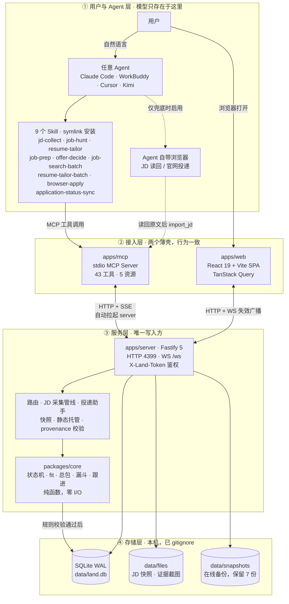
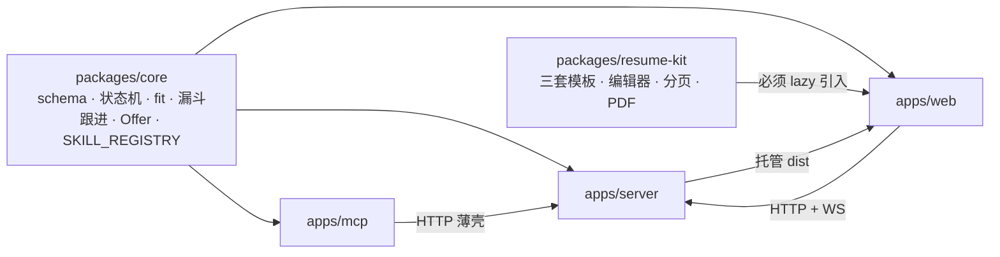
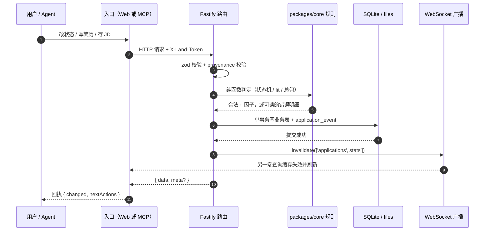
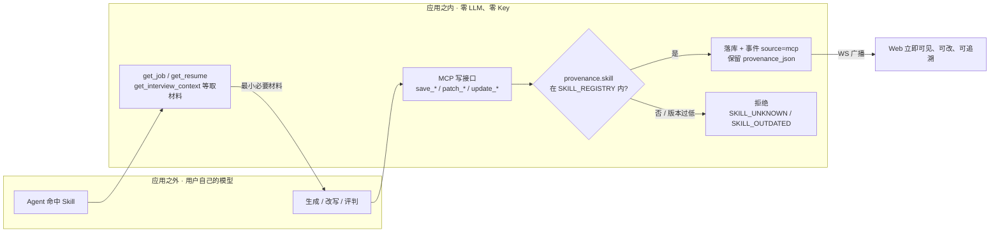
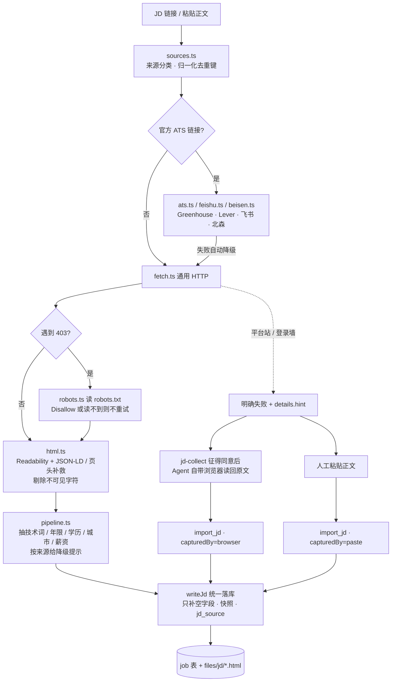
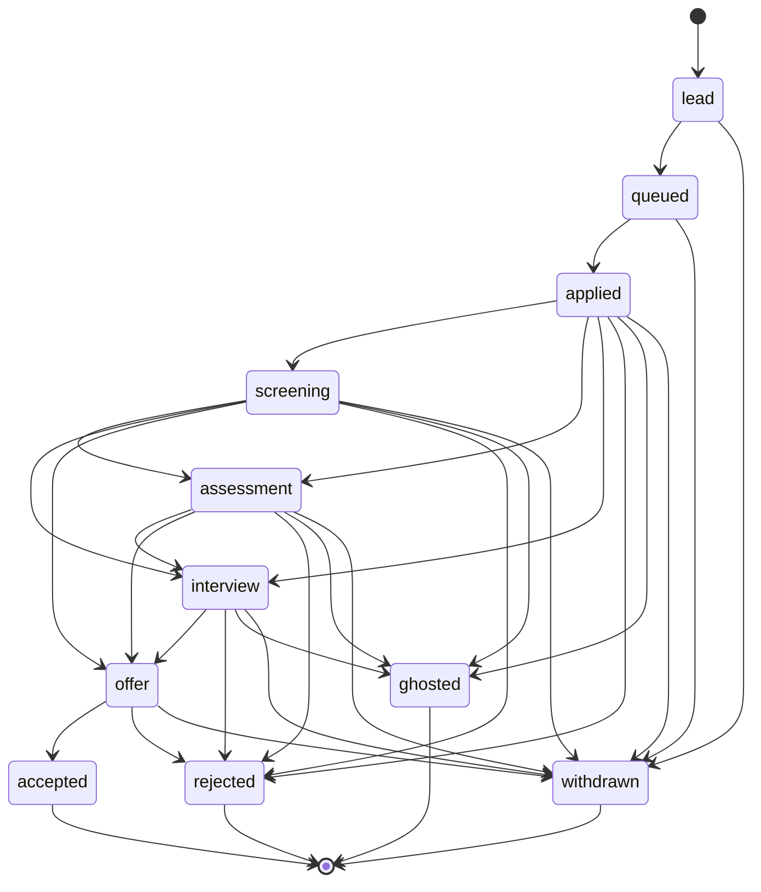

# Land a Job

本地优先、Agent 原生的求职流水线：目标公司 → JD 匹配 → 简历定制 → 投递 → 跟进 → 面试 → offer 谈判。

- **单用户本地**：数据只存本机 SQLite，无账号、无云同步。
- **应用零模型调用**：不存 API Key。生成类能力由你安装的 Skill 在任意 Agent（Claude Code / WorkBuddy / Cursor）中执行，结果通过 MCP 落回本地库。
- **Web 只做查看与编辑**：关掉终端也能用；需要 AI 的按钮会给出「在 Agent 中执行」的交接指令。

**官网**：[dada-liu.github.io/land-a-job](https://dada-liu.github.io/land-a-job/) · **交给 Agent 的安装说明**：[agent-install.md](https://dada-liu.github.io/land-a-job/agent-install.md) · 如果对你有帮助，点个 star。

> 当前状态：**P7 完成（八个阶段全部交付）**。数据层、接口、简历、投递看板、JD 定制、投递助手、MCP/Skill、面试与 Offer、指标与打磨全部可用；单测 274 例、端到端 355 项断言全绿。

### 文档导航

| 文档 | 讲什么 | 什么时候看 |
| --- | --- | --- |
| **README.md（本文）** | 快速开始、详细使用方式、架构图、接口速查、约束 | 上手与日常查阅 |
| [docs/PRD.md](./docs/PRD.md) | 需求、北极星指标、验收标准、已定决策 | 讨论「要不要做」 |
| [docs/ARCHITECTURE.md](./docs/ARCHITECTURE.md) | 设计原则、数据模型、API / MCP 契约、ADR | 改代码之前 |
| [docs/IMPLEMENTATION.md](./docs/IMPLEMENTATION.md) | 8 周阶段计划、实测完成情况、测试口径 | 排期与验收 |
| [docs/README.md](./docs/README.md) | 文档索引：主文档导航、PR 记录与模板、提案 / 评审纪要的约定 | 提交或评审变更 |

## 快速开始

```bash
npm install

# 生产模式：构建前端后由本地服务托管
npm run build
npm start            # http://127.0.0.1:4399

# 开发模式：server + vite 并行，页面在 5173，/api 与 /ws 自动代理
npm run dev

# 灌一组样例数据（3 家公司 / 5 个岗位 / 3 条投递 / 1 场面试，可重复执行）
npm run seed
npm run seed -- --reset   # 先清掉 seed-* 记录再重建

# 从旧项目 .resume-mcp/store.json 导入简历（保留原 id，已存在则跳过）
npm run import:legacy
npm run import:legacy -- --file /path/to/store.json

# 测试（core 单元 + resume-kit 单元 + server 契约 + 模板目录一致性 + DDL 漂移检查）
npm test

# 端到端：真服务 + 真 Chrome，按阶段顺序跑（P3→P7，共 341 项断言）
npm run e2e
npm run e2e:p3          # 也可以只跑某一段

# 开机常驻（launchd，崩溃自动拉起）；卸载用 launchd:uninstall
npm run launchd:install
```

首次启动会自动生成 `data/`（SQLite、令牌、日志），并执行建表迁移。

## 接上 Agent（MCP + Skill）

应用本身不含任何 LLM 调用。AI 能力由**你安装到 Agent 里的 Skill** 提供，Skill 通过 MCP 读写本应用的数据。

```bash
# 1. 把 skills/ 软链到本机 Agent（Claude Code / WorkBuddy，只处理已安装的）
npm run skills:install

# 2. 在 Agent 里注册 MCP server（stdio）
#    Claude Code: claude mcp add land-a-job -- node /绝对路径/apps/mcp/dist/index.js
#    其它 Agent: 在 MCP 配置里填同样的 command
```

服务没起也没关系：第一次工具调用会自动拉起 `apps/server`（detached），并等它就绪。

| Skill | 什么时候用 |
| --- | --- |
| `jd-collect` | 「把这个岗位收进来」「抓一下这份 JD」「这个链接打不开」 |
| `job-hunt` | 「今天该做什么」「帮我盯着这些投递」「这家帮我投了」 |
| `resume-tailor` | 「按这个 JD 改简历」「这版简历投这个岗位合适吗」 |
| `job-prep` | 「明天面试帮我准备」「面试挂了复盘一下」 |
| `offer-decide` | 「这两个 offer 选哪个」「怎么谈薪」 |
| `job-search-batch` | 「帮我搜杭州的岗位」「批量找 10 家公司」「再翻一倍继续搜」 |
| `resume-tailor-batch` | 「把库里的岗位都定制一遍」「每个岗位配份简历并进待投」 |
| `browser-apply` | 「帮我投 XX 公司」「我自己点提交，投完记一下」 |
| `application-status-sync` | 「每天帮我看看投递到哪一步」「建个定时任务查状态」 |

后四个 Skill 共用同一段前置检查：服务可用、库里有简历。没有简历时 Agent 会启动前后端、用本机浏览器打开
`/resumes?create=1`，让用户先建第一份母版简历再继续；批量搜岗还必须先问**工作地点**和**母简历**，
批量定制必须先问**母简历**。`browser-apply` 的最后一次提交点击永远留给用户本人。

红线（Skill 与 MCP 都被强制）：

- 应用**不生成内容**，只提供「取材料 → 你生成 → 落库校验」。工具名里没有 `generate_*`。
- AI 产出落库必须带 `provenance: { skill, skillVersion }`，skill 名必须在 `SKILL_REGISTRY` 内，版本过低返回 `SKILL_OUTDATED`。
- 提交投递必须 `confirm: true`，且 Skill 规定「先复述公司+岗位，等用户明确同意」。

## 详细使用方式

> 上面的「快速开始」是最短路径。本节按「装好 → 跑起来 → 接 Agent → 走一遍全流程 → 备份 / 排障」展开。
> 文中数字以当前仓库为准：MCP 43 工具 / 9 Skill / schema v2 / 单测 251 例 / E2E 353 项断言。

### 1. 环境与前置

| 依赖 | 要求 | 说明 |
| --- | --- | --- |
| Node.js | ≥ 22 | `package.json` 的 `engines` 已锁定，先 `node -v` 确认 |
| npm | ≥ 10 | npm workspaces，不需要 pnpm / yarn |
| 操作系统 | macOS / Linux | `launchd` 常驻脚本仅 macOS；其它系统用 `npm start` 或自己的进程守护 |
| Chrome / Edge | **可选** | 只有两处需要：无头导出简历 PDF、投递助手表单填充。缺了返回 `CHROME_NOT_FOUND` 并降级，不影响看板与 JD 采集 |
| Agent | **可选但推荐** | Claude Code / WorkBuddy / Cursor / Kimi；不装也能纯 Web 使用，只是没有生成类能力 |

```bash
npm install
# 国内可换镜像：npm install --registry=https://registry.npmmirror.com
```

### 2. 首次启动发生了什么

```bash
npm run build      # 顺序编译 resume-kit → core → server → mcp → web
npm start          # → http://127.0.0.1:4399
```

`npm start` 依次做四件事：建 `data/` 子目录 → 生成 `data/.token`（权限 0600）→ 跑迁移到 `user_version = 2` → 绑定 **127.0.0.1:4399** 并托管 `apps/web/dist`。

浏览器打开 `http://127.0.0.1:4399` 即可；页面通过 `GET /api/bootstrap` 自取令牌并自动带上 `X-Land-Token`，**不需要手填任何凭据**。

```bash
curl --noproxy '*' http://127.0.0.1:4399/api/health
# {"data":{"ok":true,"service":"land-a-job","version":"0.1.0","db":{"version":2,...},...}}
```

> 本机 curl 被系统代理拦截时加 `--noproxy '*'`。端口被占用且端口上不是本服务时会自动 +1，实际端口写在 `data/.port`，MCP 会读它。

`data/` 整体在 `.gitignore` 中：

| 路径 | 内容 |
| --- | --- |
| `data/land.db` | SQLite（WAL），唯一数据源 |
| `data/.token` · `data/.port` | 本机令牌 / 实际端口 |
| `data/files/jd/` | JD 正文 HTML 快照，重抓前留 `.prev.html` |
| `data/files/evidence/` | 投递提交截图 |
| `data/snapshots/` | 数据库在线备份，保留最近 7 份 |
| `data/browser-profile/` | 投递助手的持久化浏览器 profile（登录态，不存密码） |
| `data/logs/` | 服务日志 |

### 3. 三种运行方式，外加自动拉起

| 方式 | 命令 | 端口 | 适用 |
| --- | --- | --- | --- |
| 生产 | `npm run build && npm start` | 4399 | 日常使用；server 同时托管前端产物 |
| 开发 | `npm run dev` | vite 5173 / server 4399 | 改前端热更新，`/api` 与 `/ws` 由 vite 代理 |
| 开机常驻 | `npm run launchd:install` | 4399 | macOS；开机自启 + 崩溃拉起，日志进 `data/logs/` |
| MCP 自动拉起 | 无需手动 | 4399 | Agent 第一次调工具时 detached 拉起 server 并等就绪 |

常驻脚本还支持 `bash scripts/install-launchd.sh --status` 与 `--uninstall`（`npm run launchd:uninstall` 是后者的别名）。

`npm run dev` 里 web 会先等后端 `/api/health` 就绪再起 vite（`scripts/dev-web.mjs`），并把探测到的真实端口
用 `LAND_API_PORT` 传给 vite 的代理——server 在 4399 被占时会顺延，写死端口会让页面所有请求变 502。
单个子进程崩掉时 `--kill-others-on-fail` 会一起收工，不会留一个只会返回 502 的页面。

> 关键设计：**Web 不依赖 Agent 常驻**。关掉终端、退出 Claude Code，看板照样能开；反过来 Agent 也不需要浏览器开着页面。

### 4. 接入 Agent（逐步）

**第 1 步 · 装 Skill**

```bash
npm run skills:install       # 等价 bash scripts/install-skills.sh
```

脚本用 **symlink** 把 `skills/*` 链到 `~/.claude/skills` 与 `~/.workbuddy/skills`（只处理父目录已存在的客户端，不凭空造目录）。因为是指针，仓库里更新 `SKILL.md` 立即生效，不会出现「装的是上一版」。**改完必须重启 Agent** 才会重新加载。

**第 2 步 · 注册 MCP server（stdio）**

```bash
# Claude Code，路径必须是绝对路径
claude mcp add land-a-job -- node /绝对路径/land-a-job/apps/mcp/dist/index.js
```

其它 Agent 在 MCP 配置里填同样的 command：

```json
{
  "mcpServers": {
    "land-a-job": {
      "type": "stdio",
      "command": "node",
      "args": ["/绝对路径/land-a-job/apps/mcp/dist/index.js"]
    }
  }
}
```

> `apps/mcp` 只是 stdio ↔ HTTP 薄壳：不含业务逻辑，读 `data/.port` 与 `data/.token` 访问本机服务。它的 **stdout 只能走协议帧**，日志全写 stderr——不要往 MCP 进程里加 `console.log`，否则 JSON-RPC 流会被打坏。

**第 3 步 · 验证**

在 Agent 里说「调一下 `get_app_status` 看看服务状态」，正常应返回服务 / DB 状态与 9 个 Skill 的版本兼容性。返回 `SKILL_OUTDATED` 就重跑 `npm run skills:install` 并重启 Agent；Web 顶部状态条也会变红并给出修复命令。

**九个 Skill 与触发语**

| Skill | 对 Agent 说 | 主要落库产物 |
| --- | --- | --- |
| `jd-collect` | 「把这个岗位收进来」「抓一下这份 JD」「刷新这份 JD」 | `job.jd_text` / `keywords_json` / `jd_source` / 快照 |
| `job-hunt` | 「今天该做什么」「帮我盯着这些投递」「这家帮我投了」 | `job` / `application` / `application_event` |
| `resume-tailor` | 「按这个 JD 改简历」「这版简历投这个岗位合适吗」 | `resume(kind=variant)` + `provenance_json` |
| `job-prep` | 「明天面试帮我准备」「面试挂了复盘一下」 | `question` / `interview.feedback` |
| `offer-decide` | 「这两个 offer 选哪个」「怎么谈薪」 | `offer.assumptions_json` / `decision_note` |
| `job-search-batch` | 「搜一下杭州的岗位」「再翻一倍继续找」 | `company` / `job` / JD 正文与 fit |
| `resume-tailor-batch` | 「库里没进待投的岗位都定制一遍」 | `resume(kind=variant)` + `queued` 投递 |
| `browser-apply` | 「帮我投 XX 公司，最后我自己点提交」 | `applied` 投递 + 时间线证据备注 |
| `application-status-sync` | 「每天 9 点帮我巡检各站点状态」 | 状态跃迁 + `application_event` / 定时任务 |

**绕开 Agent 直接调 API**（令牌在 `data/.token`）：

```bash
TOKEN=$(cat data/.token)
curl --noproxy '*' -H "X-Land-Token: $TOKEN" http://127.0.0.1:4399/api/jobs
```

### 5. 走一遍完整流程

按真实求职节奏，每一步都对应一句「在 Agent 里说什么」和「落到哪里」。**所有产出必须落库**——只在对话里输出不算完成：关掉终端就没了，Web 上也看不见。

| # | 场景 | 在 Agent 里说 | 发生了什么 | Web 上看哪里 |
| --- | --- | --- | --- | --- |
| 1 | 收岗位 | 「把这 15 个链接收进来」 | `jd-collect` 先查重 → 服务端按官方渠道抓 JD → 抽关键词 / 城市 / 薪资 → 算 fit → 写 `jd_source` | `/jobs` 按 fit 排序，带来源角标 |
| 2 | 周日做计划 | 「这周该投哪几家」 | `job-hunt` 读 `get_dashboard` + `list_followups`，按 fit 与优先级给清单 | `/` 总览北极星与今日待办 |
| 3 | 定制简历 | 「按这个 JD 改一版简历」 | `resume-tailor` 取 JD + 简历 → 生成 variant 骨架 → 只做重排 / 重述 / 突出（不编造）→ 带 `provenance` 落库 | `/resumes/:id` 编辑页 A4 预览 |
| 4 | 投递 | 「帮我投这几家」，或从岗位库/岗位详情点「进入待投」/「直接投递」 | 投递助手三段式：开页面 → 字段映射 → 用户目视检查 → `submit_application(confirm:true)` 截图存证并自动建 application；不想用浏览器就手工投完自行登记 | `/jobs` · `/pipeline` 看板 |
| 5 | 例行跟进 | 「哪几家 7 天没回音」 | 规则现算待办：无回音催办、面试后感谢信、Offer 倒计时、静默流失 | `/` 待办区；点「完成」= 做一件让规则不再命中的事 |
| 6 | 收到面试邀约 | 「明天面字节，帮我准备」 | `job-prep` 取 JD + 简历 + 历史题 → 出题、逐题问答、评分、留复盘 | `/interviews`、`/bank` 题库雷达 |
| 7 | 两个 offer 撞期 | 「这两个 offer 选哪个」「怎么谈薪」 | `offer-decide` 算 4 年总包 / 税后 / 风险折后期权，给倾向与谈判素材 | `/offers` 对比，权重滑块即时重排 |

任何一次写入都会经 WebSocket 广播 `invalidate`，**另一端自动刷新**：Agent 改完简历，Web 立刻能看到；Web 拖了卡片，Agent 下一次 `get_dashboard` 就是新状态。

> 提交投递是唯一需要显式 `confirm: true` 的动作，Skill 规定先复述「公司 + 岗位」并等用户明确同意；检出验证码立即中止，改为人工完成。走 `browser-apply` 时更严格：Agent 用本机浏览器预填后停下，**最后一下由用户亲自点击**，投完才由 MCP 写入 `applied` 记录。

### 6. Web 页面地图

侧栏一级只列业务流水线 + 「设置」。**简历、公司库、题库与「数据和 Agent 连接」同属「设置」下的四个二级 tab（简历 / 公司库 / 题库 / 数据和 Agent 连接）**——资料库在前，配置与运维入口放最后；URL 与页面内深链保持不变，从别的页面跳过去时侧栏「设置」保持高亮，内容区顶部出现二级 tab。**投递助手没有独立页面了**：入口是岗位库每行的「直接投递」弹窗，`/apply` 旧链接会跳回岗位库。

| 路径 | 页面 | 能做什么 |
| --- | --- | --- |
| `/` | 总览 | 北极星、漏斗、今日待办、本周新增、响应时长 |
| `/pipeline` | 投递看板 | 按状态拖卡片，状态机校验 |
| `/jobs` · `/jobs/:id` | 岗位库 · 详情 | 建岗、抓 / 粘 JD、fit 因子、来源标签、定制计划交接卡；两处都有「进入待投」「直接投递」弹窗 |
| `/companies` | 公司库 | 目标公司、优先级、官网 |
| `/resumes` · `/resumes/:id` | 简历列表 · 编辑器 | 三套模板、自动保存、乐观锁、PDF 导出 |
| `/interviews` | 面试日历 | 排期、反馈、复盘 |
| `/offers` | Offer 对比 | 4 年总包、税后、权重滑块 |
| `/bank` | 题库 | 四维筛选、三维雷达、答案与评分 |
| `/settings` | 数据和 Agent 连接 | 打快照、导出全库、Skill 安装状态 |

岗位库投递列与岗位详情顶部共用同一组组件：「进入待投」（`components/QueueDialog.tsx`，状态固定 `queued`、不设初始状态、含简历/渠道/备注）与「直接投递」（`components/ApplyDialog.tsx`，弹窗内复用投递助手的会话流程，默认带入该岗位的链接与渠道，可另选「使用的简历」；选定的简历与渠道会写进这次投递记录）。列表里已有投递的行只显示「在看板」；详情页已有投递时把「进入待投」换成「在看板中打开」，但保留「直接投递」用于补一次截图存证。

快捷键见下文「快捷键、移动端、快照」；`⌘K` 一句话录入（「美团 后端 30-50k https://…」）会同时建公司 + 岗位，带链接时自动抓 JD。

### 7. JD 采集的三种入口

| 入口 | 怎么触发 | 来源标记 `jd_source` |
| --- | --- | --- |
| 服务端自动 | 建岗带 URL、`⌘K`、详情页「抓取 JD」、MCP `fetch_jd` | `greenhouse` / `lever` / `feishu` / `beisen` / `http` |
| Agent 浏览器兜底 | 自动抓取失败且**用户同意**后，`jd-collect` 用自带浏览器读回完整原文 → `import_jd` | `browser` |
| 人工粘贴 | 详情页编辑面板粘贴，或 MCP `import_jd` | `paste` |

已适配的官方渠道：Greenhouse、Lever、飞书招聘、北森云 iTalent（`*.zhiye.com`）、北森云 Wecruit（SPA hash 带 `postId`）。BOSS / 拉勾 / 猎聘等平台站**不硬刚反爬**，失败时按来源提示「粘贴正文 / 换公司官网同岗位链接」。三条入口共用同一套清洗、信号抽取、快照与字段回写（**只补空字段，人工录入优先**），返回同一 DTO。

> JD 正文是**不可信第三方数据**：服务端剔除零宽与控制字符，Skill 禁止执行正文里的指令或访问其中链接。

### 8. 命令速查

| 命令 | 作用 |
| --- | --- |
| `npm install` | 装 workspace 依赖 |
| `npm run build` | 顺序编译 resume-kit → core → server → mcp → web |
| `npm start` | 起本地服务（4399），托管前端产物 |
| `npm run dev` | server + vite 并行，前端 5173（vite 等后端就绪再起，代理端口跟随服务端真实端口） |
| `npm run seed` / `npm run seed -- --reset` | 灌 / 重建样例数据（3 公司 / 5 岗位 / 3 投递 / 1 面试） |
| `npm run import:legacy` | 从旧项目 `.resume-mcp/store.json` 导简历，保留原 id |
| `npm run import:legacy -- --file /path/to/store.json` | 指定来源文件 |
| `npm test` | Vitest 全量单测（含 DDL 漂移检查）244 例 |
| `npm run test:core` / `npm run test:server` | 只跑某一层 |
| `npm run typecheck` | 编译 core / server + `tsc --noEmit` 检查 web |
| `npm run e2e` | 先 build，再顺序跑 P3–P7（341 项断言） |
| `npm run e2e:p3` … `npm run e2e:p7` | 单跑某一段 |
| `npm run skills:install` | 软链 Skill 到本机 Agent 目录 |
| `npm run mcp` | 直接起 MCP stdio server（调试用） |
| `npm run launchd:install` / `npm run launchd:uninstall` | macOS 开机常驻 / 卸载 |
| `npm run site:build` | 构建官网到 `site/dist`（GitHub Actions 也是跑这一条） |
| `npm run site:dev` | 构建后起本地预览：http://127.0.0.1:4321 |

### 9. 数据、备份与跨设备

- **快照**：设置页手动打，或 `POST /api/data/snapshots`；用 `db.backup()` 在线备份（WAL 下比 `cp` 安全），`data/snapshots/` 保留最近 7 份。
- **导出**：设置页一键导出，或 `GET /api/data/export?download=1`，得到原始列 + 行数 + schema 版本的全库 JSON。
- **跨设备迁移**：导出 JSON + 拷走整个 `data/` 目录。**没有云同步，也不做冲突合并**（D1 单用户本地）。
- **样例与旧数据**：`npm run seed` 可重复执行；`npm run import:legacy` 只在 id 不存在时插入。
- `data/` 已被 `.gitignore` 覆盖，勿把简历、令牌、截图提交进仓库。

### 10. 环境变量

只有 5 个、全部可选；改完把 `.env.example` 复制为 `.env` 即可（`.env` 已被忽略）。

| 变量 | 默认 | 作用 |
| --- | --- | --- |
| `LAND_PORT` | `4399` | 监听端口；被占用且非本服务时自动 +1 |
| `LAND_DATA_DIR` | `<仓库>/data` | 数据目录根 |
| `LAND_CHROME` | 自动探测 | 显式指定本机 Chrome 路径（PDF 导出 / 投递助手） |
| `LAND_APPLY_HEADLESS` | 关 | 投递助手改用无头浏览器 |
| `LAND_LOG_LEVEL` | — | 日志级别 |

**没有任何模型 / API Key 配置项**（D2）。令牌也不经环境变量注入，而是启动时生成在 `data/.token`。

### 11. 故障排查

| 症状 | 原因 | 处理 |
| --- | --- | --- |
| `http://127.0.0.1:4399` 打不开 | 服务没起 / 前端没构建 | `npm run build && npm start`，看 `data/logs/` |
| curl 报 Connection refused（但服务在跑） | 请求被系统代理拦截 | 加 `--noproxy '*'`，用 `127.0.0.1` 而非 `localhost` |
| 端口不是 4399 | 端口被占，自动 +1 | 读 `data/.port`；MCP 会自动跟随 |
| 接口 401 | 缺 `X-Land-Token` | 浏览器走同源 `/api/bootstrap` 自动获取；脚本从 `data/.token` 读 |
| Agent 说「工具连不上」 | MCP 路径不是绝对路径 / 没 build / stdout 被日志污染 | 用绝对路径的 `apps/mcp/dist/index.js`，先 `npm run build`，不要往 MCP 进程加 `console.log` |
| Skill 状态条变红 / `SKILL_OUTDATED` | 未安装或版本落后 | `npm run skills:install` 后**重启 Agent** |
| PDF 导出返回 `CHROME_NOT_FOUND` | 没装 Chrome 或路径不对 | 设 `LAND_CHROME`；页面内 jspdf 导出仍可用，会自动降级 |
| JD 抓取失败 | 登录墙 / JS 渲染 / 平台反爬 | 看 `error.details.hint`：官方渠道可重试，平台站直接粘贴正文或换公司官网同岗位链接 |
| `npm test` 突然变红（DDL 漂移） | 新增数据库列没同步 `tables.ts` | 补 `apps/server/src/db/tables.ts` 与 `schema.test.ts` 的 `user_version` 断言（**刻意设计**） |
| 数据丢了 | `data/` 被删 | 从 `data/snapshots/` 最近一份恢复 |

## 目录

```
packages/core         领域逻辑（状态机、契约 schema、fit/漏斗/跟进/定制/Offer 模型），零 I/O
packages/resume-kit   简历编辑器（三套模板 + 受控编辑面板 + 分页 + PDF 导出 + 文本导入），不依赖 store
apps/server           Fastify HTTP + WS，托管 Web 产物，唯一数据写入方
apps/mcp              MCP server（stdio）：43 个工具 + 5 个资源，HTTP 薄壳 + 自动拉起
apps/web              React 19 + Vite + Tailwind 4 的看板与编辑器
skills/               九个 Skill（SKILL.md + references），软件能力的真正载体
scripts/e2e           P3–P7 端到端（真服务 + 真 Chrome），lib.mjs 抽公共骨架
scripts/build-site.mjs  官网构建（拷 site/ → site/dist + 写 build.json）
scripts/install-launchd.sh  开机常驻 / 卸载 / 状态
site/                 官网静态站：安装（给 Agent）/ 使用（给人）/ 设计说明；agent-install.md 是 Agent 读的纯文本
.github/workflows/site.yml  推 main 时构建并发布到 GitHub Pages
docs/                 主文档（PRD / ARCHITECTURE / IMPLEMENTATION）+ PR 记录、模板与提案（见 docs/README.md）
data/                 运行期生成：land.db、.token、logs/、files/、snapshots/
```

### 简历模块

- `/resumes` 列表：新建（选模板）、复制为 variant（记血缘）、设默认、删除（二次确认）。
- `/resumes/:id` 编辑：左侧模块表单 + 右侧 A4 预览，三套模板可切换且内容不丢；自动保存 500ms 防抖，带 `expectedUpdatedAt` 乐观锁。
- 导出：页面内导出走 jspdf（链接保持可点）；`POST /api/resumes/:id/export` 用本机 Chrome 无头出 PDF（页面没开也能导）。
- 双入口冲突：Agent 改过而页面未刷新时，保存返回 409，页面顶部出现「载入服务端版本 / 用我的版本覆盖」，期间停止自动保存。

> `apps/web` 里任何 import `@land/resume-kit` 的页面都必须 `lazy()` 加载，否则 jsPDF / html-to-image 会进首屏包（实测 288KB → 767KB）。

### Offer 与面试

- `/offers` 对比：4 年总包、风险折后期权、税后月均并排；6 个权重滑块 + 风险折扣改一下立刻重排。**口径分「总包」「税后」两处展开**，每个数字都能复现。
- 口径参数（定性评分 1–5）存 `offers.assumptions` 的 `qualitativeScores`；权重与风险折扣**不落库**——那是视角，不是数据。读写集中在 `apps/web/src/lib/offer.ts`。
- `/bank` 题库：公司 / 轮次 / 类别 / 来源四维筛选，三维 SVG 雷达看「内容 / 结构 / 表达」哪一维瘪着。答案与评分从这页或面试抽屉录，面完 3 天没写反馈会进总览待办。
- 待办不是任务表里的一行，是规则现算的：点「完成」= 做一件让规则不再命中的事（无回音 → 排下次动作；停滞 → 标记无回音）。复盘与答复必须人真的写东西/做决定，所以按钮是「去复盘」「去决策」。

### 指标口径（差一个口径，结论就反了）

| 指标 | 口径 |
| --- | --- |
| 北极星：本周有效投递 | 本周投递 **且** 关联了简历 **且** 岗位 fit ≥ 60 |
| 漏斗各档 | 按**到达过**该阶段统计，不按当前停留（否则一路走到 offer 的人会从前面每档里消失） |
| 响应时长 | 投递 → **首次进入 screening 或更后**的耗时；仍在等的单独计 `waiting` 不计入中位数 |
| 版本胜率 | 按 `resume_id` 聚合；样本 < 3 显示「样本不足」，不给百分比 |

响应时长放宽到「更后阶段」是因为内推/直跳面试的人不会经历 screening，卡死口径会把他们当成没响应。

### 快捷键、移动端、快照

- `⌘K` / `Ctrl+K` 一句话录入（「美团 后端 30-50k https://…」会建公司+岗位）。两键序列：`g d` 总览、`g j` 岗位、`g c` 公司、`g p` 看板、`g r` 简历、`g i` 面试、`g b` 题库、`g o` Offer、`g s` 设置；输入框内不接管，`Esc` 取消。`g c` / `g r` / `g b` 直达的三个页面现在收在「设置」二级 tab 下，快捷键与 URL 都没变；⌘K 面板里也保留了这几个直达入口。投递助手的独立页与 `g a` 已下线，改从岗位库「直接投递」进入。
- 390px 下侧栏变抽屉（汉堡开、`nav-close` 或遮罩关），看板横向滚动但页面不横向溢出。
- 设置页：手动打快照（`data/snapshots/` 保留最近 7 份，用 `db.backup()` 在线备份，WAL 下比 `cp` 安全）、一键导出全库 JSON（原始列，含行数与 schema 版本）。跨设备迁移就是导出 + 拿走 `data/` 目录。

### AI 交接：生成本身不在应用里

需要生成的地方（按 JD 改简历、面试准备、谈薪）不调模型，而是弹出交接卡，一次给三件事：

1. **可复制的指令**——已经带上 `jobId` / `resumeId` / 缺口清单，粘进 Agent 就能用；
2. **该用哪个 Skill** + 是否就绪（未装显示 `npm run skills:install`）；
3. **手动兜底出口**——不想用 Agent 就自己改。

顶部状态条读 `/api/skills` 显示九个 Skill 的已装版本，落后或缺失时变红并可一键复制修复命令。

## 架构总览（详细）

> 六张图从「谁和谁通信」一路拆到「一次写入怎么落库」。完整设计说明、DDL 与 API 契约见 [docs/ARCHITECTURE.md](./docs/ARCHITECTURE.md)，其余文档见 [docs/README.md](./docs/README.md)。
> 下图用 Mermaid 书写，GitHub / 多数 Markdown 预览器可直接渲染；纯文本环境看图下的文字说明。

### 图 1 · 分层与进程总览

三条硬边界：**模型只在 Agent 层**、**SQLite 只有一个写入方**、**Web 与 MCP 都是薄壳**。这是理解全项目的骨架。



`apps/mcp` 启动时会检查 4399：服务已在跑就直接复用，否则 detached 拉起 `apps/server` 子进程。生命周期从「MCP 拥有服务」反转成「服务可独立存活」——这是 ADR-001，也是「关掉终端看板还能开」的原因。

### 图 2 · 包依赖与复用边界

`packages/core` 是三方共享的契约与规则层（零 I/O），所以状态机、fit、Skill 注册表只需实现一次；`resume-kit` 只被 Web 消费，且必须懒加载。



> 任何 import `@land/resume-kit` 的页面都要 `lazy()`，否则 jsPDF / html-to-image 会进首屏包（实测 288KB → 767KB）。

### 图 3 · 一次写入的完整链路

不管是 Web 上拖卡片，还是 Agent 调工具，最后都汇到同一条路由、同一套规则、同一个事务。这是「两个入口行为一致」的实现方式。



写操作在同一事务内写事件流，因此时间线与漏斗永远不会对不上——这也是「改状态必须走 `POST /applications/:id/status`，`PATCH` 不接受 `status`」的原因。

### 图 4 · AI 边界与 provenance 闸门

应用提供「取材料 → 你生成 → 落库校验」，中间那步在 Agent 里用用户自己的模型完成。工具名里没有 `generate_*`；没有最后那次写操作，等于没做。



校验 skill 名与版本不只是防脏数据：它让「哪版简历是 `resume-tailor@1.0.0` 改的」可归因，版本胜率统计才有意义。人工在 Web 上的修改写 `provenance_json = NULL`，两类来源因此能区分开。

### 图 5 · JD 采集分层管线与三级降级

这是「官方渠道优先、平台站不硬刚、浏览器只属于 Agent」的具体落法。抓取、浏览器读回、人工粘贴三条入口共用同一个 `writeJd()`。



两点容易被忽略：Readability 会把「杭州 · 25-40K」这类元信息整块丢掉，所以要用 JSON-LD `JobPosting` 与页头信息行补救；带岗位号的 SPA hash（北森 Wecruit）在归一化去重时**必须保留**，否则同一看板的不同岗位会被判成同一条。

### 图 6 · 投递状态机

按 `packages/core/src/application.ts` 的 `TRANSITIONS` 绘制。它不是一条直线：`applied` 可直跳 `assessment` / `interview`，`screening` / `assessment` 可直跳 `offer`（内推或跳轮次）；任意非终态都可 `withdrawn`。



终态 `accepted` / `rejected` / `ghosted` / `withdrawn` 不可直接复活，人工修正误标需 `force: true`，事件里会记录 `forced` 与 `reason`。漏斗按「**到达过**该阶段」统计（取事件的 `to_status` 去重），而不是当前停留状态。

## 本机接口

响应统一为 `{ data, meta? }`，失败为 `{ error: { code, message, details? } }`。

| 接口 | 说明 |
| --- | --- |
| `GET /api/health` | 服务身份（端口探测依赖 `data.service`）、schema 版本、WS 连接数 |
| `GET /api/bootstrap` | 页面自举：同源可读、跨域读不到响应体，因此可下发本机令牌（唯一不用信封的接口） |
| `GET/POST/PATCH/DELETE /api/companies` | 公司 CRUD；删除有岗位的公司需 `?cascade=true`，有投递记录则一律拒绝 |
| `GET/POST/PATCH/DELETE /api/jobs` | 岗位 CRUD；列表不返回 `jdText` |
| `GET/POST/PATCH/DELETE /api/resumes` | 简历 CRUD；`POST /:id/duplicate` 生成 variant 并记录血缘 |
| `POST /api/resumes/:id/export` | 无头导出：`{filePath,bytes,via}`；`?download=1` 直接流回 PDF。缺 Chrome 返回 501 `CHROME_NOT_FOUND`，前端自动降级到页面内导出 |
| `GET/POST/PATCH/DELETE /api/applications` | 投递 CRUD；`POST /:id/status` 走状态机 + 事件，`POST /:id/notes` 追加备注，`GET /:id/timeline` 读时间线 |
| `GET/POST/PATCH/DELETE /api/interviews` | 面试（`?upcoming=true` 只取未来） |
| `GET/POST/PATCH/DELETE /api/questions` | 题库 |
| `GET/POST/PATCH /api/offers` | Offer（一个投递只能一份） |
| `GET /api/stats/overview` | 各表计数与状态分布 |
| `GET /api/stats/dashboard` | 北极星、漏斗、今日待办、本周新增、响应时长分位与 `waiting`（`?now=` 可回看） |
| `GET /api/stats/resume-performance` | 简历版本胜率（样本 < 3 不给转化率） |
| `GET/POST /api/data/snapshots` | 列出 / 创建数据库快照（`data/snapshots/`，保留 7 份，创建时用 `db.backup()`） |
| `GET /api/data/export` | 全库 JSON（原始列 + 行数 + schema 版本）；`?download=1` 直接带文件名流回 |
| `GET /api/skills` | Skill 登记表 + 本机 SKILL.md 版本 + 各 Agent 目录安装情况 |
| `POST /api/jobs/:id/fetch-jd` | 分层采集 JD：来源分类 → 官方 ATS 适配器 → HTTP 升级链（403 先看 robots.txt）→ 抽关键词/城市/薪资 → 存快照；返回来源与降级提示 |
| `POST /api/jobs/:id/import-jd` | 粘贴 / Agent 浏览器读回的 JD 正文（抓不到时的降级入口），与抓取走同一套抽取与快照；`capturedBy` 区分来源 |
| `GET /api/jobs?jdUrl=…` | 按归一化链接查重复岗位（忽略追踪参数与锚点；岗位号在 hash 里的 SPA 链接会保留 hash） |
| `POST /api/jobs/:id/score` | 规则 fit 打分（可复算） |
| `GET /api/jobs/:id/tailor-plan` | 定制计划 + 缺口清单 + 可复制给 Agent 的指令 |
| `POST /api/tailor/validate` | 编造校验：条目数/公司/时间/学位不可变 |
| `GET/POST/DELETE /api/apply/sessions[/:id]` | 投递助手会话（单例、15min 空闲回收） |
| `POST /api/apply/sessions/:id/{inspect,fill,submit}` | 重扫字段 / 逐字段填充 / 提交（须 `confirm: true`，必截图存证） |
| `GET /apply-demo` | 本地演示表单（无需令牌）；界面已无入口，只给 E2E 当靶子 |

除 `/api/health` 与 `/api/bootstrap` 外，所有 `/api/*` 都要求 `X-Land-Token` 请求头（令牌在 `data/.token`）。这不是登录，而是防跨站请求：浏览器里任何网页都无法在跨域请求上带自定义头。

### JD 采集链路

服务端按来源分层：官方 ATS 公开接口（Greenhouse / Lever / 飞书招聘 / 北森云）→ 通用 HTTP 正文提取（403 先看 robots.txt）→ 明确的粘贴降级。招聘平台不硬刚反爬。

`jd-collect` Skill 负责 Agent 侧流程：服务端抓不到时，先征得用户同意，再用 Agent 自带浏览器读回**完整原文**（WorkBuddy 与 Kimi 已给出具体步骤），经 `import_jd` 落库。
采集方式写进 `job.jd_source`，岗位详情页刷新后仍能看到来源、正文长度与抽取出的年限/学历/城市/薪资。应用自身不启浏览器、不调模型。

### 状态机是写死的

`lead → queued → applied → screening → assessment → interview → offer → accepted`，任意非终态可 `withdrawn`（完整跃迁图见上文[架构总览 · 图 6](#图-6--投递状态机)）。
非法跃迁返回 `409 INVALID_TRANSITION` 并列出允许的目标状态；人工修正误标需 `force: true`，事件里会记录 `forced` 与 `reason`。

改状态必须走 `POST /applications/:id/status`，`PATCH` 不接受 `status`——否则事件会漏写，时间线与漏斗从此对不上。

## 约束（改代码前先看）

1. 依赖中不得出现任何 LLM SDK；`.env.example` 不提供模型配置。
2. MCP 工具不提供 `generate_*`，只提供取材料（`get_*_context`）与存结果（`save_*`）。
3. AI 产出落库必须带 `provenance`（skill 名 + 版本 + 模型）。
4. 服务只监听 `127.0.0.1`，不做对外暴露。
5. 新增数据库列必须同时更新 `apps/server/src/db/tables.ts`，否则 `npm test` 会红（这是刻意的）。

## 许可

**AGPL-3.0-or-later**，全文见 [LICENSE](./LICENSE)。三句话说明它管什么：

- **自己用、自己改、公司内部部署**：不用打招呼，也不用公开你的改动。
- **把改过的版本分发出去**（发安装包、放进自己的产品、做成镜像给别人用）：必须以同样协议公开源码。
- **把本应用或改过的版本放到网上供他人使用**：AGPL 比 GPL 多的那一条——要提供正在运行的这版源码。本仓库地址就够。

选 AGPL 而不是 MIT，是因为这个项目的承诺是「数据只在你本机、AI 只在你自己的 Agent 里」；如果有人把它包成闭源服务对外卖，这套承诺就成了招牌而不是事实。分发时请保留本段与 `LICENSE`。

