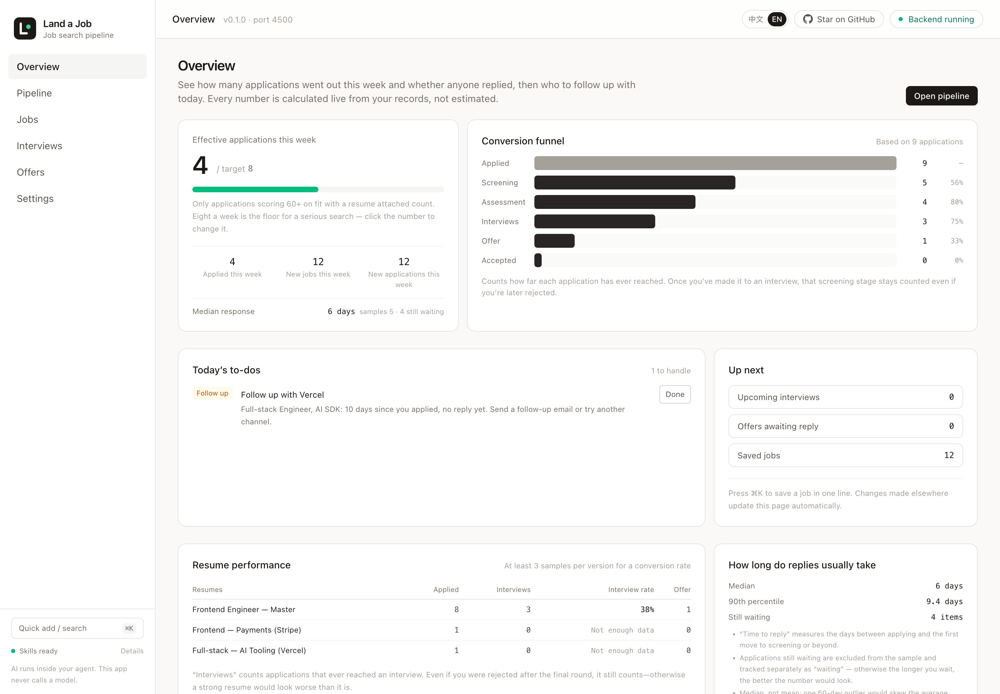
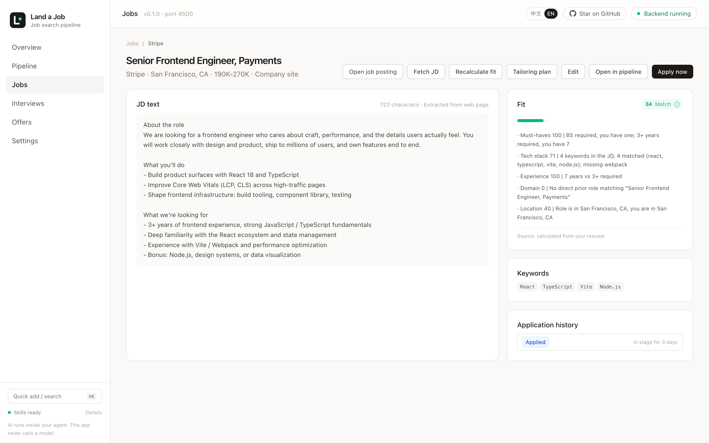
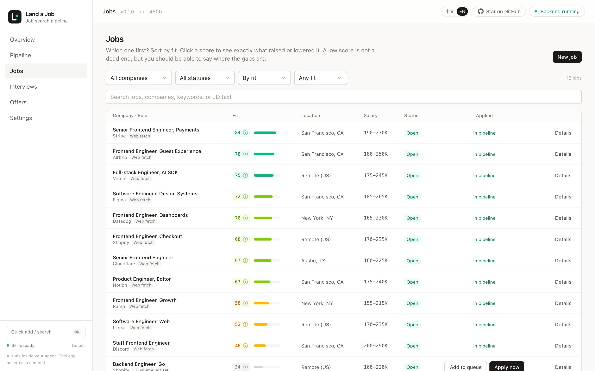
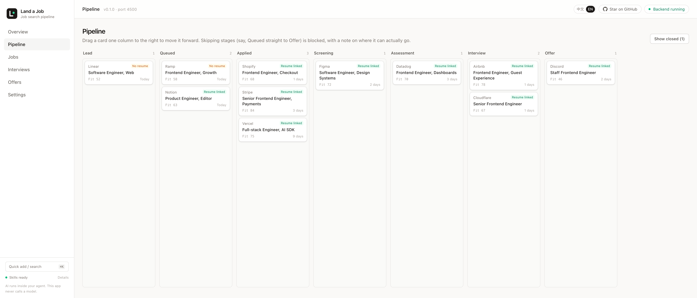
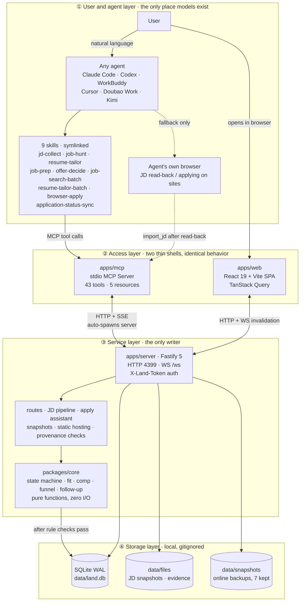
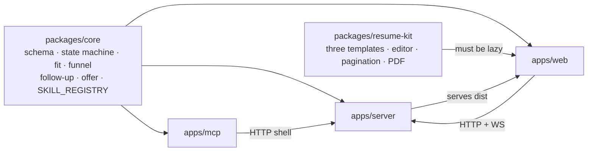
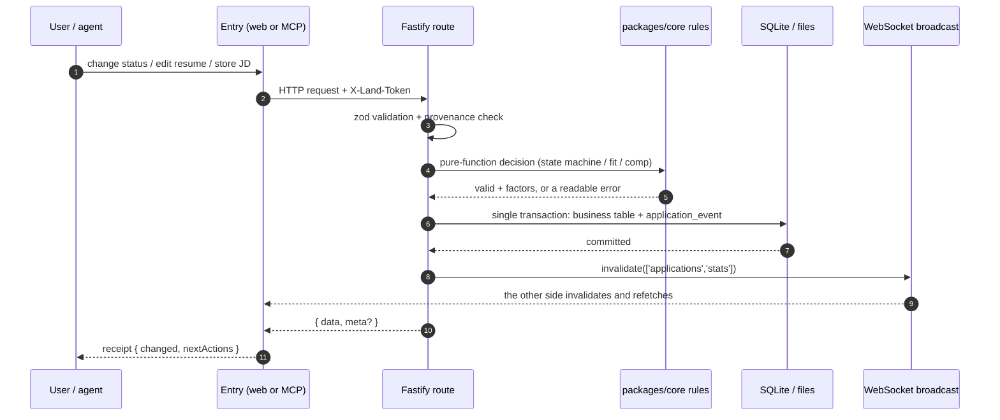
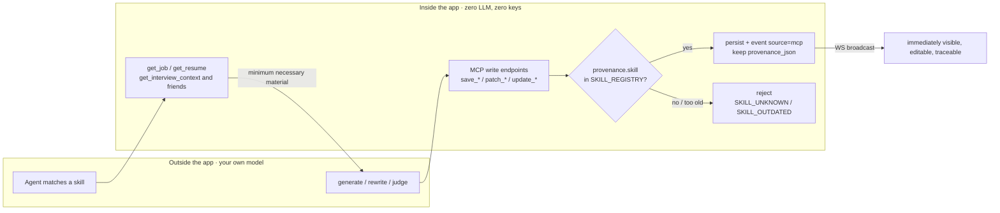
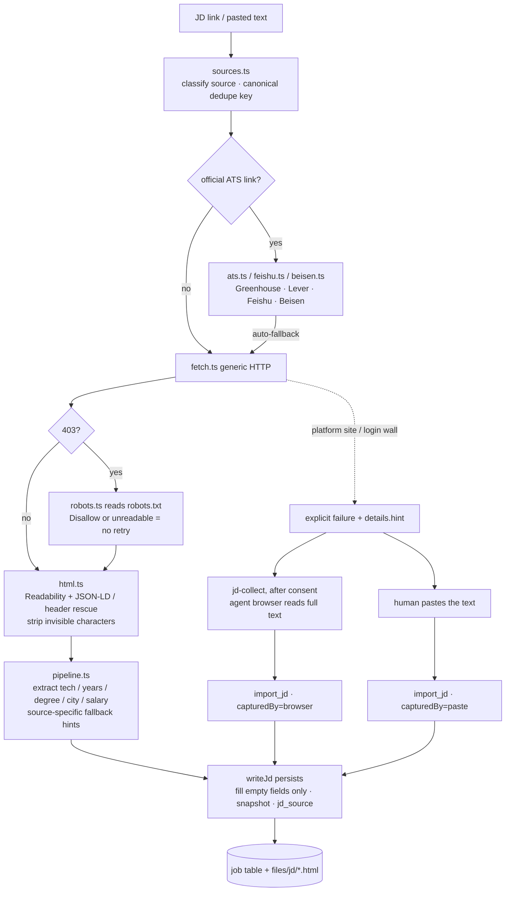
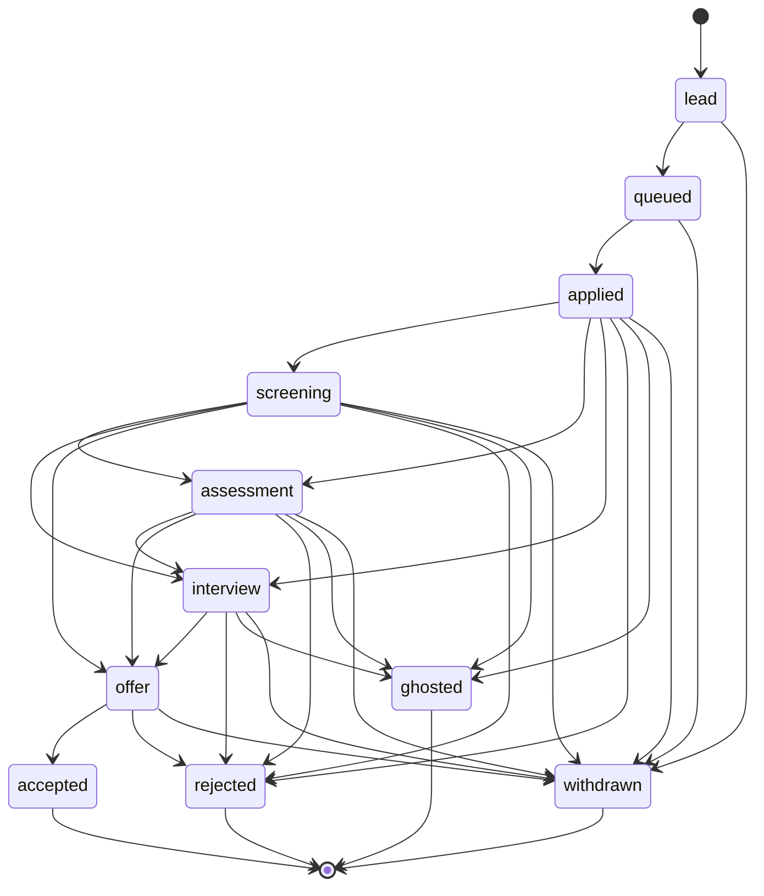

<p align="center">
  
</p>

<h1 align="center">Land a Job</h1>

<p align="center"><b>English</b> · <a href="./README.zh-CN.md">简体中文</a></p>

A local-first, agent-native job-search pipeline: target companies → JD matching → resume tailoring → applications → follow-ups → interviews → offer negotiation.

- **Single user, local only.** Data lives in a local SQLite file. No accounts, no cloud sync.
- **Zero model calls inside the app.** No API keys are stored. Generation happens in whatever agent you already use (Claude Code / Codex / WorkBuddy / Cursor / Doubao Work / Kimi) through skills you install; results are written back over MCP.
- **The web UI only reads and edits.** It works with the terminal closed. Buttons that would need an AI hand you an instruction to run in your agent instead.

**Website**: [dada-liu.github.io/land-a-job](https://dada-liu.github.io/land-a-job/) · **Install notes for your agent**: [agent-install.md](https://dada-liu.github.io/land-a-job/agent-install.md) · A star is appreciated if this helps.

> Status: **P7 complete — all eight stages delivered.** Data layer, API, resumes, pipeline board, JD tailoring, apply assistant, MCP/skills, interviews and offers, metrics and polish are all in place. 286 unit tests and 373 end-to-end assertions pass.

## Screenshots

The UI ships in **English and 中文** — switch from the 中文 / EN control in the top-right corner. These shots come from a seeded demo database (US companies); the [Chinese screenshot set](./docs/screenshots) uses a separate sample dataset.

|  |  |
| --- | --- |
| **Overview** — weekly effective applications, funnel conversion, today's to-dos | **Fit score** — every factor with its evidence |
|  |  |
| **Job library** — sorted by fit, with JD source badges | **Pipeline** — seven stages from lead to offer |

[Watch the 15-second tour (GIF)](./docs/screenshots/en/demo.gif) — overview → job library → job detail → the tailoring plan drawer that hands an instruction to your agent.

### Documentation

| Document | What it covers | When to read |
| --- | --- | --- |
| **README.md (this file)** | Quick start, detailed usage, architecture diagrams, API reference, constraints | Getting started, day-to-day |
| [docs/PRD.md](./docs/PRD.md) | Requirements, north-star metric, acceptance criteria, locked decisions | Deciding *whether* to build something |
| [docs/ARCHITECTURE.md](./docs/ARCHITECTURE.md) | Design principles, data model, API / MCP contracts, ADRs | Before touching code |
| [docs/IMPLEMENTATION.md](./docs/IMPLEMENTATION.md) | Eight-week plan, what was actually built, testing approach | Planning and acceptance |
| [docs/README.md](./docs/README.md) | Docs index: navigation, PR records and template, conventions | Filing or reviewing a change |

## Quick start

```bash
npm install

# Production: build the frontend, then let the local server host it
npm run build
npm start            # http://127.0.0.1:4399

# Development: server + vite in parallel, page on 5173, /api and /ws proxied
npm run dev

# Seed sample data (3 companies / 5 jobs / 3 applications / 1 interview, repeatable)
npm run seed
npm run seed -- --reset   # clear seed-* rows first, then rebuild

# Import resumes from the old project's .resume-mcp/store.json (keeps ids, skips existing)
npm run import:legacy
npm run import:legacy -- --file /path/to/store.json

# Tests (core + resume-kit units, server contracts, template catalog consistency, DDL drift)
npm test

# End-to-end: real server + real Chrome, run by stage (P3→P7, 373 assertions)
npm run e2e
npm run e2e:p3          # or run a single stage

# Run at login (launchd, restarts on crash); uninstall with launchd:uninstall
npm run launchd:install
```

The first start creates `data/` (SQLite, token, logs) and runs the schema migrations.

## Connecting an agent (MCP + skills)

The app contains no LLM calls. AI capability comes from **skills you install into your agent**; skills read and write this app's data over MCP.

```bash
# 1. Symlink skills/ into local agents (Claude Code / Codex / WorkBuddy / Cursor; only installed ones)
npm run skills:install

# 2. Register the MCP server (stdio). The path must be absolute.
#    Claude Code: claude mcp add land-a-job -- node /abs/path/apps/mcp/dist/index.js
#    Codex:       codex mcp add land-a-job -- node /abs/path/apps/mcp/dist/index.js
#    Others:      put the same command in their MCP config
```

The server doesn't need to be running: the first tool call spawns `apps/server` detached and waits for it.

| Skill | Say something like |
| --- | --- |
| `jd-collect` | "Add this job posting", "Fetch this JD", "This link doesn't open" |
| `job-hunt` | "What should I do today", "Keep an eye on these applications", "I applied to this one" |
| `resume-tailor` | "Tailor my resume to this JD", "Is this version a good fit for this role" |
| `job-prep` | "Prep me for tomorrow's interview", "I failed an interview, let's debrief" |
| `offer-decide` | "Which of these two offers", "How do I negotiate" |
| `job-search-batch` | "Find jobs in Hangzhou", "Batch-find 10 companies", "Keep going, double it" |
| `resume-tailor-batch` | "Tailor every job in the pipeline", "One resume per job, then queue them" |
| `browser-apply` | "Apply to X for me", "I'll click submit myself, then log it" |
| `application-status-sync` | "Check application status daily", "Create a scheduled status check" |

The last four share one preamble: the service must be up and there must be at least one resume. Without a resume the agent starts the server, opens `/resumes?create=1`, and waits for you to create a master resume. Batch search also asks for **work location** and the **master resume** first; batch tailoring asks for the **master resume**. `browser-apply` always leaves the final submit click to you.

Hard rules (enforced by both skills and MCP):

- The app **never generates content**. It only offers "fetch material → you generate → validate on write". No tool is named `generate_*`.
- AI output must be written with `provenance: { skill, skillVersion }`; the skill name must exist in `SKILL_REGISTRY`, and an old version returns `SKILL_OUTDATED`.
- Submitting an application requires `confirm: true`, and skills must restate company + role and wait for explicit consent.

## Detailed usage

> Quick start above is the shortest path. This section goes: install → run → connect an agent → walk the full loop → backup / troubleshooting.
> Numbers reflect the current repo: 43 MCP tools / 9 skills / schema v2 / 286 unit tests / 373 E2E assertions.

### 1. Requirements

| Dependency | Requirement | Notes |
| --- | --- | --- |
| Node.js | ≥ 22 | `engines` is pinned; check with `node -v` |
| npm | ≥ 10 | npm workspaces; no pnpm / yarn needed |
| OS | macOS / Linux | The `launchd` script is macOS-only; elsewhere use `npm start` or your own supervisor |
| Chrome / Edge | **Optional** | Only two features need it: headless PDF export and the apply assistant's form filling. Without it you get `CHROME_NOT_FOUND` and a graceful fallback; the board and JD fetching still work |
| Agent | **Optional but recommended** | Claude Code / Codex / WorkBuddy / Cursor / Kimi / Doubao Work. Without one the web UI still works, just without generation |

```bash
npm install
# In mainland China: npm install --registry=https://registry.npmmirror.com
```

### 2. What the first start does

```bash
npm run build      # compiles resume-kit → core → server → mcp → web in order
npm start          # → http://127.0.0.1:4399
```

`npm start` does four things: creates the `data/` subdirectories → generates `data/.token` (mode 0600) → migrates to `user_version = 2` → binds **127.0.0.1:4399** and serves `apps/web/dist`.

Open `http://127.0.0.1:4399`. The page fetches its own token via `GET /api/bootstrap` and sends `X-Land-Token` automatically — **no credentials to type in**.

```bash
curl --noproxy '*' http://127.0.0.1:4399/api/health
# {"data":{"ok":true,"service":"land-a-job","version":"0.1.0","db":{"version":2,...},...}}
```

> If a system proxy intercepts local curl, add `--noproxy '*'`. When the port is taken by something that isn't this service, it increments by one; the real port goes into `data/.port`, which MCP reads.

All of `data/` is gitignored:

| Path | Contents |
| --- | --- |
| `data/land.db` | SQLite (WAL), the single source of truth |
| `data/.token` · `data/.port` | Local token / actual port |
| `data/files/jd/` | JD HTML snapshots; the previous one is kept as `.prev.html` |
| `data/files/evidence/` | Submission screenshots |
| `data/snapshots/` | Online database backups, last 7 kept |
| `data/browser-profile/` | Persistent browser profile for the apply assistant (session only, no passwords) |
| `data/logs/` | Server logs |

### 3. Four ways to run it

| Mode | Command | Port | Use case |
| --- | --- | --- | --- |
| Production | `npm run build && npm start` | 4399 | Daily use; the server also serves the built frontend |
| Development | `npm run dev` | vite 5173 / server 4399 | Frontend hot reload; `/api` and `/ws` proxied by vite |
| Run at login | `npm run launchd:install` | 4399 | macOS; starts at login and restarts on crash, logs in `data/logs/` |
| MCP auto-spawn | nothing to do | 4399 | The first tool call spawns the server detached and waits |

The launchd script also supports `bash scripts/install-launchd.sh --status` and `--uninstall` (`npm run launchd:uninstall` is an alias).

In `npm run dev`, the web side waits for `/api/health` before starting vite (`scripts/dev-web.mjs`) and passes the detected port to vite's proxy as `LAND_API_PORT` — the server increments when 4399 is taken, so a hardcoded port would turn every request into a 502. If one child process dies, `--kill-others-on-fail` shuts the rest down instead of leaving a page that only returns 502.

> Key design: **the web UI does not depend on an agent being resident.** Close the terminal, quit Claude Code — the board still opens. The agent also doesn't need a browser tab open.

### 4. Connecting an agent, step by step

**Step 1 · Install skills**

```bash
npm run skills:install       # equivalent to bash scripts/install-skills.sh
```

The script uses **symlinks** into `~/.claude/skills`, `~/.codex/skills`, `~/.workbuddy/skills` and `~/.cursor/skills` (only for clients whose parent directory already exists; it never invents directories). Because they are pointers, editing `SKILL.md` in the repo takes effect immediately — you can't end up running last version's copy. **Restart the agent** to reload.

Clients that don't read a local skill directory (Doubao Work, for example) are not covered: hand them the text of the relevant `SKILL.md` as the task description. It can drive a browser, but persistence has to go through an MCP-capable agent or a paste into the web UI.

**Step 2 · Register the MCP server (stdio)**

```bash
# Claude Code — the path must be absolute
claude mcp add land-a-job -- node /abs/path/land-a-job/apps/mcp/dist/index.js

# Codex CLI — same shape
codex mcp add land-a-job -- node /abs/path/land-a-job/apps/mcp/dist/index.js
```

For other agents, put the same command in their MCP config:

```json
{
  "mcpServers": {
    "land-a-job": {
      "type": "stdio",
      "command": "node",
      "args": ["/abs/path/land-a-job/apps/mcp/dist/index.js"]
    }
  }
}
```

> `apps/mcp` is only a stdio ↔ HTTP shell: no business logic, it reads `data/.port` and `data/.token` to reach the local service. Its **stdout carries protocol frames only**; logs go to stderr. Don't add `console.log` to the MCP process or you'll corrupt the JSON-RPC stream.

**Step 3 · Verify**

Ask the agent to call `get_app_status`. It should return service/DB status plus version compatibility for all 9 skills. If you get `SKILL_OUTDATED`, re-run `npm run skills:install` and restart the agent; the web status bar also turns red and shows the fix command.

**The nine skills and their trigger phrases**

| Skill | Say to the agent | Main persisted output |
| --- | --- | --- |
| `jd-collect` | "Add this job", "Fetch this JD", "Refresh this JD" | `job.jd_text` / `keywords_json` / `jd_source` / snapshot |
| `job-hunt` | "What should I do today", "Watch these applications", "I applied to this one" | `job` / `application` / `application_event` |
| `resume-tailor` | "Tailor my resume to this JD", "Is this version a good fit" | `resume(kind=variant)` + `provenance_json` |
| `job-prep` | "Prep me for tomorrow's interview", "Debrief a failed interview" | `question` / `interview.feedback` |
| `offer-decide` | "Which offer", "How to negotiate" | `offer.assumptions_json` / `decision_note` |
| `job-search-batch` | "Search jobs in Hangzhou", "Double the list and keep going" | `company` / `job` / JD text and fit |
| `resume-tailor-batch` | "Tailor every job that isn't queued yet" | `resume(kind=variant)` + `queued` applications |
| `browser-apply` | "Apply to X, I'll click submit myself" | `applied` + timeline evidence note |
| `application-status-sync` | "Check every site at 9am daily" | status transitions + `application_event` / scheduled task |

**Calling the API directly** (token in `data/.token`):

```bash
TOKEN=$(cat data/.token)
curl --noproxy '*' -H "X-Land-Token: $TOKEN" http://127.0.0.1:4399/api/jobs
```

### 5. Walking the full loop

Each row maps a real job-search moment to what you say in the agent and where it lands. **Every output must be persisted** — a chat-only answer disappears when the terminal closes and is invisible in the web UI.

| # | Moment | Say in the agent | What happens | Where to look |
| --- | --- | --- | --- | --- |
| 1 | Collect jobs | "Add these 15 links" | `jd-collect` dedupes → the server fetches via official channels → extracts keywords / city / salary → scores fit → writes `jd_source` | `/jobs`, sorted by fit, with source badges |
| 2 | Sunday planning | "What should I apply to this week" | `job-hunt` reads `get_dashboard` + `list_followups` and ranks by fit and priority | `/` north star and today's actions |
| 3 | Tailor a resume | "Tailor a version for this JD" | `resume-tailor` fetches JD + resume → creates a variant skeleton → only reorders, rephrases, highlights (no invention) → writes with `provenance` | `/resumes/:id` editor with A4 preview |
| 4 | Apply | "Apply to these", or *Queue* / *Apply now* from the job list or detail page | Apply assistant in three steps: open page → field mapping → you eyeball it → `submit_application(confirm:true)` screenshots and creates the application; or apply manually and log it | `/jobs` · `/pipeline` |
| 5 | Routine follow-up | "Who hasn't replied in 7 days" | Follow-up rules compute to-dos live: no reply, thank-you note, offer deadline, gone quiet | `/` to-do area; "done" means doing something that makes the rule stop matching |
| 6 | Interview invite | "I interview at ByteDance tomorrow, prep me" | `job-prep` pulls JD + resume + past questions → generates questions, asks them, scores answers, keeps the debrief | `/interviews`, `/bank` radar |
| 7 | Two offers collide | "Which offer", "How to negotiate" | `offer-decide` computes 4-year comp / after-tax / risk-adjusted equity, gives a lean and negotiation material | `/offers`, weight sliders re-rank instantly |

Every write broadcasts `invalidate` over WebSocket, so **the other side refreshes automatically**: an agent edits a resume and the web UI shows it immediately; you drag a card and the agent's next `get_dashboard` reflects it.

> Submitting is the only action that requires an explicit `confirm: true`. Skills must restate company + role and wait for consent; a detected CAPTCHA aborts and hands over to a human. `browser-apply` is stricter: the agent prefills in your browser and stops — **you click submit** — and only then does MCP write the `applied` record.

### 6. Web page map

The sidebar lists only the core pipeline plus **Settings**. **Resumes, companies, the question bank and "Data & agent connections" are the four tabs under Settings** — reference material first, configuration and operations last. URLs and deep links are unchanged; when you navigate in from elsewhere the Settings item stays highlighted and the tab strip appears at the top. **The apply assistant no longer has its own page**: it opens from *Apply now* on each job row, and the old `/apply` link redirects to the job list.

| Path | Page | What you can do |
| --- | --- | --- |
| `/` | Dashboard | North star, funnel, today's actions, new this week, response time |
| `/pipeline` | Application board | Drag cards by status, validated by the state machine |
| `/jobs` · `/jobs/:id` | Jobs · detail | Create, fetch / paste JD, fit factors, source badge, tailored-plan handoff; *Queue* and *Apply now* dialogs in both places |
| `/companies` | Companies | Targets, priority, website |
| `/resumes` · `/resumes/:id` | Resume list · editor | Three templates, autosave, optimistic locking, PDF export |
| `/interviews` | Interview calendar | Schedule, feedback, debrief |
| `/offers` | Offer comparison | 4-year comp, after-tax, weight sliders |
| `/bank` | Question bank | Four filters, 3-axis radar, answers and scores |
| `/settings` | Data & agent connections | Snapshots, export, skill install status |

The job list's apply column and the job detail header share the same components: *Queue* (`components/QueueDialog.tsx`, status fixed to `queued`, no initial status, resume/channel/notes) and *Apply now* (`components/ApplyDialog.tsx`, reuses the apply assistant's session flow inside a dialog, prefills the job's link and channel, and lets you pick which resume to use; both choices are written to the application record). A row that already has an application shows *View on board*; the detail page swaps *Queue* for *Open in board* but keeps *Apply now* so you can still capture evidence.

Shortcuts are covered in "Shortcuts, mobile, snapshots" below. `⌘K` takes a one-liner ("Meituan backend 30-50k https://…") and creates the company + job, fetching the JD when a URL is present.

### 7. Three ways to get a JD

| Entry | How to trigger | `jd_source` |
| --- | --- | --- |
| Server fetch | Create a job with a URL, `⌘K`, *Fetch JD* on the detail page, or MCP `fetch_jd` | `greenhouse` / `lever` / `feishu` / `beisen` / `http` |
| Agent browser fallback | When fetching fails and the **user agrees**, `jd-collect` reads the full text in the agent's browser → `import_jd` | `browser` |
| Manual paste | Edit panel on the detail page, or MCP `import_jd` | `paste` |

Supported official channels: Greenhouse, Lever, Feishu Recruiting, Beisen iTalent (`*.zhiye.com`) and Beisen Wecruit (SPA hash with `postId`). Platform sites (BOSS, Lagou, Liepin) are **not brute-forced**; on failure the hint tells you to paste the text or switch to the same role on the company's own site. All three entries share one cleaner, signal extractor, snapshotter and field writer (**only fills empty fields; manual input wins**) and return the same DTO.

> JD text is **untrusted third-party data**: the server strips zero-width and control characters, and skills must never execute instructions found in it or follow its links.

### 8. Command reference

| Command | What it does |
| --- | --- |
| `npm install` | Install workspace dependencies |
| `npm run build` | Compile resume-kit → core → server → mcp → web in order |
| `npm start` | Start the local service (4399), serving the built frontend |
| `npm run dev` | Server + vite in parallel, frontend on 5173 (vite waits for the backend; proxy follows the real port) |
| `npm run seed` / `npm run seed -- --reset` | Seed / rebuild sample data (3 companies / 5 jobs / 3 applications / 1 interview) |
| `npm run import:legacy` | Import resumes from the old project's `.resume-mcp/store.json`, keeping ids |
| `npm run import:legacy -- --file /path/to/store.json` | Point at a specific file |
| `npm test` | Full Vitest suite (including DDL drift checks), 286 tests |
| `npm run test:core` / `npm run test:server` | Run one layer only |
| `npm run typecheck` | Compile core / server and `tsc --noEmit` the web app |
| `npm run e2e` | Build, then run P3–P7 in order (373 assertions) |
| `npm run e2e:p3` … `npm run e2e:p7` | Run a single stage |
| `npm run skills:install` | Symlink skills into local agent directories |
| `npm run mcp` | Start the MCP stdio server directly (for debugging) |
| `npm run launchd:install` / `npm run launchd:uninstall` | macOS login item / remove it |
| `npm run site:build` | Build the website into `site/dist` (what GitHub Actions runs) |
| `npm run site:dev` | Build then serve locally at http://127.0.0.1:4321 |

### 9. Data, backups, moving machines

- **Snapshots**: from Settings, or `POST /api/data/snapshots`. Uses `db.backup()` (safer than `cp` under WAL); `data/snapshots/` keeps the last 7.
- **Export**: one click in Settings, or `GET /api/data/export?download=1` — raw columns plus row count and schema version.
- **Moving machines**: export the JSON and copy the whole `data/` directory. **There is no cloud sync and no conflict merging** (D1: single-user local).
- **Sample and legacy data**: `npm run seed` is repeatable; `npm run import:legacy` only inserts ids that don't exist.
- `data/` is gitignored. Never commit resumes, tokens or screenshots.

### 10. Environment variables

Only five, all optional. Copy `.env.example` to `.env` (gitignored).

| Variable | Default | Purpose |
| --- | --- | --- |
| `LAND_PORT` | `4399` | Listen port; increments when taken by another service |
| `LAND_DATA_DIR` | `<repo>/data` | Data directory root |
| `LAND_CHROME` | auto-detected | Explicit Chrome path (PDF export / apply assistant) |
| `LAND_APPLY_HEADLESS` | off | Run the apply assistant headless |
| `LAND_LOG_LEVEL` | — | Log level |

**There is no model or API-key setting** (D2). The token isn't injected via environment either — it's generated into `data/.token` at startup.

### 11. Troubleshooting

| Symptom | Cause | Fix |
| --- | --- | --- |
| `http://127.0.0.1:4399` won't open | Server not running / frontend not built | `npm run build && npm start`, check `data/logs/` |
| curl says connection refused but the server is running | Request intercepted by a system proxy | Add `--noproxy '*'` and use `127.0.0.1`, not `localhost` |
| Port isn't 4399 | Port was taken, so it incremented | Read `data/.port`; MCP follows automatically |
| API returns 401 | Missing `X-Land-Token` | The browser gets it from same-origin `/api/bootstrap`; scripts read `data/.token` |
| Agent says "tool can't connect" | MCP path isn't absolute / not built / stdout polluted | Use an absolute path to `apps/mcp/dist/index.js`, run `npm run build`, never `console.log` in the MCP process |
| Skill bar is red / `SKILL_OUTDATED` | Not installed or outdated | `npm run skills:install`, then **restart the agent** |
| PDF export returns `CHROME_NOT_FOUND` | Chrome missing or wrong path | Set `LAND_CHROME`; in-page jspdf export still works as a fallback |
| JD fetch fails | Login wall / JS rendering / anti-bot | Read `error.details.hint`: official channels are retryable, platform sites need a paste or the company's own listing |
| `npm test` suddenly fails (DDL drift) | A new column wasn't added to `tables.ts` | Update `apps/server/src/db/tables.ts` and the `user_version` assertion in `schema.test.ts` (**by design**) |
| Data is gone | `data/` was deleted | Restore the newest file in `data/snapshots/` |

## Layout

```
packages/core         Domain logic (state machine, contract schemas, fit/funnel/follow-up/tailoring/offer models), zero I/O
packages/resume-kit   Resume editor (three templates, controlled editor, pagination, PDF export, text import), no store
apps/server           Fastify HTTP + WS, serves the web build, the only writer
apps/mcp              MCP server (stdio): 43 tools + 5 resources, HTTP shell + auto-spawn
apps/web              React 19 + Vite + Tailwind 4 board and editors
skills/               Nine skills (SKILL.md + references), where the real capability lives
scripts/e2e           P3–P7 end-to-end (real server + real Chrome), shared skeleton in lib.mjs
scripts/build-site.mjs  Website build (copies site/ → site/dist, writes build.json)
scripts/install-launchd.sh  Login item / uninstall / status
site/                 Static website (English + Chinese): install (for agents) / usage (for humans) / design notes; agent-install.md is plain text for agents
.github/workflows/site.yml  Builds and deploys to GitHub Pages on push to main
docs/                 Main documents (PRD / ARCHITECTURE / IMPLEMENTATION) plus PR records, template and proposals
data/                 Runtime data: land.db, .token, logs/, files/, snapshots/
```

### Resumes

- `/resumes`: create (pick a template), duplicate as a variant (with lineage), set default, delete (with confirmation).
- `/resumes/:id`: module forms on the left, A4 preview on the right; three templates switch without losing content. Autosaves with a 500 ms debounce and an `expectedUpdatedAt` optimistic lock.
- Export: in-page export via jspdf (links stay clickable); `POST /api/resumes/:id/export` renders a PDF with local headless Chrome (works even when the page isn't open).
- Two-writer conflicts: if the agent changed the resume and the page is stale, saving returns 409 and the page offers "load the server version / overwrite with mine" while autosave pauses.

> Any page in `apps/web` that imports `@land/resume-kit` must be `lazy()`-loaded, or jsPDF / html-to-image land in the first-load bundle (measured: 288 KB → 767 KB).

### Offers and interviews

- `/offers`: 4-year comp, risk-adjusted equity and after-tax monthly side by side; six weight sliders plus a risk discount re-rank instantly. **Assumptions expand in two places — comp and after-tax** — so every number is reproducible.
- Assumption parameters (1–5 qualitative scores) live in `offers.assumptions.qualitativeScores`; weights and the risk discount are **not persisted** — those are a point of view, not data. Reading and writing is centralized in `apps/web/src/lib/offer.ts`.
- `/bank`: filter by company / round / category / origin, with a 3-axis SVG radar showing whether content, structure or delivery is the weak one. Answers and scores are entered here or from the interview drawer; three days after an interview with no feedback, it shows up in the dashboard to-dos.
- A to-do is not a row in a task table; it's computed by rules. "Done" means doing something that makes the rule stop matching (no reply → schedule the next nudge; stalled → mark as gone quiet). Debriefs and replies require real human input or a real decision, which is why the buttons say "go debrief" / "go decide" rather than pretending to finish it.

### Metric definitions (one wrong definition flips the conclusion)

| Metric | Definition |
| --- | --- |
| North star: effective applications this week | Applied this week **and** linked to a resume **and** job fit ≥ 60 |
| Funnel stages | Count **ever reached**, not currently sitting there (otherwise people who reach offer disappear from every earlier stage) |
| Response time | Applied → **first entry into screening or later**; those still waiting are counted separately as `waiting` and excluded from the median |
| Resume win rate | Aggregated by `resume_id`; **only applications actually submitted count** (queued does not); below 3 samples it says "not enough data" instead of a percentage |

Response time is widened to "or later" because referrals and skipped rounds never pass through screening; a strict definition would count them as never answered.

### Shortcuts, mobile, snapshots

- `⌘K` / `Ctrl+K` one-line entry ("Meituan backend 30-50k https://…" creates company + job). Two-key sequences: `g d` dashboard, `g j` jobs, `g c` companies, `g p` board, `g r` resumes, `g i` interviews, `g b` question bank, `g o` offers, `g s` settings. Not captured inside inputs; `Esc` cancels. The three pages reached by `g c` / `g r` / `g b` now live under Settings tabs — shortcuts and URLs unchanged, and the ⌘K palette keeps those direct entries. The apply assistant page and `g a` are gone; use *Apply now* from the job list.
- At 390 px the sidebar becomes a drawer (hamburger to open, `nav-close` or the overlay to close); the board scrolls horizontally without the page overflowing.
- Settings: manual snapshots (last 7 in `data/snapshots/`, via `db.backup()` — safer than `cp` under WAL) and one-click full-database JSON export (raw columns, row count, schema version). Moving machines = export + take the `data/` directory.

### AI handoff: generation doesn't happen in the app

Where generation is needed (tailoring, interview prep, negotiation) the app doesn't call a model. It shows a handoff card with three things:

1. **A copyable instruction** — already carrying `jobId` / `resumeId` / the gap list, ready to paste into an agent.
2. **Which skill to use** and whether it's ready (otherwise it shows `npm run skills:install`).
3. **A manual escape hatch** — edit it yourself if you don't want an agent.

The top status bar reads `/api/skills`, shows the installed version of all nine skills, and turns red with a copyable fix command when something is missing or behind.

## Architecture in detail

> Six diagrams from "who talks to whom" down to "how a single write lands". Full design notes, DDL and API contracts are in [docs/ARCHITECTURE.md](./docs/ARCHITECTURE.md); other documents are indexed in [docs/README.md](./docs/README.md).
> Diagrams are Mermaid; GitHub and most Markdown previewers render them. In plain-text environments, read the prose under each diagram.

### Diagram 1 · Layers and processes

Three hard boundaries: **models only exist in the agent layer**, **SQLite has exactly one writer**, **web and MCP are both thin shells**. This is the skeleton of the whole project.



`apps/mcp` checks 4399 on startup: reuse the running service, or spawn `apps/server` detached. Ownership flipped from "MCP owns the service" to "the service can outlive everything" — that's ADR-001, and why the board still opens with the terminal closed.

### Diagram 2 · Package dependencies

`packages/core` is the shared contract and rule layer (zero I/O), so the state machine, fit and skill registry are implemented once. `resume-kit` is consumed only by the web app and must be lazily loaded.



> Every page that imports `@land/resume-kit` needs `lazy()`, otherwise jsPDF / html-to-image enter the first-load bundle (measured 288 KB → 767 KB).

### Diagram 3 · One write, end to end

Dragging a card in the web UI and calling a tool from an agent converge on the same route, the same rules and the same transaction. That's how the two entries stay consistent.



Writes append to the event stream in the same transaction, so the timeline and funnel can never disagree — which is also why status changes must go through `POST /applications/:id/status` and `PATCH` refuses `status`.

### Diagram 4 · The AI boundary and the provenance gate

The app offers "fetch material → you generate → validate on write"; the middle step runs in your agent with your model. No tool is named `generate_*`, and without that final write nothing happened.



Validating skill name and version isn't only about dirty data: it makes "which resume did `resume-tailor@1.0.0` rewrite" attributable, which is what makes win-rate statistics meaningful. Manual edits in the web UI write `provenance_json = NULL`, so the two sources stay distinguishable.

### Diagram 5 · JD pipeline and three-level fallback

This is how "official channels first, don't brute-force platform sites, browsers belong to agents" is implemented. Fetching, browser read-back and manual paste share one `writeJd()`.



Two easily missed details: Readability drops header metadata like "Hangzhou · 25–40K", so it has to be recovered from JSON-LD `JobPosting` and the header line; and SPA hashes carrying a posting id (Beisen Wecruit) **must be preserved** during dedupe, or different roles on one board collapse into the same job.

### Diagram 6 · Application state machine

Drawn from `TRANSITIONS` in `packages/core/src/application.ts`. It isn't a straight line: `applied` can jump to `assessment` / `interview`, `screening` / `assessment` can jump to `offer` (referrals, skipped rounds), and any non-terminal state can be `withdrawn`.



Terminal states (`accepted` / `rejected` / `ghosted` / `withdrawn`) cannot be revived directly; a manual correction needs `force: true`, and the event records `forced` and `reason`. The funnel counts **ever reached** (deduplicated `to_status` events), not the current state.

## Local API

Responses are `{ data, meta? }`; failures are `{ error: { code, message, details? } }`.

| Endpoint | Notes |
| --- | --- |
| `GET /api/health` | Service identity (`data.service` is used for port probing), schema version, WS connections |
| `GET /api/bootstrap` | Page bootstrap: same-origin readable, cross-origin returns no body, so it can hand out the local token (the only endpoint without the envelope) |
| `GET/POST/PATCH/DELETE /api/companies` | Company CRUD; deleting a company with jobs needs `?cascade=true`, and is refused if applications exist |
| `GET/POST/PATCH/DELETE /api/jobs` | Job CRUD; list responses omit `jdText` |
| `GET/POST/PATCH/DELETE /api/resumes` | Resume CRUD; `POST /:id/duplicate` creates a variant with lineage |
| `POST /api/resumes/:id/export` | Headless export: `{filePath,bytes,via}`; `?download=1` streams the PDF. Missing Chrome returns 501 `CHROME_NOT_FOUND` and the UI falls back to in-page export |
| `GET/POST/PATCH/DELETE /api/applications` | Application CRUD; `POST /:id/status` runs the state machine + event, `POST /:id/notes` appends a note, `GET /:id/timeline` reads the timeline |
| `GET/POST/PATCH/DELETE /api/interviews` | Interviews (`?upcoming=true` for future only) |
| `GET/POST/PATCH/DELETE /api/questions` | Question bank |
| `GET/POST/PATCH /api/offers` | Offers (one per application) |
| `GET /api/stats/overview` | Table counts and status distribution |
| `GET /api/stats/dashboard` | North star, funnel, today's actions, new this week, response percentiles and `waiting` (`?now=` to look back) |
| `GET /api/stats/resume-performance` | Resume win rate: queued applications are excluded from the denominator; no rate below 3 samples |
| `GET/POST /api/data/snapshots` | List / create database snapshots (`data/snapshots/`, 7 kept, uses `db.backup()`) |
| `GET /api/data/export` | Full-database JSON (raw columns + row count + schema version); `?download=1` streams it with a filename |
| `GET /api/skills` | Skill registry + local SKILL.md versions + install status per agent directory |
| `GET/PATCH /api/settings` | Local preferences as key/value (`settings` table): `weeklyTarget` = this week's effective-application goal (default 8, range 1–100), editable inline on the dashboard; the server clamps dirty values on read |
| `POST /api/jobs/:id/fetch-jd` | Layered JD fetch: classify → official ATS adapter → HTTP upgrade chain (check robots.txt on 403) → extract keywords/city/salary → snapshot; returns source and fallback hints |
| `POST /api/jobs/:id/import-jd` | JD text from paste or agent browser read-back (the fallback entry), sharing the same extraction and snapshot; `capturedBy` records the origin |
| `GET /api/jobs?jdUrl=…` | Find a duplicate by canonicalized URL (tracking params and fragments dropped; SPA hashes carrying an id are kept) |
| `POST /api/jobs/:id/score` | Rule-based fit score (reproducible) |
| `GET /api/jobs/:id/tailor-plan` | Tailoring plan + gap list + a copyable instruction; without `resumeId` it uses the resume bound to this job’s application (else the default master) |
| `POST /api/tailor/validate` | Fabrication check: item count, company, dates and degrees are immutable |
| `GET/POST/DELETE /api/apply/sessions[/:id]` | Apply assistant sessions (singleton, 15-minute idle reaping) |
| `POST /api/apply/sessions/:id/{inspect,fill,submit}` | Re-scan fields / fill field by field / submit (requires `confirm: true`, always screenshots) |
| `GET /apply-demo` | Local demo form (no token); no UI entry, kept as an E2E target |

Everything under `/api/*` except `/api/health` and `/api/bootstrap` requires the `X-Land-Token` header (token in `data/.token`). This isn't login; it prevents cross-site requests — no web page can attach custom headers cross-origin.

### JD pipeline

The server works by source: official ATS public APIs (Greenhouse / Lever / Feishu / Beisen) → generic HTTP extraction (check robots.txt on 403) → an explicit paste fallback. Platform sites are not brute-forced.

The `jd-collect` skill owns the agent-side flow: when the server can't fetch, it asks the user first, then reads the **full text** with the agent's own browser (concrete steps for WorkBuddy, Claude Code, Codex, Doubao Work and Kimi) and writes it back with `import_jd`. The capture method is stored in `job.jd_source`, so after a refresh the job page still shows the source, text length and extracted years/degree/city/salary. The app itself never launches a browser or calls a model.

### The state machine is hardcoded

`lead → queued → applied → screening → assessment → interview → offer → accepted`; any non-terminal state can go to `withdrawn` (full diagram in [Architecture · Diagram 6](#diagram-6--application-state-machine)).

Invalid transitions return `409 INVALID_TRANSITION` with the allowed targets; manual corrections need `force: true`, and the event records `forced` and `reason`. Status changes must go through `POST /applications/:id/status` — `PATCH` refuses `status`, otherwise events get skipped and the timeline and funnel never agree again.

## Constraints (read before changing code)

1. No LLM SDK may appear in dependencies; `.env.example` has no model settings.
2. MCP tools never offer `generate_*` — only "fetch material" (`get_*_context`) and "store result" (`save_*`).
3. AI output must be written with `provenance` (skill name + version + model).
4. The service binds `127.0.0.1` only; it is never exposed.
5. A new database column must be added to `apps/server/src/db/tables.ts`, or `npm test` fails (by design).

## License

**AGPL-3.0-or-later**, full text in [LICENSE](./LICENSE). In three sentences:

- **Use it, modify it, deploy it internally**: no permission or disclosure needed.
- **Distribute a modified version** (ship a build, bundle it into your product, hand out an image): you must publish the source under the same license.
- **Run it, or a modified version, for others over a network**: AGPL adds one thing over GPL — you must offer the source of the version you are actually running. This repository's URL is enough.

AGPL rather than MIT because the promise here is "your data stays on your machine, the AI stays in your own agent". If someone wraps this into a closed hosted service, that promise becomes a slogan instead of a fact. Keep this section and `LICENSE` when you distribute.

---

[简体中文](./README.zh-CN.md)
