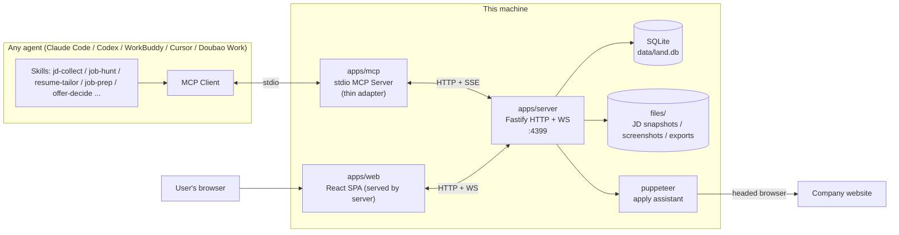
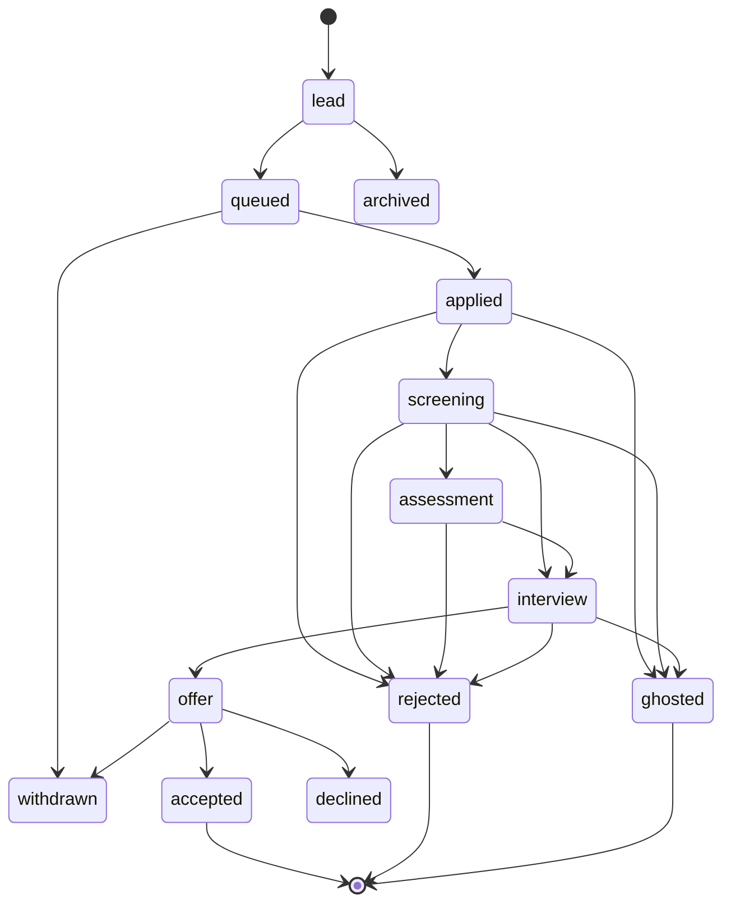
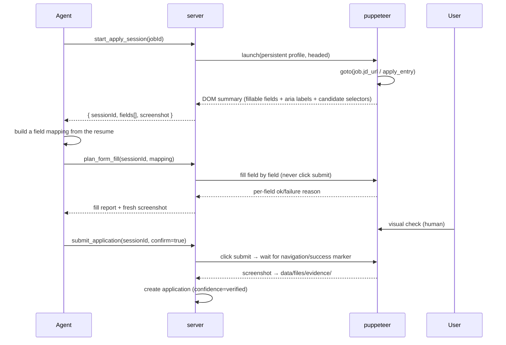
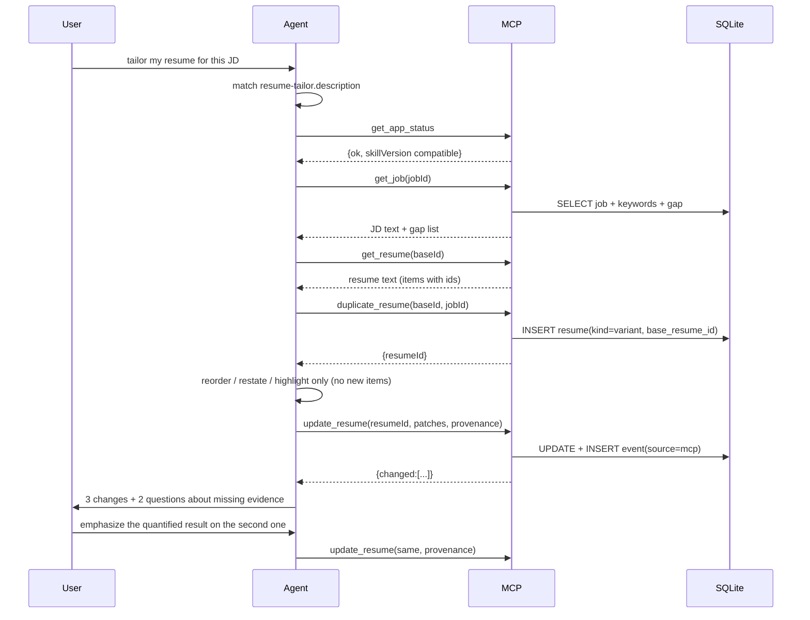

# Land a Job — Architecture

**English** · [简体中文](./ARCHITECTURE.zh-CN.md)

| Item | Value |
| --- | --- |
| Version | v1.0 |
| PRD | [PRD.md](./PRD.md) v1.0 |
| Implementation | [IMPLEMENTATION.md](./IMPLEMENTATION.md) |
| Target | Node ≥ 22 · macOS / Linux · single-user local-first |

---

## 1. Overview

### 1.1 Principles

1. **One writer for the data**: SQLite is owned by the local service; MCP never reads the file directly, so no two processes can clobber each other.
2. **Capability in the service, thin shells at the edges**: the web UI and MCP are both HTTP clients. Business rules (state machine, scoring, comp) live in `packages/core`, so every entry behaves identically.
3. **AI outside the product, capability inside skills**: the app makes zero model calls and holds zero API keys. Every generation/rewrite/scoring capability lives in a skill the user installs; the agent runs it with the user's model, and output **must be persisted over MCP** — otherwise it looks good in chat and is invisible in the app.
4. **Human confirmation counts**: anything that changes state in the outside world (submitting an application, deleting data) requires explicit confirmation and leaves evidence.
5. **Always degradable**: fetch failure falls back to paste, browser failure to manual work, no agent to a fully usable web UI.

### 1.2 Processes and data flow



**Key point**: `apps/mcp` holds no business logic; it only translates stdio ↔ HTTP. On startup, if nothing answers on 4399, it **spawns** `apps/server` as a child process (recording a pid file); if the service is already running it reuses it. This matches the owner/attached pattern from `resume-generator-2`, but flips ownership: from "MCP owns the service" to "the service can outlive everything".

### 1.3 Why three processes (ADR-001)

| Option | Pros | Cons | Verdict |
| --- | --- | --- | --- |
| A. HTTP inside MCP (as in resume-generator-2) | One process, simple | The UI only works while the agent runs; quit the agent and the board dies | Rejected |
| B. Pure MCP + local files | Minimal | No concurrency or transactions; the web UI can't read/write directly; stats require full scans | Rejected |
| **C. Resident server + thin MCP + web SPA** | UI independent of the agent; single writer; stateless MCP; agent exit doesn't affect the board | One extra process and health checks | **Chosen** |

### 1.4 The AI boundary (PRD D2)

```
┌──────────── The user's agent (the model lives here) ────────────┐
│  Skill(jd-collect / job-hunt / resume-tailor / job-prep / ...)   │
│    ├─ prompts and steps: how to write, what to ask, how to score │
│    └─ tool calls: only through MCP into the app                  │
└───────────────────────────┬─────────────────────────────────────┘
                            │ MCP (stdio)
┌───────────────────────────▼─────────────────────────────────────┐
│ This app (no model, no keys)                                     │
│  Rules: state machine / fit / comp / funnel / follow-up           │
│  Storage: SQLite + evidence files + provenance (AI vs. human)     │
└──────────────────────────────────────────────────────────────────┘
```

Three hard constraints, checked in code review:

1. **No LLM SDK** in `package.json` dependencies (no `openai`, `@anthropic-ai/*`, `ai`).
2. The server never reads `OPENAI_API_KEY`-style variables; `.env.example` has no model settings.
3. MCP tools never offer "generate for me" — only "fetch material" (`get_*_context`) and "store result" (`save_*` / `update_*`). Generation happens in the agent.

> This isn't fussiness: the moment the server calls a model, you inherit keys, quotas, model versions and data egress, and the product turns from a local tool into a service that needs operating. Keeping the boundary puts that complexity in the agent, where it belongs.

---

## 2. Repository layout (npm workspaces)

```
land-a-job/
├── package.json                 # workspaces + scripts (dev/build/test)
├── tsconfig.base.json
├── packages/
│   ├── core/                    # pure domain logic, zero I/O, unit-testable
│   │   ├── src/
│   │   │   ├── schema/          # zod schemas + types (company/job/application/offer/...)
│   │   │   ├── application.ts   # state machine, illegal transitions, time in stage
│   │   │   ├── fit.ts           # JD keyword extraction + deterministic fit scoring
│   │   │   ├── offer.ts         # comp / after-tax estimation / 4-year model
│   │   │   ├── funnel.ts        # funnel, conversion, resume win rate
│   │   │   ├── followup.ts      # follow-up threshold rules
│   │   │   └── interview.ts     # question templates, scoring dimensions
│   │   └── test/
│   ├── resume-kit/              # reusable pieces extracted from resume-generator-2
│   │   ├── src/types/resume.ts
│   │   ├── src/templates/       # classic / template-1 / template-2
│   │   ├── src/editor/          # EditorPanel, ResumePaper, editors
│   │   ├── src/export/pdf.ts    # jspdf + html-to-image
│   │   └── src/markdown.ts      # Markdown/plain text → ResumeData
│   └── contracts/               # API DTOs shared by web and server (derived from core schemas)
├── apps/
│   ├── server/
│   │   ├── src/
│   │   │   ├── index.ts         # startup, port guard, graceful shutdown
│   │   │   ├── db/              # better-sqlite3 connection, migrations, repositories
│   │   │   ├── routes/          # companies/jobs/resumes/applications/interviews/offers/stats
│   │   │   ├── ws.ts            # change broadcasts
│   │   │   ├── jd/              # capture pipeline: source classification / ATS adapters / HTTP upgrade chain / snapshots
│   │   │   ├── apply/           # puppeteer sessions, field-plan execution, screenshots
│   │   │   └── static.ts        # serves apps/web/dist
│   │   └── test/
│   ├── web/
│   │   ├── src/
│   │   │   ├── pages/           # Dashboard/Resumes/Companies/Pipeline/Interviews/Offers/Bank
│   │   │   ├── components/
│   │   │   ├── api/             # fetch wrapper + WS subscription
│   │   │   └── stores/
│   │   └── vite.config.ts
│   └── mcp/
│       └── src/
│           ├── index.ts         # stdio server + auto-spawn of the server
│           ├── client.ts        # HTTP client (with local token)
│           ├── tools/           # tool registration by domain
│           └── resources.ts
├── skills/
│   └── job-hunt/{SKILL.md, references/}
├── site/                        # static website (install for agents, usage for humans)
├── data/                        # runtime, gitignored
│   ├── land.db
│   ├── files/{jd,evidence,exports}/
│   └── snapshots/
└── docs/
```

---

## 3. Technology choices

| Layer | Choice | Why | Alternatives rejected |
| --- | --- | --- | --- |
| Language | TypeScript 5.x strict | One language across the stack, shared schemas | — |
| Runtime | Node 22 LTS | Verified v22.x locally; native fetch/WebSocket client | Bun: ecosystem not settled |
| Package manager | npm workspaces | npm 10 already installed, zero extra tooling | pnpm: faster but another dependency |
| HTTP | Fastify 5 | Schema validation, performance, plugin ecosystem | Express: no built-in validation |
| Database | SQLite + better-sqlite3 (WAL) | Synchronous API, reliable transactions, single-file backup | `node:sqlite`: still experimental; Postgres: too heavy locally |
| Migrations | Hand-rolled (SQL files + `user_version`) | Six tables don't justify an ORM | Prisma: large generated client, slow start |
| Frontend | React 19 + Vite 7 + Tailwind 4 | Identical to resume-kit, components reused directly | Next.js: no SSR needed |
| Server state | TanStack Query | Caching/invalidations/retries plus precise WS invalidation | Hand-written fetch: duplicate work |
| Board drag | dnd-kit | Lightweight, good accessibility | react-beautiful-dnd: unmaintained |
| Charts | Recharts | Enough for funnel and trends, small | ECharts: heavy |
| PDF | jspdf + html-to-image | Link annotation approach already proven | Puppeteer PDF: needs a resident Chrome |
| JD fetching | undici + @mozilla/readability + jsdom + site adapters | High-quality text extraction; official channels give structured fields; platform sites aren't brute-forced | Regex: brittle; Chromium: still blocked by login walls and slow |
| Browser automation | puppeteer-core (local Chrome, headed by default) | No second Chromium download; CDP is enough | Playwright: extra browser; Selenium: slow |
| MCP | @modelcontextprotocol/sdk (stdio) | Official SDK | — |
| Testing | Vitest (unit) + puppeteer-core scripts (e2e) | Same stack as core/resume-kit; e2e needs its own isolated service and database checks, which scripts express more directly | Jest: heavy config |

---

## 4. Data model

### 4.1 Conventions

- Primary keys are `TEXT` (`crypto.randomUUID()`), for cross-device merging and export.
- Times are ISO 8601 strings (UTC), localized at render time.
- Soft delete: `deleted_at` (`NULL` = alive); queries filter by default.
- Every write touching an application also writes `application_event` in the same transaction.

### 4.2 DDL

```sql
PRAGMA journal_mode = WAL;
PRAGMA foreign_keys = ON;

CREATE TABLE company (
  id            TEXT PRIMARY KEY,
  name          TEXT NOT NULL,
  website       TEXT,
  industry      TEXT,
  size          TEXT,             -- e.g. 500-2000
  city          TEXT,
  priority      INTEGER DEFAULT 3, -- 1 is highest
  apply_entry   TEXT,             -- careers / application entry URL
  notes         TEXT,
  created_at    TEXT NOT NULL,
  updated_at    TEXT NOT NULL,
  deleted_at    TEXT
);
CREATE UNIQUE INDEX ux_company_name ON company(name) WHERE deleted_at IS NULL;

CREATE TABLE job (
  id            TEXT PRIMARY KEY,
  company_id    TEXT NOT NULL REFERENCES company(id),
  title         TEXT NOT NULL,
  jd_text       TEXT,
  jd_url        TEXT,
  jd_snapshot   TEXT,             -- data/files/jd/<id>.html relative path
  channel       TEXT NOT NULL DEFAULT 'official', -- official|referral|platform|other
  city          TEXT,
  salary_min    INTEGER,          -- CNY per month
  salary_max    INTEGER,
  level         TEXT,
  keywords_json TEXT,             -- {must:[], nice:[], tech:[], responsibilities:[]}
  fit_score     INTEGER,
  fit_reasons_json TEXT,          -- scoring factor details
  fit_source    TEXT,             -- rule|agent (set when the agent overrides)
  status        TEXT NOT NULL DEFAULT 'open', -- open|closed|expired
  priority      INTEGER DEFAULT 3,
  notes         TEXT,
  created_at    TEXT NOT NULL,
  updated_at    TEXT NOT NULL,
  deleted_at    TEXT
);
CREATE INDEX ix_job_company ON job(company_id);
CREATE INDEX ix_job_fit ON job(fit_score DESC);

CREATE TABLE resume (
  id             TEXT PRIMARY KEY,
  title          TEXT NOT NULL,
  kind           TEXT NOT NULL DEFAULT 'master', -- master|variant
  template_id    TEXT NOT NULL DEFAULT 'classic',
  data_json      TEXT NOT NULL,                  -- ResumeData (compatible with resume-generator-2)
  base_resume_id TEXT REFERENCES resume(id),
  job_id         TEXT REFERENCES job(id),
  is_default     INTEGER NOT NULL DEFAULT 0,
  provenance_json TEXT,           -- {skill, skillVersion, model, at}; NULL for manual
  created_at     TEXT NOT NULL,
  updated_at     TEXT NOT NULL,
  deleted_at     TEXT
);
CREATE INDEX ix_resume_job ON resume(job_id);

CREATE TABLE application (
  id              TEXT PRIMARY KEY,
  job_id          TEXT NOT NULL REFERENCES job(id),
  resume_id       TEXT REFERENCES resume(id),
  status          TEXT NOT NULL DEFAULT 'queued',
  channel         TEXT NOT NULL DEFAULT 'official',
  applied_at      TEXT,
  status_at       TEXT NOT NULL,             -- when the current status began (days in stage)
  contact         TEXT,                      -- HR name / email / WeChat
  next_action_at  TEXT,
  evidence_json   TEXT,                      -- [{path,kind:'screenshot'|'email',at}]
  confidence      TEXT DEFAULT 'reported',   -- reported|verified (verified = evidence exists)
  notes           TEXT,
  created_at      TEXT NOT NULL,
  updated_at      TEXT NOT NULL,
  deleted_at      TEXT
);
CREATE UNIQUE INDEX ux_app_active ON application(job_id)
  WHERE deleted_at IS NULL AND status NOT IN ('rejected','ghosted','withdrawn','accepted');
CREATE INDEX ix_app_status ON application(status, status_at);

CREATE TABLE application_event (
  id             TEXT PRIMARY KEY,
  application_id TEXT NOT NULL REFERENCES application(id),
  type           TEXT NOT NULL,  -- created|status_changed|note|interview|offer|task|evidence
  from_status    TEXT,
  to_status      TEXT,
  payload_json   TEXT,
  actor          TEXT NOT NULL DEFAULT 'user', -- user|agent
  source         TEXT NOT NULL DEFAULT 'web',  -- web|mcp|cli|system
  at             TEXT NOT NULL
);
CREATE INDEX ix_event_app ON application_event(application_id, at);

CREATE TABLE interview (
  id             TEXT PRIMARY KEY,
  application_id TEXT NOT NULL REFERENCES application(id),
  round          INTEGER NOT NULL DEFAULT 1,
  kind           TEXT NOT NULL DEFAULT 'tech', -- phone|tech|manager|hr|final
  scheduled_at   TEXT,
  duration_min   INTEGER,
  format         TEXT,                          -- video|onsite|phone
  interviewer    TEXT,
  location       TEXT,                          -- link or address
  prep_status    TEXT DEFAULT 'none',           -- none|prepared|done
  feedback       TEXT,
  self_rating    INTEGER,                       -- 1-5
  result         TEXT DEFAULT 'pending',        -- pending|pass|fail|unknown
  notes          TEXT,
  created_at     TEXT NOT NULL,
  updated_at     TEXT NOT NULL
);
CREATE INDEX ix_interview_time ON interview(scheduled_at);

CREATE TABLE question (
  id             TEXT PRIMARY KEY,
  interview_id   TEXT REFERENCES interview(id), -- real interview question
  job_id         TEXT REFERENCES job(id),       -- generated question (not yet asked)
  category       TEXT NOT NULL,                 -- tech|behavior|risk|system_design
  question       TEXT NOT NULL,
  intent         TEXT,                          -- what it tests
  linked_item    TEXT,                          -- resume item id
  my_answer      TEXT,
  score_json     TEXT,                          -- {structure,evidence,clarity}
  improvement    TEXT,
  origin         TEXT NOT NULL DEFAULT 'generated', -- generated|real
  provenance_json TEXT,                          -- when generated: {skill, skillVersion, model, at}
  created_at     TEXT NOT NULL
);
CREATE INDEX ix_question_job ON question(job_id);

CREATE TABLE offer (
  id             TEXT PRIMARY KEY,
  application_id TEXT NOT NULL UNIQUE REFERENCES application(id),
  company_name   TEXT NOT NULL,
  level          TEXT,
  city           TEXT,
  base_monthly   INTEGER NOT NULL,
  months_per_year INTEGER NOT NULL DEFAULT 12,
  perf_months    REAL DEFAULT 0,      -- expected performance bonus months
  signon         INTEGER DEFAULT 0,
  equity_shares  INTEGER DEFAULT 0,
  equity_strike  REAL DEFAULT 0,
  equity_fmv     REAL DEFAULT 0,
  vest_years     INTEGER DEFAULT 4,
  cliff_months   INTEGER DEFAULT 12,
  housing_fund   REAL DEFAULT 0.07,   -- rate; note whether employee-only or combined
  subsidy_monthly INTEGER DEFAULT 0,
  deadline       TEXT,
  status         TEXT DEFAULT 'pending', -- pending|accepted|declined|expired
  assumptions_json TEXT,
  decision_note  TEXT,
  created_at     TEXT NOT NULL,
  updated_at     TEXT NOT NULL
);

CREATE TABLE task (
  id             TEXT PRIMARY KEY,
  type           TEXT NOT NULL,  -- followup|interview|offer_deadline|custom
  title          TEXT NOT NULL,
  due_at         TEXT NOT NULL,
  application_id TEXT REFERENCES application(id),
  done_at        TEXT,
  created_at     TEXT NOT NULL
);
CREATE INDEX ix_task_due ON task(done_at, due_at);

CREATE TABLE settings (
  key   TEXT PRIMARY KEY,
  value TEXT NOT NULL
);
```

### 4.3 Compatibility with old data

`resume.data_json` stores `resume-generator-2`'s `ResumeData` verbatim (personalInfo / selfIntroduction / experiences / educations / skills / projects / contacts, all items with ids). The migrator reads the old `.resume-mcp/store.json`, inserts rows keeping `title` and `templateId`, and **changes no fields**, so the old MCP tool logic and PDF export can be reused wholesale.

---

## 5. Domain logic (`packages/core`)

### 5.1 State machine



Implemented as `const TRANSITIONS: Record<Status, Status[]>` with `assertTransition(from, to)` throwing `InvalidTransitionError`. Reviving `rejected/ghosted → screening` is allowed but requires `force`, and writes an event, so a "rejected" record isn't silently reopened.

`stageOrder` drives the funnel: `applied=100, screening=200, assessment=250, interview=300, offer=400, accepted=500`. Conversion counts "ever reached", not current status (deduplicated over `application_event.to_status`).

> The diagram above is the PRD-era sketch; the authoritative table is `TRANSITIONS` in `packages/core/src/application.ts` (it also has `archived`, `declined` and additional edges). Treat the code as the source of truth.

### 5.2 Fit scoring (deterministic)

```ts
// Weights are configurable; output must be explainable
const WEIGHTS = { must: 0.35, tech: 0.25, years: 0.15, domain: 0.10, city: 0.10, salary: 0.05 }

score = Σ(weight_i × subScore_i)  // each 0..1; missing items are excluded from the denominator
```

- `must`: hard requirement hit rate (degree/years/mandatory skills). A miss that can't be worked around caps the score at 40.
- `tech`: intersection of `job.keywords.tech` with the resume's `skills + projects.technologies`, over the JD tech term count.
- `years`: distance between `personalInfo.workYears` and the JD range (piecewise linear).
- Output `{ score, factors: [{key, weight, score, evidence, note}] }`; the web UI and MCP show the same factors. The agent may `override_fit`, which sets `fit_source='agent'` and keeps the rule score.

### 5.3 Offer comp model

```
annual cash   = base_monthly × months_per_year + base_monthly × perf_months + subsidy_monthly × 12
first-year    = annual cash + signon
4-year cash   = first-year + annual cash × 3   (no raises assumed, as a baseline)
equity annual = shares × max(fmv − strike, 0) / vest_years
4-year total  = 4-year cash + equity annual × 4 × riskFactor   // riskFactor defaults to 0.5
```

- **Assumptions must be visible in the UI**: "no raises", "equity at current FMV, 0.5 risk discount", "housing fund shown but not counted in comp".
- After-tax estimation is a separate function `estimateNet(base_monthly, city)` using simplified progressive tax plus social insurance and housing fund rates, labelled "estimate, ±5%".
- `compareOffers(offers, weights)` returns a ranking and per-dimension normalized scores; weight changes recompute instantly (pure function, client-side).

### 5.4 Follow-up rules

| Rule | Condition | Output |
| --- | --- | --- |
| No reply | `status='applied'` and `now - status_at > 7d` | `task(followup)` |
| Post-interview thank-you | An interview exists, `now - scheduled_at > 3d`, no feedback | `task(followup)` |
| Offer countdown | `offer.deadline - now < 2d` and `status='pending'` | `task(offer_deadline)`, high priority |
| Gone quiet | `status in (applied, screening)` and `now - status_at > 30d` | Candidate `ghosted` (needs confirmation) |

The engine is a pure function `evaluate(applications, interviews, offers, now) → Task[]`, computed lazily whenever the server reads "today" (not persisted); only user confirmation writes a `task` row. This avoids background schedulers entirely.

---

## 6. API design

### 6.1 Conventions

- Base: `http://127.0.0.1:4399/api`
- Auth: local `X-Land-Token` (generated at startup into `data/.token`, read by MCP); binds `127.0.0.1` only.
- Responses: success `{ data }`; failure `{ error: { code, message, details? } }` with a matching status code.
- Writes accept an `Idempotency-Key` header; a repeat within 24 h returns the first result.
- Pagination: `?limit&cursor`, cursor is `updated_at|id`.

### 6.2 Endpoints

| Method | Path | Notes |
| --- | --- | --- |
| GET | `/health` | Version, db path, WS connections, registered skills and versions |
| GET | `/skills` | Registered skills (name, version, covered requirements) for the UI and upgrade prompts |
| GET/POST/PATCH/DELETE | `/companies` `/companies/:id` | Company CRUD |
| GET/POST/PATCH/DELETE | `/jobs` `/jobs/:id` | Job CRUD (with fit factors); list supports canonical `jdUrl` dedupe lookup |
| POST | `/jobs/:id/fetch-jd` | Layered JD capture: classify → ATS adapter → HTTP upgrade chain; writes keywords/city/salary and a snapshot |
| POST | `/jobs/:id/import-jd` | Paste fallback: same cleaning, signal extraction, field writing and snapshot |
| POST | `/jobs/:id/score` | Recompute fit (body may carry an override) |
| GET/POST/PATCH/DELETE | `/resumes` `/resumes/:id` | Resume CRUD (`data_json` read/written whole) |
| POST | `/resumes/:id/duplicate` | Copy as a variant (optionally bound to a job) |
| POST | `/resumes/:id/export-pdf` | Export, returns the file path |
| GET/POST/PATCH/DELETE | `/applications` `/applications/:id` | Application CRUD |
| POST | `/applications/:id/status` | Change status (state machine + event) |
| POST | `/applications/:id/notes` | Append a note event |
| GET | `/applications/:id/timeline` | Event stream |
| GET/POST/PATCH | `/interviews` `/interviews/:id` | Interviews |
| GET/POST/PATCH/DELETE | `/questions` | Question bank |
| GET/POST/PATCH | `/offers` `/offers/:id` | Offers |
| POST | `/offers/compare` | ids + weights → comparison |
| GET | `/stats/dashboard` | North star, funnel, trend, today's actions |
| GET | `/stats/resume-performance` | Resume win rate |
| POST | `/apply/sessions` | Open a site, return session + field plan |
| POST | `/apply/sessions/:id/fill` | Execute the fill |
| POST | `/apply/sessions/:id/submit` | Confirm and submit (`confirm: true`) + screenshot |
| GET | `/export/all` | Whole-database JSON export |

#### 6.2.1 JD pipeline (layered, no browser, no LLM)

```
URL → sources.ts classify + dedupe key
    → ATS provider (Greenhouse / Lever / Feishu / Beisen, anonymous public APIs)
    → fetch.ts generic HTTP (check robots.txt before a 403 retry; Readability + JSON-LD/header rescue)
    → pipeline.ts extract signals, unify the fallback chain, give source-specific hints
    → shared writeJd(): text + keywords + city/salary (fill empty only) + snapshot + jd_source
```

A failing site adapter degrades to generic HTTP; platform sites (BOSS/Lagou/Liepin) are not brute-forced.
When the server fails entirely, the `jd-collect` skill takes over **in the agent**: with the user's consent it reads the full text in the agent's own browser (concrete steps for WorkBuddy, Claude Code, Codex, Doubao Work and Kimi live in `skills/jd-collect/references/browser-fallback.md`), then persists it via `import_jd`. The browser never enters the app process, and login state is never handed to the app.

Paste and browser entries share the same cleaning, extraction, snapshot and field writing, and return the same DTO.

`jd_source` records the capture method (official API / http / browser / paste) and remains visible on the job page after refresh.
JD text is untrusted third-party data: the server strips invisible characters, and skills must never execute instructions found in it or follow its links.

### 6.3 WebSocket

`ws://127.0.0.1:4399/ws`, server-push only:

```json
{ "type": "invalidate", "keys": ["applications", "stats"], "at": "..." }
{ "type": "entity", "entity": "application", "id": "...", "op": "update" }
```

The client calls `queryClient.invalidateQueries` on receipt. Heartbeat every 30 s; exponential backoff reconnect (1 s → 30 s cap). **No bidirectional sync**, which would create double-write conflicts with HTTP.

---

## 7. MCP design

### 7.1 Layers

```
apps/mcp
├── index.ts      # stdio transport, instructions, auto-spawn of the server
├── client.ts     # fetch wrapper: base URL, token, error normalization, idempotency key
├── tools/
│   ├── company.ts
│   ├── job.ts
│   ├── resume.ts
│   ├── application.ts
│   ├── apply.ts       # apply assistant (session-based)
│   ├── interview.ts
│   ├── offer.ts
│   └── insights.ts    # dashboard / followups / fit
└── resources.ts
```

### 7.2 Tool inventory (43; `apps/mcp/src/tools/index.ts` `TOOL_MANIFEST` is authoritative)

| Domain | Tools | Key parameters | Notes |
| --- | --- | --- | --- |
| Company | `create_company` / `list_companies` / `update_company` | name, website, priority | Duplicate names return the existing id instead of failing |
| Job | `add_job` | company, title, jdText?, jdUrl?, salary?, channel | Fetches the JD when a URL is given; an existing link returns the existing job |
| Job | `fetch_jd` | id, url?, score? | Re-fetch and rewrite signals; recomputes fit by default |
| Job | `import_jd` | id, text, url?, score? | Paste fallback, equivalent to fetching |
| Job | `list_jobs` | filters{status, minFit, city, companyId, jdUrl} | Fit descending by default; `jdUrl` uses canonical dedupe |
| Job | `get_job` | id | JD, keywords, fit factors, related applications |
| Job | `score_job` / `override_fit` | id, score?, reasons | Override is recorded |
| Resume | `list_resumes` / `get_resume` | kind, jobId | Includes item ids |
| Resume | `create_resume` / `duplicate_resume` / `update_resume` | data_json / patch | Deep merge |
| Resume | `tailor_resume` | baseId, jobId | Variant skeleton + gap list (content filled by the agent) |
| Resume | `export_resume_pdf` | id, outPath? | Reuses the old implementation |
| Resume | `import_legacy_resumes` | path | Migrates `resume-generator-2` store.json |
| Application | `create_application` / `list_applications` / `get_application` | jobId, resumeId, channel | Duplicates return a conflict, not a new row |
| Application | `update_application_status` | id, status, note?, force? | State machine validated |
| Application | `add_application_note` | id, note | Appends an event |
| Application | `get_timeline` | id | Full event stream |
| Apply assistant | `start_apply_session` | jobId | Opens a headed browser, returns `sessionId` + page summary |
| Apply assistant | `plan_form_fill` | sessionId, mapping | Agent submits a selector → value plan |
| Apply assistant | `fill_form` | sessionId | Executes the fill (dry-run optional), returns per-field results |
| Apply assistant | `submit_application` | sessionId, confirm:true | Submits, screenshots, creates the application |
| Apply assistant | `close_apply_session` | sessionId | Cleanup |
| Interview | `schedule_interview` / `list_interviews` / `update_interview` | applicationId, round, at | Advances status to interview |
| Interview | `get_interview_context` | applicationId | Returns JD + resume + past questions (for the agent) |
| Interview | `save_question` / `score_answer` | jobId, question, score | Persisted |
| Offer | `create_offer` / `list_offers` / `update_offer` | comp components | — |
| Offer | `compare_offers` | ids, weights | Per-dimension scores and comp |
| Offer | `get_negotiation_brief` | offerId, target? | Anchors/range/material (the agent writes the prose) |
| Insight | `get_app_status` | — | Service/DB/bridge status + registered skills and compatibility (first call in every skill) |
| Insight | `get_dashboard` | — | North star, funnel, today's actions |
| Insight | `list_followups` | — | Rule matches |
| Insight | `resume_performance` | — | Resume win rate |

### 7.3 Constraints

- **Response size**: lists return summaries (id/name/status/time); details on demand. Responses over 8 KB prompt pagination.
- **Readable errors**: `InvalidTransitionError` returns `current status applied cannot go directly to offer; allowed: screening/rejected/ghosted` so the agent can self-correct.
- **Write receipts**: return `{ id, changed: [...], nextActions: [...] }` to guide the next step.
- **instructions**: the MCP server declares the recommended workflow so the agent is less likely to call tools out of order.
- **No generative tools**: names never start with `generate_`. Anything needing AI is split into "fetch context (`get_*_context`) → agent generates → `save_*` persists"; `tailor_resume` returns only a skeleton, constraints and gaps.
- **provenance required**: skills must send `provenance: { skill, skillVersion, model? }`; the server validates `skill` against `SKILL_REGISTRY`, writes `provenance_json` on `resume` / `question`, and records the event with `source='mcp'`. Manual edits in the UI write `provenance_json = NULL`, which is how the two are distinguished.

```ts
// Server-side validation sketch; the authoritative list is packages/core/src/skills.ts (9 today)
const SKILL_REGISTRY = [
  'jd-collect', 'job-hunt', 'resume-tailor', 'job-prep', 'offer-decide',
  'job-search-batch', 'resume-tailor-batch', 'browser-apply', 'application-status-sync',
] as const
const Provenance = z.object({
  skill: z.enum(SKILL_REGISTRY),
  skillVersion: z.string(),
  model: z.string().optional(),
  at: z.string().datetime().optional(),
}).strict()
```

> Why validate the skill name: it makes AI output attributable — which resume was rewritten by `resume-tailor@1.2`, which batch of questions performed well. Win-rate analysis depends on it, and it blocks agents from inventing skill names that pollute stats.

### 7.4 MCP resources

| URI | Content |
| --- | --- |
| `land://today` | Today's interviews, follow-ups, pending submissions, offer countdowns |
| `land://pipeline` | Compact table of all active applications |
| `land://job/{id}` | Job detail + full JD + fit factors |
| `land://resume/{id}` | Full resume (Markdown-rendered, easy for agents) |
| `land://offer/compare` | Comparison table of all pending offers |

---

## 8. Apply assistant (puppeteer-core)

### 8.1 Why session-based human-in-the-loop

Company form structures differ wildly (Workday, in-house, Jinshuju, recruiting SaaS). Pure scripting can't adapt, and pure LLM clicking is unreliable and risky. Hence three phases:



### 8.2 Implementation notes

- **Persistent profile**: `data/browser-profile/` keeps login state; log in once manually and reuse it. No passwords stored.
- **Field extraction**: `page.locator('input,textarea,select,[contenteditable]')` → `name/id/placeholder/aria-label/label text/type`, filtering hidden and disabled elements; `select` includes options.
- **Fill execution**: only `fill` / `selectOption` / `setChecked` / `setInputFiles` (resume PDF). **No arbitrary scripts.** The mapping plan is schema-validated (the selector must resolve to exactly one element on the current page).
- **Submit protection**: `submit` requires `confirm:true`; a heuristic CAPTCHA check (`captcha/recaptcha/hcaptcha`) aborts with a request for manual completion; after submit, verify URL change or success text, otherwise mark `needs_review` and keep the screenshot.
- **Timeouts**: a session closes after 15 idle minutes; only one session at a time (`Map<sessionId>` singleton) to avoid two browser windows fighting for focus.
- **Fallback**: browser unavailable (no Chrome / launch failure), login required, or fields unrecognizable → return copy-paste panel data (company, role, name, phone, email, resume summary); the user applies manually and logs it with one click.

---

## 9. Skills (the AI layer)

### 9.1 Positioning

By PRD D2, AI capability = skill × agent × MCP. **A skill is a deliverable, not documentation.** A good skill has three properties:

1. A single sentence from the user hits it via `description`;
2. It fetches enough context itself (no repeated id-hunting);
3. Its output **lands in the database** and is visible, editable and traceable in the UI.

The third is the easiest to miss. A beautiful rewrite printed in chat disappears when the terminal closes. Every workflow must end in an MCP write.

### 9.2 Package layout and installation

```
skills/
├── job-hunt/{SKILL.md, references/pipeline-rules.md}
├── resume-tailor/{SKILL.md, references/tailoring-rules.md, references/gap-classification.md}
├── job-prep/{SKILL.md, references/question-patterns.md}
└── offer-decide/{SKILL.md, references/negotiation-playbook.md}
```

**Progressive disclosure**: keep `SKILL.md` under 400 lines (metadata is always in context; the body loads on match); long rules, playbooks and scoring anchors go in `references/`, read on demand.

**Installation** (symlink recommended — repo updates take effect immediately):

```bash
# Detect installed clients
./scripts/install-skills.sh
# Equivalent to
ln -s "$PWD/skills/job-hunt"   ~/.claude/skills/job-hunt        # Claude Code
ln -s "$PWD/skills/job-hunt"   ~/.codex/skills/job-hunt          # Codex
ln -s "$PWD/skills/job-hunt"   ~/.workbuddy/skills/job-hunt     # WorkBuddy
```

Copying (`cp -r`) also works, but upgrades need a manual re-copy and drift from the documented version — `get_app_status` reports the registered `skillVersion`, and the UI flags mismatches.

### 9.3 SKILL.md standard structure (six sections)

Every skill follows this order; a missing section means it isn't done:

```markdown
---
name: resume-tailor
description: Tailor a resume to a JD and analyse gaps. Use when the user says ...
---

## 0. Preconditions
- Call get_app_status; confirm MCP works and skillVersion is compatible
- Missing jobId: list_jobs and ask, never guess

## 1. Fetch (get everything up front)
- get_job(jobId)        → JD text, keywords, fit factors, gaps
- get_resume(baseId)    → item ids, original text
- If gaps are empty: score_job first

## 2. Steps
1. Compare hard requirements to resume evidence; grade gaps fatal/fixable/bonus
2. Create the variant skeleton: duplicate_resume(baseId, kind='variant', jobId)
3. Only three kinds of edits: reorder (projects/skills), restate (stronger wording), highlight (quantify first)
4. Persist with update_resume, always with provenance
5. Report 3 changes + 2 questions asking the user for missing evidence

## 3. Output contract
- provenance required: { skill:'resume-tailor', skillVersion:'x.y.z' }
- Never add experiences/projects; never change company, period, school
- Cite the source item id for each rewritten sentence

## 4. Confirmation points
- Show a diff summary before writing
- If a gap suggests "add a project", ask whether it actually happened

## 5. Prohibitions
- No invented experience, inflated titles or fabricated numbers
- Never output only in chat without persisting
- Never PATCH the whole data_json over manual edits
```

### 9.4 The nine skills

| Skill | Covers | Key tool sequence | Persisted output |
| --- | --- | --- | --- |
| `jd-collect` | FR-2.1 | `get_app_status` → `list_jobs` dedupe → `add_job` / `fetch_jd` → (agent browser read-back on failure) → `import_jd` → `get_job` | `job.jd_text`, `keywords_json`, `city`, `salary_*`, `jd_source`, `jd_snapshot` |
| `job-hunt` | FR-3, FR-4 | `get_dashboard` → `list_followups` → `add_job` / `create_application` → `update_application_status` → apply-assistant tools | `job`, `application`, `application_event`, evidence |
| `resume-tailor` | FR-2, FR-1.5 | `get_job` → `get_resume` → `duplicate_resume` → `update_resume` (with provenance) → `export_resume_pdf` | `resume(kind=variant)` + `provenance_json` |
| `job-prep` | FR-6 | `get_interview_context` → `save_question` × N → Q&A → `score_answer` → `update_interview(prep_status='done')` | `question`, `interview.feedback` |
| `offer-decide` | FR-5 | `list_offers` → `compare_offers` → `get_negotiation_brief` → `update_offer(assumptions_json, decision_note)` | `offer.assumptions_json`, `decision_note` |
| `job-search-batch` | FR-2.1 bulk entry | Web search (agent side) → `list_companies` / `list_jobs` dedupe → `add_job` → `list_jobs` review; gaps go to `jd-collect` | `company`, `job`, JD text and fit |
| `resume-tailor-batch` | FR-2 bulk entry | `list_jobs` + `list_applications` + `list_resumes` → per job `get_job` → `tailor_resume` → `update_resume` (with provenance) → `create_application(status=queued)` | `resume(kind=variant)`, `application(status=queued)` |
| `browser-apply` | FR-4 manual submit path | `list_companies` / `list_jobs` / `get_resume` → `export_resume_pdf` → agent browser prefill → **user clicks submit** → status update or `create_application(status=applied)` → `add_application_note` → `get_timeline` | `application(status=applied)`, timeline evidence |
| `application-status-sync` | FR-4 status write-back | `get_app_status` → `list_applications` → `get_job` / `get_application` → browser reads site status → `update_application_status` + `add_application_note` → verify | status transitions, `application_event` |

The last four share an identical §0: service reachable + at least one resume; without a resume they start the server and open `/resumes?create=1` in the browser. None of them add MCP tools, and none let the app touch a model or login state.

`resume-tailor` end to end (the other skills follow the same "fetch → agent produces → validated write" shape):



### 9.5 Provenance contract

One format across all nine skills:

```json
{
  "skill": "resume-tailor",
  "skillVersion": "1.2.0",
  "model": "claude-sonnet-4.5",
  "at": "2026-11-04T08:31:00Z"
}
```

- `model` is filled by the agent (optional), enabling later comparison of "which model's rewrites pass screening".
- Manual edits in the UI → `provenance_json = NULL`, shown as "manual".
- When AI and human edit alternately, the last writer wins, **but the event stream keeps the full history**, and each version can be restored (`resume` snapshots to `data/files/resume-history/` before each patch).

### 9.6 Versioning and compatibility

| Change | Handling |
| --- | --- |
| Wording/playbook tweaks | Bump patch |
| New steps or output format changes | Bump minor; update `references/` |
| Dependent MCP tool signature changes | Bump major; `SKILL_REGISTRY` records the minimum compatible version and returns `SKILL_OUTDATED` with the upgrade command |
| New skill | Register in `SKILL_REGISTRY` and in the UI's available-skills list |

### 9.7 Anti-patterns (check in review)

| Anti-pattern | Consequence | Correct approach |
| --- | --- | --- |
| SKILL.md says "use GPT-4/Claude to generate" | Breaks when the agent changes, violating D2 | Describe the task and constraints; the model is the agent's choice |
| Generates but only prints in chat | Invisible in the UI; effectively not implemented | The last step must be `save_*` / `patch_*` |
| Dumps 50 records into one tool call | Context blow-up, partial failure hard to roll back | Batch + idempotency keys |
| `submit_application` without confirmation | Wrong application, irreversible | Restate company + role, require `confirm:true` |
| Depends on one vendor's todo list or filesystem | Not portable across agents | Use only MCP tools and its own references |
| Hardcodes jobId/companyId | Wrong for another user | Resolve at runtime with `list_*` or read `land://today` |

---

## 10. Security and privacy

| Area | Measure |
| --- | --- |
| Network exposure | Server binds `127.0.0.1`; `X-Land-Token` required; no wildcard CORS |
| Data | SQLite local; `data/` gitignored; export offers a masked mode |
| Model egress | The app proxies no model requests; skills send only the minimum context (this JD + relevant resume items), never the whole database |
| Credentials | No site passwords stored; puppeteer uses a persistent profile for sessions |
| Evidence | Local `data/files/evidence/` only, timestamped, never synced |
| Agent overreach | Destructive tools require `confirm:true`; every write records `actor/source` |
| Compliance | Publicly accessible forms only; abort on CAPTCHA; no high-frequency requests (single-threaded, ≥ 3 s apart) |
| Backups | Daily snapshot on first start, `data/snapshots/land-YYYYMMDD.db`, 7 kept |

---

## 11. Deployment and operation

```bash
npm install
npm run build            # core/server/mcp + web
npm run start            # server, then open http://127.0.0.1:4399
```

- **Resident**: macOS `launchd` plist (`npm run launchd:install`), starts at login, logs to `data/logs/`.
- **MCP registration** (Claude Code example, `.mcp.json`):

```json
{
  "mcpServers": {
    "land-a-job": {
      "type": "stdio",
      "command": "node",
      "args": ["/abs/path/land-a-job/apps/mcp/dist/index.js"]
    }
  }
}
```

- **Port**: `LAND_PORT` (default 4399). If taken by something else, it increments by one and writes `data/.port`, which MCP reads.
- **Environment**: `LAND_PORT`, `LAND_DATA_DIR`, `LAND_CHROME`, `LAND_APPLY_HEADLESS`, `LAND_LOG_LEVEL`. **No model settings** (D2).
- **No cloud deployment planned** (D1): local single-user is the product shape, not a stepping stone. Move machines by exporting the whole database as JSON; no sync protocol, no conflict merging.

---

## 12. Decision log (ADR summary)

| # | Decision | Main reason | Cost |
| --- | --- | --- | --- |
| 001 | Three processes (resident server) | UI independent of the agent; single writer | Health checks across processes |
| 002 | SQLite instead of JSON files | Relational queries, transactions, indexes; cheap metrics | Needs migrations |
| 003 | **Zero LLM in the server; AI via skills (D2)** | No keys to manage, the user's model, clear privacy boundary, swap agents to swap models | The UI can't generate; needs handoffs; skills need versioning |
| 004 | Applications must be human-confirmed | Compliance + avoiding irreversible mistakes | No true one-click mass apply |
| 005 | Deterministic fit with agent override | Reproducible, explainable, arguable | Rule accuracy is limited at first |
| 006 | **Reuse resume-kit instead of forking (D3)** | Saves ~60% of frontend work; both projects evolve independently | One-off cost of removing the store (~1 day) |
| 007 | Event table instead of status history columns | Timeline, funnel and audit from one source | Queries need joins |
| 008 | Follow-up rules computed lazily | No scheduler, no clock drift | Requires a page or tool call to refresh |
| 009 | **Skills as first-class deliverables** | They *are* the AI implementation, so they must be versioned and verifiable | More documentation work; must track MCP signatures |
| 010 | **Mandatory provenance** | Attribution, rollback, model/version comparison | One more required parameter on writes; manual edits need NULL |
| 011 | Single-user local, no sync (D1) | Removes auth, multi-tenancy and conflict merging | Moving devices needs manual export/import |

---

[简体中文](./ARCHITECTURE.zh-CN.md)
