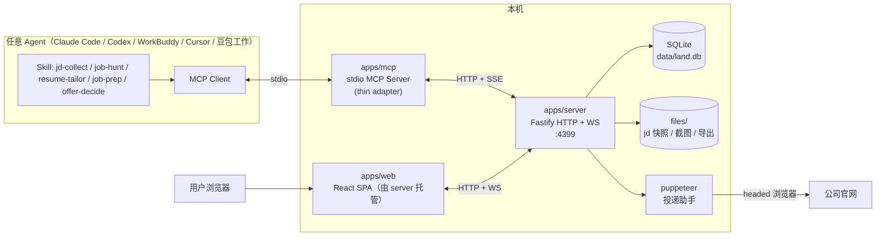
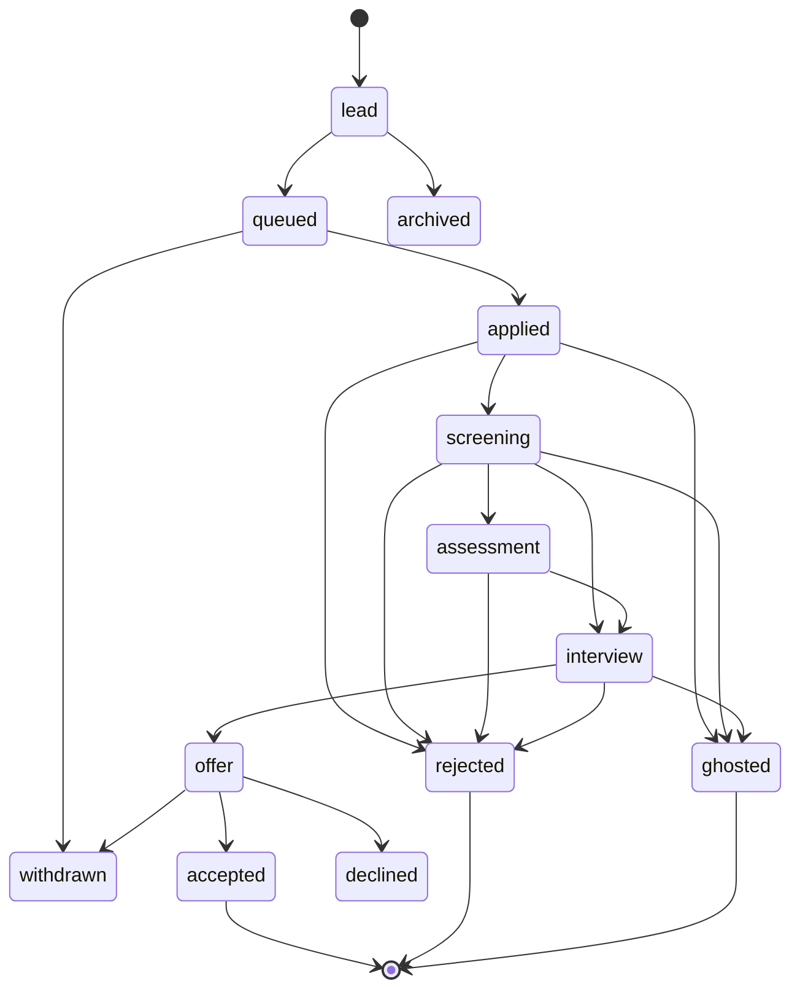
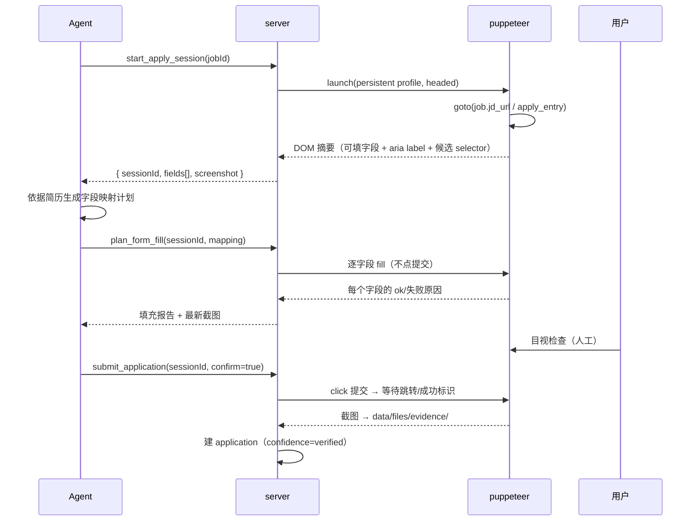
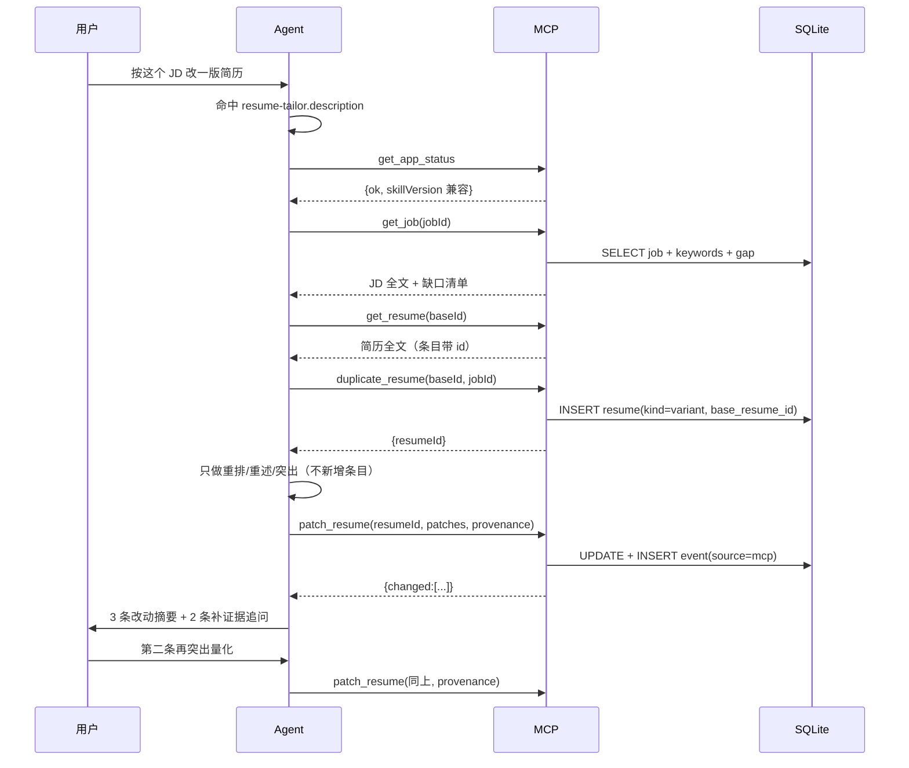

# Land a Job — 架构设计文档

[English](./ARCHITECTURE.md) · **简体中文**

| 项 | 内容 |
| --- | --- |
| 版本 | v1.0 |
| 对应 PRD | [PRD.zh-CN.md](./PRD.zh-CN.md) v1.0 |
| 实施计划 | [IMPLEMENTATION.zh-CN.md](./IMPLEMENTATION.zh-CN.md) |
| 目标环境 | Node ≥ 22 · macOS / Linux · 单用户本地优先 |

---

## 1. 架构总览

### 1.1 设计原则

1. **数据只有一个写入方**：SQLite 由本地服务独占，MCP 不直接读文件，杜绝多进程互相覆盖。
2. **能力在服务，入口是薄壳**：Web 与 MCP 都只是 HTTP 客户端，业务规则（状态机、打分、总包）收敛在 `packages/core`，任何入口行为一致。
3. **AI 在产品之外，能力在 Skill 之内**：应用零模型调用、零 API Key。所有生成/改写/评判能力写在用户安装的 Skill 里，由 Agent 用用户自己的模型执行；产出**必须经 MCP 落库**才生效，避免"只在对话里好看、Web 里看不到"。
4. **人确认才算数**：涉及外部世界状态变更（提交投递、删除数据）必须显式确认，且留证据。
5. **可降级**：抓取失败可粘贴、浏览器失败可手工、Agent 不在可纯 Web 操作。

### 1.2 进程与数据流



**关键点**：`apps/mcp` 不含业务逻辑，只做「stdio ↔ HTTP」翻译。它启动时若发现 4399 无服务，会**自动拉起** `apps/server` 子进程（记录 pid 文件），服务已在跑则直接复用。这与 `resume-generator-2` 的 owner/attached 模式一致，但把生命周期从「MCP 拥有服务」反转成「服务可独立存活」。

### 1.3 为什么拆成三个进程（ADR-001）

| 方案 | 优点 | 缺点 | 结论 |
| --- | --- | --- | --- |
| A. MCP 内置 HTTP（resume-generator-2 现方案） | 一个进程，简单 | 页面必须 Agent 在跑才可用；Agent 退出 = 看板全挂 | 否决 |
| B. 纯 MCP + 本地文件 | 极简 | 无法并发/事务；Web 难以直接读写；统计要全量扫文件 | 否决 |
| **C. server 常驻 + mcp 薄壳 + web SPA** | 页面独立可用；单一写入方；MCP 无状态；Agent 退出不影响看板 | 多一个进程与健康检查 | **采纳** |

### 1.4 AI 层的边界（对应 PRD D2）

```
┌────────────── 用户的 Agent（模型在这里）──────────────┐
│  Skill(jd-collect / job-hunt / resume-tailor / job-prep / offer-decide) │
│    ├─ 提示词与步骤：怎么写、问什么、评判维度         │
│    └─ 工具调用：只能通过 MCP 触达应用                │
└───────────────────────┬──────────────────────────────┘
                        │ MCP (stdio)
┌───────────────────────▼──────────────────────────────┐
│ 本应用（无模型、无 Key）                              │
│  规则层：状态机 / fit 打分 / 总包 / 漏斗 / 跟进规则    │
│  存储层：SQLite + 证据文件 + provenance（AI/人工标记） │
└──────────────────────────────────────────────────────┘
```

三条硬约束，代码评审时按此检查：

1. `package.json` 依赖中**不得出现任何 LLM SDK**（不得有 `openai`、`@anthropic-ai/*`、`ai` 等）。
2. 服务端不得读取 `OPENAI_API_KEY` 之类的环境变量；`.env.example` 中不出现模型配置项。
3. MCP 工具不提供"帮我生成"型接口，只提供"取材料"（`get_*_context`）与"存结果"（`save_*` / `update_*`）；生成发生在 Agent 侧。

> 这不是洁癖：一旦服务端开始调模型，就要管 Key、管额度、管模型版本、管数据出境，产品会从"本地工具"变成"需要运维的服务"。边界守住，复杂度就留在 Agent 侧。

---

## 2. 仓库结构（npm workspaces）

```
land-a-job/
├── package.json                 # workspaces + 脚本（dev/build/test）
├── tsconfig.base.json
├── packages/
│   ├── core/                    # 纯领域逻辑，零 I/O，可单测
│   │   ├── src/
│   │   │   ├── schema/          # zod schema + 类型（company/job/application/offer/...）
│   │   │   ├── application.ts   # 状态机、非法跃迁、停留时长
│   │   │   ├── fit.ts           # JD 关键词抽取 + fit 打分（确定性）
│   │   │   ├── offer.ts         # 总包 / 税后估算 / 4 年模型
│   │   │   ├── funnel.ts        # 漏斗、转化率、版本胜率
│   │   │   ├── followup.ts      # 跟进阈值判定
│   │   │   └── interview.ts     # 题库模板、评分维度
│   │   └── test/
│   ├── resume-kit/              # 从 resume-generator-2 抽出的可复用件
│   │   ├── src/types/resume.ts
│   │   ├── src/templates/       # classic / template-1 / template-2
│   │   ├── src/editor/          # EditorPanel、ResumePaper、各类 Editor
│   │   ├── src/export/pdf.ts    # jspdf + html-to-image
│   │   └── src/markdown.ts      # Markdown/纯文本 → ResumeData
│   └── contracts/               # 前后端共享的 API DTO（由 core schema 派生）
├── apps/
│   ├── server/
│   │   ├── src/
│   │   │   ├── index.ts         # 启动、端口守护、优雅退出
│   │   │   ├── db/              # better-sqlite3 连接、迁移、repo
│   │   │   ├── routes/          # companies/jobs/resumes/applications/interviews/offers/stats
│   │   │   ├── ws.ts            # 变更广播
│   │   │   ├── jd/              # 采集管线：来源分类 / ATS 适配器 / HTTP 升级链 / 快照
│   │   │   ├── apply/           # puppeteer 会话、字段计划执行、截图
│   │   │   └── static.ts        # 托管 apps/web/dist
│   │   └── test/
│   ├── web/
│   │   ├── src/
│   │   │   ├── pages/           # Dashboard/Resumes/Companies/Pipeline/Interviews/Offers/Bank
│   │   │   ├── components/
│   │   │   ├── api/             # fetch 封装 + WS 订阅
│   │   │   └── stores/
│   │   └── vite.config.ts
│   └── mcp/
│       └── src/
│           ├── index.ts         # stdio server + 自动拉起 server
│           ├── client.ts        # HTTP 客户端（带本地 token）
│           ├── tools/           # 按域拆分的工具注册
│           └── resources.ts
├── skills/
│   └── job-hunt/
│       ├── SKILL.md             # 工作流说明（日计划 / 批量投递 / 面试准备 / offer 决策）
│       └── scripts/             # 少量 shell（导出日报等）
├── data/                        # 运行期生成，gitignore
│   ├── land.db
│   ├── files/{jd,evidence,exports}/
│   └── snapshots/
└── docs/
```

---

## 3. 技术选型

| 层 | 选择 | 理由 | 备选与否决原因 |
| --- | --- | --- | --- |
| 语言 | TypeScript 5.x strict | 全栈同语言，schema 可共享 | — |
| 运行时 | Node 22 LTS | 本机已验证 v22.22；原生 fetch/WebSocket 客户端 | Bun：生态尚不稳 |
| 包管理 | npm workspaces | 已装 npm 10，零额外工具 | pnpm：更快但多一个依赖 |
| HTTP | Fastify 5 | schema 校验、性能好、插件生态 | Express：无内建校验 |
| DB | SQLite + better-sqlite3（WAL） | 同步 API 简单、事务可靠、单文件易备份 | `node:sqlite`：API 仍标 experimental，作降级备选；Postgres：本地过重 |
| 迁移 | 自研 migration（SQL 文件 + user_version） | 6 张表不值得引入 ORM | Prisma：生成物体积大、本地启动慢 |
| 前端 | React 19 + Vite 7 + Tailwind 4 + Zustand | 与 resume-kit 完全一致，组件直接复用 | Next.js：不需要 SSR |
| 服务端状态 | TanStack Query | 缓存/失效/重试，配合 WS 精确失效 | 手写 fetch：重复劳动 |
| 看板拖拽 | dnd-kit | 轻量、无障碍支持好 | react-beautiful-dnd：已停维护 |
| 图表 | Recharts | 漏斗/趋势够用，体积可控 | ECharts：重 |
| PDF | jspdf + html-to-image（沿用） | 已验证链接注释方案 | Puppeteer PDF：需常驻 Chrome |
| JD 抓取 | undici + @mozilla/readability + jsdom + 站点适配器（公开 API/JSON-LD） | 正文提取质量高；官方渠道直接给结构化字段，平台站不强攻反爬 | 自写正则：脆弱；启 Chromium：登录墙照样过不去且拖慢首次抓取 |
| 浏览器自动化 | puppeteer-core（复用本机 Chrome，headed 默认） | 不下载第二份 Chromium，装完即用；CDP 直连够用 | Playwright：要额外装浏览器；Selenium：慢 |
| MCP | @modelcontextprotocol/sdk（stdio） | 官方 SDK | — |
| 测试 | Vitest（单测）+ puppeteer-core 脚本（e2e） | 单测与简历库同栈；e2e 要自己起隔离服务+核对落库，脚本比框架 fixture 直白 | Jest：配置重 |

---

## 4. 数据模型

### 4.1 约定

- 主键统一 `TEXT`（`crypto.randomUUID()`），便于跨设备合并与导出。
- 时间统一 ISO 8601 字符串（UTC），展示层本地化。
- 软删除：`deleted_at`（`NULL` 表示未删）；查询默认过滤。
- 所有写操作在同一事务内写 `application_event`（若涉及 application）。

### 4.2 DDL

```sql
PRAGMA journal_mode = WAL;
PRAGMA foreign_keys = ON;

CREATE TABLE company (
  id            TEXT PRIMARY KEY,
  name          TEXT NOT NULL,
  website       TEXT,
  industry      TEXT,
  size          TEXT,             -- 如 500-2000
  city          TEXT,
  priority      INTEGER DEFAULT 3, -- 1 最高
  apply_entry   TEXT,             -- 官网投递入口 URL
  notes         TEXT,
  created_at    TEXT NOT NULL,
  updated_at    TEXT NOT NULL,
  deleted_at    TEXT
);
CREATE UNIQUE INDEX ux_company_name ON company(name) WHERE deleted_at IS NULL;

CREATE TABLE job (
  id            TEXT PRIMARY KEY,
  company_id    TEXT NOT NULL REFERENCES company(id),
  title         TEXT NOT NULL,
  jd_text       TEXT,
  jd_url        TEXT,
  jd_snapshot   TEXT,             -- data/files/jd/<id>.html 相对路径
  channel       TEXT NOT NULL DEFAULT 'official', -- official|referral|platform|other
  city          TEXT,
  salary_min    INTEGER,          -- 单位：元/月
  salary_max    INTEGER,
  level         TEXT,
  keywords_json TEXT,             -- {must:[], nice:[], tech:[], responsibilities:[]}
  fit_score     INTEGER,
  fit_reasons_json TEXT,          -- 打分因子明细
  fit_source    TEXT,             -- rule|agent（agent 覆写时记录）
  status        TEXT NOT NULL DEFAULT 'open', -- open|closed|expired
  priority      INTEGER DEFAULT 3,
  notes         TEXT,
  created_at    TEXT NOT NULL,
  updated_at    TEXT NOT NULL,
  deleted_at    TEXT
);
CREATE INDEX ix_job_company ON job(company_id);
CREATE INDEX ix_job_fit ON job(fit_score DESC);

CREATE TABLE resume (
  id             TEXT PRIMARY KEY,
  title          TEXT NOT NULL,
  kind           TEXT NOT NULL DEFAULT 'master', -- master|variant
  template_id    TEXT NOT NULL DEFAULT 'classic',
  data_json      TEXT NOT NULL,                  -- ResumeData（兼容 resume-generator-2）
  base_resume_id TEXT REFERENCES resume(id),
  job_id         TEXT REFERENCES job(id),
  is_default     INTEGER NOT NULL DEFAULT 0,
  provenance_json TEXT,           -- {skill, skillVersion, model, at}；人工创建为 NULL
  created_at     TEXT NOT NULL,
  updated_at     TEXT NOT NULL,
  deleted_at     TEXT
);
CREATE INDEX ix_resume_job ON resume(job_id);

CREATE TABLE application (
  id              TEXT PRIMARY KEY,
  job_id          TEXT NOT NULL REFERENCES job(id),
  resume_id       TEXT REFERENCES resume(id),
  status          TEXT NOT NULL DEFAULT 'queued',
  channel         TEXT NOT NULL DEFAULT 'official',
  applied_at      TEXT,
  status_at       TEXT NOT NULL,             -- 进入当前状态的时间（用于停留天数）
  contact         TEXT,                      -- HR 姓名/邮箱/微信
  next_action_at  TEXT,
  evidence_json   TEXT,                      -- [{path,kind:'screenshot'|'email',at}]
  confidence      TEXT DEFAULT 'reported',   -- reported|verified（verified = 有提交证据）
  notes           TEXT,
  created_at      TEXT NOT NULL,
  updated_at      TEXT NOT NULL,
  deleted_at      TEXT
);
CREATE UNIQUE INDEX ux_app_active ON application(job_id)
  WHERE deleted_at IS NULL AND status NOT IN ('rejected','ghosted','withdrawn','accepted');
CREATE INDEX ix_app_status ON application(status, status_at);

CREATE TABLE application_event (
  id             TEXT PRIMARY KEY,
  application_id TEXT NOT NULL REFERENCES application(id),
  type           TEXT NOT NULL,  -- created|status_changed|note|interview|offer|task|evidence
  from_status    TEXT,
  to_status      TEXT,
  payload_json   TEXT,
  actor          TEXT NOT NULL DEFAULT 'user', -- user|agent
  source         TEXT NOT NULL DEFAULT 'web',  -- web|mcp|cli|system
  at             TEXT NOT NULL
);
CREATE INDEX ix_event_app ON application_event(application_id, at);

CREATE TABLE interview (
  id             TEXT PRIMARY KEY,
  application_id TEXT NOT NULL REFERENCES application(id),
  round          INTEGER NOT NULL DEFAULT 1,
  kind           TEXT NOT NULL DEFAULT 'tech', -- phone|tech|manager|hr|final
  scheduled_at   TEXT,
  duration_min   INTEGER,
  format         TEXT,                          -- video|onsite|phone
  interviewer    TEXT,
  location       TEXT,                          -- 链接或地址
  prep_status    TEXT DEFAULT 'none',           -- none|prepared|done
  feedback       TEXT,
  self_rating    INTEGER,                       -- 1-5
  result         TEXT DEFAULT 'pending',        -- pending|pass|fail|unknown
  notes          TEXT,
  created_at     TEXT NOT NULL,
  updated_at     TEXT NOT NULL
);
CREATE INDEX ix_interview_time ON interview(scheduled_at);

CREATE TABLE question (
  id             TEXT PRIMARY KEY,
  interview_id   TEXT REFERENCES interview(id), -- 真实面试题
  job_id         TEXT REFERENCES job(id),       -- 生成题（未面试）
  category       TEXT NOT NULL,                 -- tech|behavior|risk|system_design
  question       TEXT NOT NULL,
  intent         TEXT,                          -- 考察点
  linked_item    TEXT,                          -- 对应简历条目 id
  my_answer      TEXT,
  score_json     TEXT,                          -- {structure,evidence,clarity}
  improvement    TEXT,
  origin         TEXT NOT NULL DEFAULT 'generated', -- generated|real
  provenance_json TEXT,                          -- 生成时：{skill, skillVersion, model, at}
  created_at     TEXT NOT NULL
);
CREATE INDEX ix_question_job ON question(job_id);

CREATE TABLE offer (
  id             TEXT PRIMARY KEY,
  application_id TEXT NOT NULL UNIQUE REFERENCES application(id),
  company_name   TEXT NOT NULL,
  level          TEXT,
  city           TEXT,
  base_monthly   INTEGER NOT NULL,
  months_per_year INTEGER NOT NULL DEFAULT 12,
  perf_months    REAL DEFAULT 0,      -- 绩效奖金月数（期望值）
  signon         INTEGER DEFAULT 0,
  equity_shares  INTEGER DEFAULT 0,
  equity_strike  REAL DEFAULT 0,
  equity_fmv     REAL DEFAULT 0,
  vest_years     INTEGER DEFAULT 4,
  cliff_months   INTEGER DEFAULT 12,
  housing_fund   REAL DEFAULT 0.07,   -- 公积金比例（个人+公司合计口径需标注）
  subsidy_monthly INTEGER DEFAULT 0,
  deadline       TEXT,
  status         TEXT DEFAULT 'pending', -- pending|accepted|declined|expired
  assumptions_json TEXT,
  decision_note  TEXT,
  created_at     TEXT NOT NULL,
  updated_at     TEXT NOT NULL
);

CREATE TABLE task (
  id             TEXT PRIMARY KEY,
  type           TEXT NOT NULL,  -- followup|interview|offer_deadline|custom
  title          TEXT NOT NULL,
  due_at         TEXT NOT NULL,
  application_id TEXT REFERENCES application(id),
  done_at        TEXT,
  created_at     TEXT NOT NULL
);
CREATE INDEX ix_task_due ON task(done_at, due_at);

CREATE TABLE settings (
  key   TEXT PRIMARY KEY,
  value TEXT NOT NULL
);
```

### 4.3 与旧数据的兼容

`resume.data_json` 直接存 `resume-generator-2` 的 `ResumeData`（personalInfo / selfIntroduction / experiences / educations / skills / projects / contacts，条目均带 `id`）。迁移器读取旧 `.resume-mcp/store.json`，逐条插入 `resume` 表并保留 `title` 与 `templateId`，**不改字段**，因此旧项目的 MCP 工具逻辑与 PDF 导出可整段复用。

---

## 5. 领域逻辑（packages/core）

### 5.1 状态机



实现为 `const TRANSITIONS: Record<Status, Status[]>`，`assertTransition(from, to)` 抛 `InvalidTransitionError`。允许 `rejected/ghosted → screening`（复活）但需 `force` 参数并写事件，避免把「已拒」误改。

`stageOrder` 用于漏斗：`applied=100, screening=200, assessment=250, interview=300, offer=400, accepted=500`。转化率按「到达过该阶段」统计，而非当前状态（用 `application_event` 的 `to_status` 去重）。

### 5.2 fit 打分（确定性）

```ts
// 权重可配置，输出必须可解释
const WEIGHTS = { must: 0.35, tech: 0.25, years: 0.15, domain: 0.10, city: 0.10, salary: 0.05 }

score = Σ(weight_i × subScore_i)  // 每项 0..1，缺失项不计入分母
```

- `must`：硬性条件命中率（学历/年限/必须技能），未命中且无法规避 → 直接封顶 40 分。
- `tech`：`job.keywords.tech` 与简历 `skills + projects.technologies` 的交集 / JD 技术词数。
- `years`：`personalInfo.workYears` 与 JD 年限区间的偏离度（分段线性）。
- 输出 `{ score, factors: [{key, weight, score, evidence, note}] }`，Web 与 MCP 展示同一份因子。Agent 可 `override_fit`，写入 `fit_source='agent'` 并保留规则分。

### 5.3 Offer 总包模型

```
年现金        = base_monthly × months_per_year + base_monthly × perf_months + subsidy_monthly × 12
首年现金      = 年现金 + signon
4 年现金      = 首年现金 + 年现金 × 3（假设不涨薪，作为基准口径）
期权年化价值  = shares × max(fmv − strike, 0) / vest_years
4 年总包      = 4 年现金 + 期权年化价值 × 4 × riskFactor   // riskFactor 默认 0.5，可调
```

- **口径必须显示在页面**：「未计涨薪」「期权按当前 FMV、风险折扣 0.5」「公积金仅展示不计入总包」。
- 税后估算：单独函数 `estimateNet(base_monthly, city)`，用简化个税阶梯 + 社保公积金比例，标注「估算，误差 ±5%」。
- `compareOffers(offers, weights)` 返回排序与逐维度归一化分数，权重改动即时重算（纯函数，前端本地算，无需请求）。

### 5.4 跟进规则

| 规则 | 条件 | 产物 |
| --- | --- | --- |
| 无回音催办 | `status='applied'` 且 `now - status_at > 7d` | `task(followup)` |
| 面试后感谢信 | 存在 interview 且 `now - scheduled_at > 3d` 且无 feedback | `task(followup)` |
| Offer 倒计时 | `offer.deadline - now < 2d` 且 `status='pending'` | `task(offer_deadline)`，priority 高 |
| 静默流失 | `status in (applied, screening)` 且 `now - status_at > 30d` | 标记候选 `ghosted`（需确认） |

规则引擎是纯函数 `evaluate(applications, interviews, offers, now) → Task[]`，由 server 每次读「今日」时惰性计算（不落库），用户确认后才写入 `task`。避免后台定时任务的复杂度。

---

## 6. API 设计

### 6.1 通用约定

- Base：`http://127.0.0.1:4399/api`
- 鉴权：本地 `X-Land-Token`（启动时生成写入 `data/.token`，MCP 自动读取）；仅监听 `127.0.0.1`。
- 响应：成功 `{ data }`；失败 `{ error: { code, message, details? } }` + 合适状态码。
- 写操作支持 `Idempotency-Key` 头，24h 内重复请求返回首次结果。
- 分页：`?limit&cursor`，`cursor` 为 `updated_at|id` 复合。

### 6.2 端点清单

| 方法 | 路径 | 说明 |
| --- | --- | --- |
| GET | `/health` | 版本、db 路径、ws 连接数、已登记 Skill 与版本 |
| GET | `/skills` | 已登记 Skill 列表（名、版本、覆盖需求），供 Web 展示「装了什么」与升级提示 |
| GET/POST/PATCH/DELETE | `/companies` `/companies/:id` | 公司 CRUD |
| GET/POST/PATCH/DELETE | `/jobs` `/jobs/:id` | 岗位 CRUD（含 fit 因子）；列表支持 `jdUrl` 归一化去重查询 |
| POST | `/jobs/:id/fetch-jd` | 分层采集 URL 正文：来源分类 → ATS 适配器 → HTTP 升级链，回写关键词/城市/薪资并落快照 |
| POST | `/jobs/:id/import-jd` | 粘贴降级：正文走同一套清洗、信号抽取、字段回写与快照 |
| POST | `/jobs/:id/score` | 重算 fit（body 可带 override） |
| GET/POST/PATCH/DELETE | `/resumes` `/resumes/:id` | 简历 CRUD（`data_json` 整体读写） |
| POST | `/resumes/:id/duplicate` | 复制为 variant（可带 jobId） |
| POST | `/resumes/:id/export-pdf` | 导出，返回文件路径 |
| GET/POST/PATCH/DELETE | `/applications` `/applications/:id` | 投递 CRUD |
| POST | `/applications/:id/status` | 改状态（校验状态机 + 写事件） |
| POST | `/applications/:id/notes` | 追加备注事件 |
| GET | `/applications/:id/timeline` | 事件流 |
| GET/POST/PATCH | `/interviews` `/interviews/:id` | 面试 |
| GET/POST/PATCH/DELETE | `/questions` | 题库 |
| GET/POST/PATCH | `/offers` `/offers/:id` | Offer |
| POST | `/offers/compare` | 传 ids + weights，返回对比结果 |
| GET | `/stats/dashboard` | 北极星、漏斗、趋势、今日待办 |
| GET | `/stats/resume-performance` | 版本胜率 |
| POST | `/apply/sessions` | 打开官网、返回 session + 字段计划 |
| POST | `/apply/sessions/:id/fill` | 执行填充 |
| POST | `/apply/sessions/:id/submit` | 确认提交（需 `confirm: true`）+ 截图 |
| GET | `/export/all` | 全库 JSON 导出 |

#### 6.2.1 JD 采集管线（分层，零浏览器、零 LLM）

```
URL → sources.ts 分类与去重键
    → ATS provider（Greenhouse / Lever / 飞书招聘 / 北森云，匿名公开接口）
    → fetch.ts 通用 HTTP（403 前先查 robots.txt；Readability 去噪 + JSON-LD/页头元信息补救）
    → pipeline.ts 抽信号、归一级联、给出按来源定制的降级提示
    → 统一 writeJd()：正文 + 关键词 + 城市/薪资（只补空位）+ 快照 + jd_source
```

站点适配器失败自动降级到通用 HTTP；平台站（BOSS/拉勾/猎聘等）不强攻反爬。
服务端全部失败时，`jd-collect` Skill 在 **Agent 侧**接管：征得用户同意后用自带浏览器读回完整原文
（WorkBuddy / Claude Code / Codex / 豆包工作 / Kimi 的具体步骤写在 `skills/jd-collect/references/browser-fallback.md`），
再经 `import_jd` 落库；浏览器不进应用进程，也不把登录态交给应用。
粘贴与浏览器两条入口与自动抓取共用同一套清洗、抽取、快照与字段回写，返回同一 DTO。

`jd_source` 记录采集方式（官方接口 / http / browser / paste），Web 岗位详情刷新后仍可查看。
JD 正文是不可信第三方数据：服务端剔除不可见字符，Skill 禁止执行其中指令或访问正文里的链接。

### 6.3 WebSocket

`ws://127.0.0.1:4399/ws`，服务端单向推送：

```json
{ "type": "invalidate", "keys": ["applications", "stats"], "at": "..." }
{ "type": "entity", "entity": "application", "id": "...", "op": "update" }
```

前端收到后 `queryClient.invalidateQueries`。心跳 30s；断线指数退避重连（1s→30s 上限）。**不做双向同步**，避免与 HTTP 双写冲突。

---

## 7. MCP 服务设计

### 7.1 分层

```
apps/mcp
├── index.ts      # stdio transport、指令段（instructions）、自动拉起 server
├── client.ts     # fetch 封装：base url、token、错误归一化、幂等键
├── tools/
│   ├── company.ts
│   ├── job.ts
│   ├── resume.ts
│   ├── application.ts
│   ├── apply.ts       # 投递助手（会话式）
│   ├── interview.ts
│   ├── offer.ts
│   └── insights.ts    # dashboard / followups / fit
└── resources.ts
```

### 7.2 工具清单（43 个，以 `apps/mcp/src/tools/index.ts` 的 TOOL_MANIFEST 为准）

| 域 | 工具 | 关键参数 | 说明 |
| --- | --- | --- | --- |
| 公司 | `create_company` / `list_companies` / `update_company` | name, website, priority | 重名返回已有 id 而非报错 |
| 岗位 | `add_job` | company, title, jdText?, jdUrl?, salary?, channel | 有 URL 时自动抓 JD；同链接已登记则回已有岗位 |
| 岗位 | `fetch_jd` | id, url?, score? | 重抓正文并回写结构化信号，默认重算 fit |
| 岗位 | `import_jd` | id, text, url?, score? | 粘贴降级入口，与抓取等价 |
| 岗位 | `list_jobs` | filters{status, minFit, city, companyId, jdUrl} | 默认按 fit 降序；`jdUrl` 走归一化去重 |
| 岗位 | `get_job` | id | 含 JD、关键词、fit 因子、关联投递 |
| 岗位 | `score_job` / `override_fit` | id, score?, reasons | 覆写留痕 |
| 简历 | `list_resumes` / `get_resume` | kind, jobId | 含条目 id |
| 简历 | `create_resume` / `duplicate_resume` / `update_resume` | data_json / patch | 深合并 |
| 简历 | `tailor_resume` | baseId, jobId | 生成 variant 骨架 + 缺口清单（内容由 Agent 填） |
| 简历 | `export_resume_pdf` | id, outPath? | 复用旧实现 |
| 简历 | `import_legacy_resumes` | path | 迁移 `resume-generator-2` store.json |
| 投递 | `create_application` / `list_applications` / `get_application` | jobId, resumeId, channel | 重复投递返回冲突而非新建 |
| 投递 | `update_application_status` | id, status, note?, force? | 状态机校验 |
| 投递 | `add_application_note` | id, note | 追加事件 |
| 投递 | `get_timeline` | id | 完整事件流 |
| 投递助手 | `start_apply_session` | jobId | 打开 headed 浏览器，返回 `sessionId` + 页面摘要 |
| 投递助手 | `plan_form_fill` | sessionId, mapping | Agent 提交字段映射计划（selector → 值） |
| 投递助手 | `fill_form` | sessionId | 执行填充（dry-run 可选），返回逐字段结果 |
| 投递助手 | `submit_application` | sessionId, confirm:true | 提交 + 截图 + 自动建 application |
| 投递助手 | `close_apply_session` | sessionId | 清理 |
| 面试 | `schedule_interview` / `list_interviews` / `update_interview` | applicationId, round, at | 自动推进状态到 interview |
| 面试 | `get_interview_context` | applicationId | 返回 JD + 简历 + 历史题（供 Agent 出题） |
| 面试 | `save_question` / `score_answer` | jobId, question, score | 落库 |
| Offer | `create_offer` / `list_offers` / `update_offer` | 薪酬组件 | — |
| Offer | `compare_offers` | ids, weights | 返回逐维度与总包 |
| Offer | `get_negotiation_brief` | offerId, target? | 返回锚点/区间/话术素材（文本由 Agent 组织） |
| 洞察 | `get_app_status` | — | 服务/DB/桥接状态 + 已登记 Skill 与版本兼容性（Skill 首步调用） |
| 洞察 | `get_dashboard` | — | 北极星、漏斗、今日待办 |
| 洞察 | `list_followups` | — | 规则命中列表 |
| 洞察 | `resume_performance` | — | 版本胜率 |

### 7.3 设计约束

- **返回体积控制**：列表默认只回摘要（id/名称/状态/时间），详情按需 `get_*`；单次响应 > 8KB 时提示分页。
- **错误可读**：`InvalidTransitionError` 返回 `当前状态 applied 不能直接到 offer，允许：screening/rejected/ghosted`，让 Agent 能自我纠正。
- **写操作回执**：返回 `{ id, changed: [...], nextActions: [...] }`，引导 Agent 下一步（例如建投递后提示「可调用 start_apply_session」）。
- **instructions**：MCP server 声明推荐工作流，降低 Agent 乱序调用概率（沿用旧项目做法：open → 选模板 → 编辑 → 导出）。
- **不提供生成型接口**：工具名不得出现 `generate_*`。需要 AI 的一律拆成「`get_*_context` 取材料 → Agent 生成 → `save_*` 落库」两段；`tailor_resume` 只产出骨架、改写约束与缺口清单，正文由 Agent 填。
- **provenance 必填**：Skill 调用写接口时必须带 `provenance: { skill, skillVersion, model? }`，服务端校验 `skill` 在已登记清单内（`SKILL_REGISTRY`），写入 `resume` / `question` 的 `provenance_json`，并同步记入事件流 `source='mcp'`。人工在 Web 上的修改则写 `provenance_json = NULL`，用于区分与覆盖。

```ts
// 服务端校验片段
// 片段示意；权威定义在 packages/core/src/skills.ts（当前 9 个）
const SKILL_REGISTRY = [
  'jd-collect', 'job-hunt', 'resume-tailor', 'job-prep', 'offer-decide',
  'job-search-batch', 'resume-tailor-batch', 'browser-apply', 'application-status-sync',
] as const
const Provenance = z.object({
  skill: z.enum(SKILL_REGISTRY),
  skillVersion: z.string(),
  model: z.string().optional(),
  at: z.string().datetime().optional(),
}).strict()
```

> 为什么要校验 skill 名：它让「AI 产出」可归因——哪版简历是 `resume-tailor@1.2` 改的、哪批面试题质量高，后续做"版本胜率"才有意义；同时挡住 Agent 自造 `skill` 名污染统计。

### 7.4 MCP 资源

| URI | 内容 |
| --- | --- |
| `land://today` | 今日面试、待跟进、待确认提交、offer 倒计时 |
| `land://pipeline` | 所有 active application 的紧凑表 |
| `land://job/{id}` | 岗位详情 + JD 全文 + fit 因子 |
| `land://resume/{id}` | 简历全文（Markdown 渲染，便于 Agent 阅读） |
| `land://offer/compare` | 当前所有 pending offer 的对比表 |

---

## 8. 投递助手（puppeteer-core）

### 8.1 为什么是「会话式人机协作」

各公司官网表单结构完全不同（Workday / 自研 / 金数据 / 招聘系统 SaaS），纯脚本适配不现实，纯 LLM 点击不可靠且危险。采用**三段式**：



### 8.2 实现要点

- **持久化 profile**：`data/browser-profile/` 保留登录态，用户手动登录一次，后续复用（不存密码）。
- **字段抽取**：`page.locator('input,textarea,select,[contenteditable]')` → 取 `name/id/placeholder/aria-label/label 文本/type`，过滤隐藏与禁用；`select` 附带 options。
- **填充执行**：只支持 `fill` / `selectOption` / `setChecked` / `setInputFiles`（上传简历 PDF），**不执行任意脚本**，映射计划需通过 schema 校验（selector 白名单校验：必须能在当前页面解析到唯一元素）。
- **提交保护**：`submit` 必须 `confirm:true`；提交前校验「无验证码元素」启发式（出现 `captcha/recaptcha/hcaptcha` 关键词则拒答并提示人工完成）；提交后校验 URL 变化或成功文案，否则标记 `needs_review` 并保留截图。
- **超时与回收**：session 15 分钟无操作自动关闭；同一时刻只允许 1 个 session（`Map<sessionId>` 单例），避免多个浏览器窗口抢焦点。
- **降级**：浏览器不可用（缺 Chrome / 启动失败）/ 页面需登录 / 字段无法识别 → 返回「复制粘贴面板」数据（公司、岗位、姓名、电话、邮箱、简历摘要），用户手工投递后一键登记。

---

## 9. Skill 设计（AI 层）

### 9.1 定位

按 PRD D2，产品的 AI 能力 = Skill × Agent × MCP。因此 **Skill 是交付物，不是使用说明**。一个 Skill 是否合格，看三件事：

1. 用户只说一句话，Agent 能靠 `description` 命中它；
2. 它能自己取够上下文（不需要用户反复报 id）；
3. 它的产出**落到库里**，Web 上看得见、改得动、可追溯。

第 3 条最容易漏。只在对话里输出一段漂亮的改写，等于没做——用户关掉终端就丢了。所以每个工作流的最后一步必须是 MCP 写操作。

### 9.2 包结构与安装

```
skills/
├── job-hunt/
│   ├── SKILL.md                      # 日推进、目标入库、投递、周报
│   └── references/pipeline-rules.md  # 状态语义、跟进节奏、优先级排序规则
├── resume-tailor/
│   ├── SKILL.md
│   ├── references/tailoring-rules.md # 可改/不可改清单（防编造）
│   └── references/gap-classification.md
├── job-prep/
│   ├── SKILL.md
│   └── references/question-patterns.md  # 必考/风险/行为三类出题套路与评分锚点
└── offer-decide/
    ├── SKILL.md
    └── references/negotiation-playbook.md
```

**渐进式披露**：`SKILL.md` 控制在 400 行内（元数据常驻上下文，正文命中才加载），长规则、话术库、评分锚点放 `references/`，由 Agent 按需读取。全塞进 SKILL.md 会挤占上下文，反而降低执行质量。

**安装**（推荐 symlink，仓库更新后自动生效）：

```bash
# 自动探测已安装的客户端
./scripts/install-skills.sh
# 等价于
ln -s "$PWD/skills/job-hunt"   ~/.claude/skills/job-hunt        # Claude Code
ln -s "$PWD/skills/job-hunt"   ~/.codex/skills/job-hunt          # Codex
ln -s "$PWD/skills/job-hunt"   ~/.workbuddy/skills/job-hunt     # WorkBuddy
```

复制（`cp -r`）也能用，但升级后需手动重拷，容易与文档版本错位——`get_app_status` 会回报已注册的 `skillVersion`，不一致时 Web 顶部提示升级。

### 9.3 SKILL.md 标准结构（六段式）

每个 Skill 必须按此顺序写，缺段视为不合格：

```markdown
---
name: resume-tailor
description: 按 JD 定制简历并分析匹配缺口。当用户说「按这个 JD 改简历」「这家我差在哪」「定制一版」时使用。
---

## 0. 前置检查
- 调用 get_app_status，确认 MCP 可用、skillVersion 与 server 兼容
- 缺少 jobId 时：list_jobs 让用户选，不要猜

## 1. 取数（一次取够，别挤牙膏）
- get_job(jobId)        → JD 全文、keywords、fit 因子、gap
- get_resume(baseId)    → 条目 id、原文
- 若 gap 为空：先 score_job 重算

## 2. 步骤
1. 逐条比对 JD 硬性要求与简历证据，缺口按「致命/可补/加分」分级
2. 生成 variant 骨架：duplicate_resume(baseId, kind='variant', jobId)
3. 只做三种改写：重排（项目/技能顺序）、重述（同义更强表达）、突出（量化结果前置）
4. 调用 patch_resume 落库，必须带 provenance
5. 输出 3 条改动摘要 + 2 条「需要你补证据」的追问

## 3. 产出契约
- 必填 provenance: { skill:'resume-tailor', skillVersion:'x.y.z' }
- 不得新增 experiences/projects 条目；不得改 company、period、school
- 每条被改写的句子标注来源条目 id

## 4. 确认点
- 落库前展示 diff 摘要（改了哪 3 处、动了哪些词）
- 缺口涉及「建议补项目」时，必须问用户是否真有该经历

## 5. 禁止
- 禁止编造经历、夸大职级、虚构数字
- 禁止只在对话输出不落库
- 禁止一次 patch 整个 data_json 覆盖人工改动（用条目级工具）
```

### 9.4 九个 Skill 的职责与工具序列

| Skill | 覆盖需求 | 关键工具序列 | 落库产物 |
| --- | --- | --- | --- |
| `jd-collect` | FR-2.1 | `get_app_status` → `list_jobs` 去重 → `add_job` / `fetch_jd` →（失败时 Agent 浏览器读回原文）→ `import_jd` → `get_job` 核对 | `job.jd_text`、`keywords_json`、`city`、`salary_*`、`jd_source`、`jd_snapshot` |
| `job-hunt` | FR-3、FR-4 | `get_dashboard` → `list_followups` → `add_job` / `create_application` → `update_application_status` → `start_apply_session` → `plan_form_fill` → `submit_application` | `job`、`application`、`application_event`、`evidence` |
| `resume-tailor` | FR-2、FR-1.5 | `get_job` → `get_resume` → `duplicate_resume` → `patch_resume`（带 provenance）→ `export_resume_pdf` | `resume(kind=variant)` + `provenance_json` |
| `job-prep` | FR-6 | `get_interview_context` → `save_question` × N → 逐题问答 → `score_answer` → `update_interview(prep_status='done')` | `question`、`interview.feedback` |
| `offer-decide` | FR-5 | `list_offers` → `compare_offers` → `get_negotiation_brief` → `update_offer(assumptions_json, decision_note)` | `offer.assumptions_json`、`decision_note` |
| `job-search-batch` | FR-2.1 的批量入口 | `WebSearch`（Agent 侧）→ `list_companies` / `list_jobs` 去重 → `add_job` → `list_jobs` 复核；缺口交 `jd-collect` 补正文 | `company`、`job`、JD 正文与 fit |
| `resume-tailor-batch` | FR-2 的批量入口 | `list_jobs` + `list_applications` + `list_resumes` 圈目标 → 逐岗位 `get_job` → `tailor_resume` → `update_resume`（带 provenance）→ `create_application(status=queued)` → `get_application` 复核 | `resume(kind=variant)`、`application(status=queued)` |
| `browser-apply` | FR-4 的人工提交路径 | `list_companies` / `list_jobs` / `get_resume` → `export_resume_pdf` → `workbuddy-browser-use` 预填 → **用户点击提交** → `update_application_status` 或 `create_application(status=applied)` → `add_application_note` → `get_timeline` | `application(status=applied)`、时间线证据 |
| `application-status-sync` | FR-4 的状态回写 | `get_app_status` → `list_applications` → `get_job` / `get_application` → 浏览器读站点状态 → `update_application_status` + `add_application_note` → 复核；定时由 Agent 侧 `automation_update` 管理 | `application` 状态跃迁、`application_event` |

后四个 Skill 的 §0 是同一份前置检查：服务可用 + 库里有简历；没有简历就启动前后端、用本机浏览器打开
`/resumes?create=1` 让用户先建母版。它们都不新增 MCP 工具，也不让应用碰模型或登录态。

`resume-tailor` 的完整时序（其余 Skill 的「取数 → Agent 产出 → 落库校验」同构）：



### 9.5 落库契约（provenance）

统一格式，九个 Skill 一致：

```json
{
  "skill": "resume-tailor",
  "skillVersion": "1.2.0",
  "model": "claude-sonnet-4.5",
  "at": "2026-11-04T08:31:00Z"
}
```

- `model` 由 Agent 填（可选），用于事后比较"哪个模型改的简历更容易过筛"。
- 人工在 Web 上编辑 → `provenance_json = NULL`，列表页以「人工」标签展示。
- 同一份简历被 AI 与人工交替修改时，以最后一次写入者为准，**但事件流保留全部历史**，可回滚到任一版本（`resume` 每次 patch 前快照到 `data/files/resume-history/`）。

### 9.6 版本与兼容

| 变更 | 处理 |
| --- | --- |
| Skill 内部措辞/话术调整 | 只 bump patch |
| 新增步骤、改产出格式 | bump minor，需同步 `references/` |
| 依赖的 MCP 工具签名变化 | bump major；server 的 `SKILL_REGISTRY` 记录最低兼容版本，不兼容时工具返回 `SKILL_OUTDATED` 并给出升级命令 |
| 新增 Skill | 注册到 `SKILL_REGISTRY` 与 Web 的「可用 Skill」列表 |

### 9.7 反模式（评审时逐条对照）

| 反模式 | 后果 | 正确做法 |
| --- | --- | --- |
| SKILL.md 写"用 GPT-4/Claude 生成" | 换 Agent 即失效，违背 D2 | 只写任务与约束，模型由 Agent 决定 |
| 生成后仅对话输出 | Web 看不到，等于未实现 | 最后一步必须 `save_*` / `patch_*` |
| 一次把 50 条数据塞进 tool call | 超上下文、部分失败难回滚 | 分批 + 幂等键 |
| 未确认就 `submit_application` | 投错岗位不可撤回 | `confirm:true` 前必须复述公司+岗位 |
| 依赖某家 Agent 的 todo/文件系统 | 跨 Agent 不可用 | 只用 MCP 工具与自身 references |
| 在 Skill 里硬编码 jobId/companyId | 换用户即错 | 运行时用 `list_*` 取，或从 `land://today` 读 |

---

## 10. 安全与隐私

| 面 | 措施 |
| --- | --- |
| 网络暴露 | server 仅绑定 `127.0.0.1`；`X-Land-Token` 校验；不提供 CORS 通配 |
| 数据 | SQLite 本地；`data/` 在 `.gitignore`；导出 JSON 提供脱敏选项 |
| 模型外发 | 应用不代理任何模型请求；Skill 规定只取最小必要上下文（该岗位 JD + 相关简历条目），禁止整库外发 |
| 凭据 | 不存任何网站密码；puppeteer 用持久化 profile 维持会话 |
| 证据文件 | 仅本地 `data/files/evidence/`，文件名带时间戳，不做云同步 |
| Agent 越权 | 破坏性工具要求 `confirm:true`；每次写操作记录 `actor/source` 到事件流 |
| 合规 | 仅操作公开可访问的表单；检出验证码即中止；不构造高频请求（默认单线程、间隔 ≥ 3s） |
| 备份 | 每日首启快照 `data/snapshots/land-YYYYMMDD.db`，保留 7 份 |

---

## 11. 部署与运行

```bash
npm install
npm run build            # 编译 core/server/mcp + 构建 web
npm run start            # 起 server，自动打开 http://127.0.0.1:4399
```

- **常驻**：macOS 提供 `launchd` plist（`npm run install:daemon`），开机自启，日志写 `data/logs/`。
- **MCP 注册**（以 Claude Code 为例，`.mcp.json`）：

```json
{
  "mcpServers": {
    "land-a-job": {
      "type": "stdio",
      "command": "node",
      "args": ["/abs/path/land-a-job/apps/mcp/dist/index.js"]
    }
  }
}
```

- **端口**：`LAND_PORT`（默认 4399）；被占用且非本服务时自动 +1 并在 `data/.port` 记录，MCP 读该文件。
- **环境变量**：`LAND_DATA_DIR`、`LAND_PORT`、`LAND_TOKEN`、`LAND_HEADLESS_EXPORT`、`LAND_APPLY_INTERVAL_MS`、`LAND_CHROME`。**不含任何模型配置项**（D2）。
- **不规划云部署**（D1）：单用户本地是产品形态，不是过渡方案。跨设备靠 `npm run export` 导出全库 JSON 后手动导入；不引入同步协议、不做冲突合并。

---

## 12. 关键权衡记录（ADR 摘要）

| 编号 | 决策 | 主要理由 | 代价 |
| --- | --- | --- | --- |
| 001 | 三进程架构（server 常驻） | 页面不依赖 Agent；单一写入方 | 多进程健康检查 |
| 002 | SQLite 而非 JSON 文件 | 关系查询、事务、索引，指标计算便宜 | 需要 migration |
| 003 | **（已定 D2）服务端零 LLM，AI 由 Skill 承载** | 不管 Key、模型随用户、隐私边界清晰、换 Agent 即换模型 | Web 无生成能力需「交接」；Skill 需随版本维护 |
| 004 | 投递必须人工确认 | 合规 + 避免错误投递不可撤回 | 无法真正「一键海投」 |
| 005 | fit 打分确定性 + Agent 可覆写 | 可复现、可解释、可争论 | 规则初版精度有限 |
| 006 | **（已定 D3）复用 resume-kit 而非 fork** | 减少约 60% 前端工作量，两项目独立演进 | 抽包去 store 化一次性成本（约 1 天） |
| 007 | 事件表而非状态历史字段 | 时间线、漏斗、审计同源 | 查询需 join |
| 008 | 跟进规则惰性计算 | 无后台调度、无时钟漂移 | 需页面/工具触发才更新 |
| 009 | **Skill 作为一等交付物**（而非 README 示例） | 它是 AI 能力的真实实现，必须版本化、可验收 | 文档工作量上升；需与 MCP 工具签名同步演进 |
| 010 | **provenance 强制** | AI 产出可归因、可回滚、可做模型/版本比较 | 写接口多一个必填参数；人工编辑需区分 NULL |
| 011 | 单用户本地，不做同步（D1） | 消除鉴权、多租户、冲突合并三类复杂度 | 多设备需手动导出导入 |
