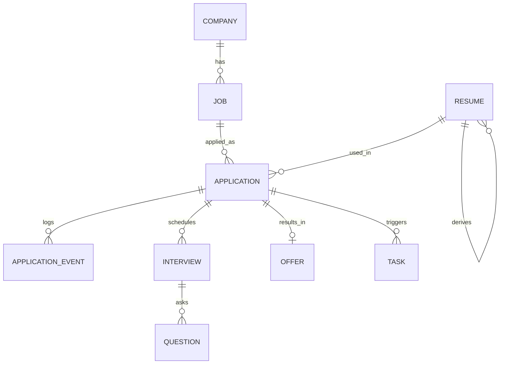

# Land a Job — Product Requirements Document (PRD)

**English** · [简体中文](./PRD.zh-CN.md)

| Item | Value |
| --- | --- |
| Product | Land a Job |
| Version | v1.0 |
| Status | In review |
| Updated | 2026-11-04 |
| Related | [ARCHITECTURE.md](./ARCHITECTURE.md) · [IMPLEMENTATION.md](./IMPLEMENTATION.md) |

---

## 1. Background and problem

Job hunting is **highly uncertain, highly repetitive, and poorly instrumented**. The real blocker isn't "I can't write a resume" — it's four things:

1. **Can't find them all.** Target companies are scattered across job boards, company sites, referrals and group chats. There is no single target list.
2. **Can't apply fast enough.** Every company has its own form; retyping name/school/history and uploading a resume takes 10–20 minutes per application. You can't do many in a day.
3. **Can't remember.** After 40 applications, who's at which round, who needs a nudge, who made a verbal offer — it lives in WeChat favorites and memory. **Losing the thread costs offers.**
4. **Can't compare or negotiate.** Total comp, equity, housing fund and hours are mixed together and decided by gut feel; when negotiating you don't know your own anchor.

Existing tools each cover one slice: resume tools don't track applications, job boards don't know your target list, spreadsheets need manual upkeep, and ChatGPT needs the whole context retold every time.

**What this product does**: a local-first, agent-native job-search cockpit — turning "target list → resume tailoring → applications → follow-up → interviews → offer negotiation" into one stateful, measurable, automatable pipeline.

---

## 2. First principles and the north-star metric

### 2.1 From "apply to more" to a conversion chain

The original instinct was "apply to as many companies as possible". That's a **means**, not a **goal**, and executing it literally backfires: spray-and-pray lowers resume fit, gets you down-ranked by ATSs, and burns energy on low-quality opportunities.

Decompose the outcome until it can't be split further:

```
offers = applications × resume hit rate × interview pass rate × offer acceptance rate
constraint: ~10 hours per week (hard ceiling, cannot be exceeded)
```

Each multiplier maps to a category of intervention the product can make:

| Multiplier | Current bottleneck | Product intervention | Feature |
| --- | --- | --- | --- |
| Applications | Repetitive forms, 10–20 min each | Semi-automated form filling + batch target management, down to 3–5 min | FR-3 |
| Resume hit rate | One resume for every job | JD keyword × resume evidence gap analysis + one-click variant | FR-2 |
| Interview pass rate | No prep, no debrief | JD × resume generated questions and risk follow-ups + scored mock interviews | FR-6 |
| Offer acceptance | Gut feel, no anchor | Comparable comp model + negotiation range and scripts | FR-5 |

**Corollary:** the core isn't "automated clicking" but **moving time from low-value work (finding, filling, remembering) to high-value work (matching, preparing, negotiating)**. Automation must therefore be **auditable and human-confirmed**, or the time saved is cancelled by the cost of wrong applications.

### 2.2 North-star metric

| Level | Metric | Definition | Target (8 weeks of v1 use) |
| --- | --- | --- | --- |
| North star | Effective applications per week | Applications with a JD-tailored resume and fit ≥ 60 | ≥ 15 / week |
| Primary | Resume → interview rate | Applications reaching interview or later / applications submitted | ≥ 15% |
| Primary | Interview → offer rate | Offers / interviews entered | ≥ 20% |
| Secondary | Time per application | Median from opening the form to confirmed submission | ≤ 5 min |
| Secondary | Missed follow-ups | Applications past their follow-up threshold with no action | 0 |
| Secondary | Data completeness | Applications with full JD text + a resume version | ≥ 90% |

---

## 3. Target user

### 3.1 Primary user (the only user in v1)

**Profile**: a technologist or product person with 3–8 years of experience, actively job hunting, 30–100 target companies, 10–30 concurrent processes.

- Comfortable with Claude Code / Codex / WorkBuddy-style agents; willing to drive by CLI or natural language
- Has their own judgment, **rejects black-box spray-and-pray**, wants to see what was sent and to whom
- Sensitive about data: resumes contain phone numbers and identity data; won't upload them to an unknown third party

### 3.2 Jobs to be done

| Scenario | Trigger | Expected outcome |
| --- | --- | --- |
| Sunday planning | A new week starts | A ranked list of 15 target companies in 20 minutes |
| Three applications during lunch | 30 spare minutes | Three tailored resumes, three site applications, all logged |
| Interview invite | HR message or email | One-click interview record plus generated likely questions and my project stories |
| Wednesday follow-up | Calendar reminder | "Five applied 7 days ago with no reply" and one-click nudge drafts |
| Two offers collide | 3-day decision window | The 4-year comp difference, plus a negotiation range and scripts |

### 3.3 Non-target users

New grads spraying applications (they need volume, not quality), non-knowledge roles (fewer web forms), headhunters (need multi-candidate management).

---

## 4. Shape and positioning

### 4.1 Two entries, one dataset, AI only inside the agent

```
        ┌──────────────────────────────────────────┐
        │   Local service (single source: SQLite)   │
        │   Rules: state machine / fit / comp / stats│
        └───────┬──────────────────────────┬───────┘
                │                          │
          MCP (stdio)                 HTTP + WS
                │                          │
      ┌─────────┴─────────┐               │
      │  Any agent        │            Web dashboard
      │  + installed skill│     (overview / board / resume
      │  ← the only place │      editor / calendar / compare
      │    AI capability  │      / question bank)
      │    lives          │
      └───────────────────┘
```

**Where AI lives (locked)**: the product **ships no model, holds no API key, proxies no model calls**. Every "generate, rewrite, judge, retrieve" capability is carried by a **skill** the user installs into their agent — the skill describes how to do the thing, which MCP tools to call, and what format to produce; the agent runs it with the user's own model, and the result lands back in the app over MCP.

| Entry | Can do | Cannot do |
| --- | --- | --- |
| **Agent + skill** | Drive the whole flow: questions, resume rewrites, field mappings, negotiation scripts, weekly reviews | Own the data (it lives in the local database) |
| **Web** | View, edit, drag, log, export, compare | Trigger any model call; generation becomes an "execute in your agent" handoff |

- **Agent entry**: driven by plain language ("apply to this week's 15", "prepare me for ByteDance tomorrow"). Works in Claude Code / Codex / WorkBuddy / Cursor as long as the same skill package is installed.
- **Web entry**: the visible state — funnel, board, calendar, comparison table, resume editor. **Doesn't require an agent running**; works with the terminal closed.
- Both write the same data and sync live over WebSocket; AI output and manual edits are distinguished by `provenance`.
- **Handoff mechanism**: buttons that need AI don't "generate" — they copy an instruction with context already injected (template versioned with the skill) or tell you to run it in your agent, so there's never a dead button.

### 4.2 Differentiation

| Compared with | What it does | What's different here |
| --- | --- | --- |
| Job boards (BOSS, Lagou) | Apply inside the platform | We manage **off-platform** site applications and the full status lifecycle, not tied to one channel |
| Resume tools | Layout and export | The resume is one stage of a pipeline, sharing data with JDs, applications and questions |
| Spreadsheets (Notion/Excel) | Free-form records | State machine, reminders, metrics, and directly readable by an agent |
| Chat | One-off generation | Persistent context (your resume library + application history), no re-explaining |

---

## 5. Functional requirements

Priority: **P0** = required for v1; **P1** = if possible; **P2** = later.

### FR-1 Resume workshop (P0)

Reuse the editor core from `resume-generator-2` (React 19 + three templates + PDF export + MCP tool layer).

| # | Requirement | Acceptance |
| --- | --- | --- |
| FR-1.1 | Multiple resumes | Named, duplicable, deletable, default flag; master vs. variant |
| FR-1.2 | Visual editing | Live preview, add/remove/reorder items, template switching, avatar cropping |
| FR-1.3 | PDF export | Filename `name_role_company_yyyymmddHHMM.pdf`; links clickable; falls back to headless Chrome when the page isn't open |
| FR-1.4 | Import/export | JSON backup/restore; compatible with the old `ResumeData` JSON |
| FR-1.5 | Lineage | Every variant records `base_resume_id` and `job_id` — "which company was this version written for" |

### FR-2 JD matching and resume tailoring (P0)

| # | Requirement | Acceptance |
| --- | --- | --- |
| FR-2.1 | JD capture | Layered capture by source (official ATS public API → generic extraction + local snapshot); on failure, the `jd-collect` skill guides the agent's own browser to read the text back, or the user pastes it; all three entries are equivalent and the capture method is stored and visible in the UI; manual entry of company/role/salary |
| FR-2.2 | Keyword extraction | Hard requirements (years/degree/city), tech stack, responsibility keywords, stored and searchable |
| FR-2.3 | Fit score | 0–100 plus **explainable factors** (skill overlap / years / domain / location / salary); deterministic and reproducible; the agent can override with an audit trail |
| FR-2.4 | Gap analysis | "Required by the JD, no evidence in the resume", graded fatal / fixable / bonus |
| FR-2.5 | One-click tailoring | Variant from master + JD: summary, project and skill order, JD wording; **diff shown before and after, rollback supported** |
| FR-2.6 | No fabrication | Only reorganize, restate, emphasize; never invent experience; each rewrite cites its source item |

### FR-3 Application pipeline (P0)

| # | Requirement | Acceptance |
| --- | --- | --- |
| FR-3.1 | Company library | Name, site, industry, size, location, apply entry, notes, priority |
| FR-3.2 | Job management | Title, JD, link, salary range, city, channel, priority, under a company |
| FR-3.3 | State machine | `lead → queued → applied → screening → assessment → interview → offer → accepted`, branches `rejected / ghosted / withdrawn`; illegal transitions rejected with an explanation |
| FR-3.4 | Manual logging | Log what you applied to, with which resume, via which channel, when — in three clicks; generates a timeline event |
| FR-3.5 | Apply assistant (semi-automatic) | Open the site form → output a field mapping plan → prefill → **human confirms submission** → screenshot evidence; dry-run by default |
| FR-3.6 | Batch queue | Queue multiple jobs, confirm one at a time; never unattended bulk submission |
| FR-3.7 | Duplicate guard | Warn when an active application exists for the same company + role; never silently create one |

### FR-4 Progress tracking and follow-up (P0)

| # | Requirement | Acceptance |
| --- | --- | --- |
| FR-4.1 | Board view | Columns by status; cards show company/role/fit/last update/days in stage; drag to change status (writes the timeline) |
| FR-4.2 | Timeline | Full event stream per application (created, status change, note, interview, offer, reminder), append-only |
| FR-4.3 | Follow-up rules | 7 days applied with no update → follow up; 3 days after an interview → thank-you note; 2 days before an offer deadline → strong reminder |
| FR-4.4 | Today | Interviews, follow-ups, pending submissions, deadline countdowns; readable by the agent |
| FR-4.5 | Funnel | Stage counts, conversion rates, channel comparison, resume win rate, median response time |
| FR-4.6 | Silent-loss detection | Past a threshold with no update → candidate `ghosted`, requires user confirmation |

### FR-5 Offer comparison and negotiation (P0)

| # | Requirement | Acceptance |
| --- | --- | --- |
| FR-5.1 | Offer entry | Base × months, performance factor, sign-on, equity (shares/strike/valuation/vesting), housing fund, subsidy, city, level, deadline |
| FR-5.2 | Comp model | First-year cash, 4-year total, annualized cash, risk-adjusted equity; assumptions shown explicitly |
| FR-5.3 | Multi-dimensional comparison | At least two offers side by side, weighted dimensions (money/growth/stability/WLB), adjustable and recomputed instantly |
| FR-5.4 | Negotiation prep | Market anchors, my concession range, three scripts (open/counter/close), responses to common objections |
| FR-5.5 | Scenario simulation | Given a counter-offer, compute after-tax monthly cash flow and the 4-year difference |
| FR-5.6 | Decision record | Final choice, reasons for declining, key assumptions archived for later review |

### FR-6 Mock interviews (P1)

| # | Requirement | Acceptance |
| --- | --- | --- |
| FR-6.1 | Question generation | From JD requirements × resume evidence: must-know technical, resume risk follow-ups, behavioral (STAR); each tagged with what it tests and the resume item it maps to |
| FR-6.2 | Answer one by one | Asked by the agent or the web UI, answers recorded as text (no voice in v1) |
| FR-6.3 | Scoring and follow-ups | Scored on structure / evidence density / clarity, with an improved answer and a follow-up chain |
| FR-6.4 | Gap closure | Questions you can't answer link back to FR-2.4 gaps, forming a reinforcement list |
| FR-6.5 | Post-interview debrief | Log real questions and self-ratings into the personal question bank, searchable by company and round |

### FR-7 MCP + skills: the only carrier of AI capability (P0)

By D2, the product's AI capability = installed skills × the user's agent × this app's MCP. A skill is therefore **a deliverable, not documentation**: it must specify input, steps, output format and how the result is persisted.

| # | Requirement | Acceptance |
| --- | --- | --- |
| FR-7.1 | MCP service | stdio MCP covering all reads and writes for FR-1~FR-6; structured JSON, readable and self-correctable errors |
| FR-7.2 | MCP resources | `land://today`, `land://pipeline`, `land://job/{id}`, `land://resume/{id}`, `land://offer/compare` so the agent can read context without round-trips |
| FR-7.3 | Skill package | Installable workflows: `jd-collect`, `job-hunt`, `resume-tailor`, `job-prep`, `offer-decide`, `job-search-batch`, `resume-tailor-batch`, `browser-apply`, `application-status-sync`; each with trigger → fetch → steps → output contract → persistence → prohibitions |
| FR-7.4 | Complete AI mapping | Every "needs AI" capability in §5.9 maps to a skill step; conversely no skill produces output that isn't persisted |
| FR-7.5 | Cross-agent compatibility | Claude Code / Codex / WorkBuddy / Cursor can install the same package; clients that don't read a local skill directory (Doubao Work) take the `SKILL.md` text as their brief — browser work is possible, persistence goes through an MCP-capable agent or a web paste; no agent-specific tools (someone's todo list, file-tree convention) |
| FR-7.6 | Install and go | One command plus manual copy; README gives the concrete paths for Claude Code (`~/.claude/skills/`), Codex (`~/.codex/skills/`) and WorkBuddy (`~/.workbuddy/skills/`) |
| FR-7.7 | Provenance | All AI-generated rewrites, questions, scores and negotiation material carry `provenance` (skill + version + model + time) on write; the UI can filter "AI only" |
| FR-7.8 | Idempotency and safety | Write operations carry idempotency keys; destructive actions (delete, submit) require explicit confirmation; skills say "confirm before submitting" |
| FR-7.9 | Degrades gracefully | With no agent, the web UI still handles entry, editing, status changes, stats and export; a missing skill never blocks anything |

### FR-8 Web visualization (P0, mobile P2)

| # | Requirement | Acceptance |
| --- | --- | --- |
| FR-8.1 | Dashboard | North star + funnel + weekly trend + today's actions, readable on first screen |
| FR-8.2 | Page matrix | Resume editor, company library, pipeline board, interview calendar, offer comparison, question bank |
| FR-8.3 | Live sync | Agent-side changes reflect within 1 s (WS), no refresh |
| FR-8.4 | Single address | Fixed `http://127.0.0.1:4399`, avoiding data split across origins |
| FR-8.5 | Mobile usable (P2) | Board and today's actions readable on a phone (responsive; editing not required) |
| FR-8.6 | AI handoff | Generate-style buttons **never call a model**: they show a context-injected instruction to copy, or say "run this in your agent"; if the skill isn't installed, show install guidance rather than a dead button |
| FR-8.7 | Source labels | AI content is badged (skill + time), distinguishable from manual edits, and can be overwritten by a manual version |

### 5.9 AI capability map

**Rule**: if rules can do it, don't use AI (reproducible, offline, free, explainable). AI only handles language and judgment calls, and results must be persisted. This decides what lives on the server and what lives in a skill.

| Capability | Needs AI | Runs in | Skill | Persistence |
| --- | --- | --- | --- | --- |
| JD keyword extraction | No (rules + vocabulary) | server | — | `job.keywords_json`, overridable by the agent |
| Fit scoring | No (deterministic weights) | server | — | `job.fit_score` / `fit_reasons_json`; overrides record `fit_source=agent` |
| Resume summary and project restatement | **Yes** | agent | `resume-tailor` | PATCH `/resumes/:id` with `provenance` |
| Gap grading (fatal/fixable/bonus) | Half (rules propose, AI judges) | server + agent | `resume-tailor` | Gap fields on the job, with provenance for the AI part |
| Site field mapping plan | **Yes** | agent | `job-hunt` | `plan_form_fill` → validated before filling |
| Follow-up scripts | **Yes** | agent | `job-hunt` | `add_application_note`, marked as draft |
| Interview questions | **Yes** | agent | `job-prep` | `save_question`, `origin=generated` |
| Answer scoring and rewrites | **Yes** | agent | `job-prep` | `score_answer` with three dimensions and improved text |
| Market salary anchors | **Yes** (web search) | agent | `offer-decide` | `offer.assumptions_json` (with source links and dates) |
| Negotiation range and scripts | **Yes** | agent | `offer-decide` | `offer.decision_note` (three offers of wording archived) |
| Weekly review | **Yes** | agent | `job-hunt` | Optional `task` row or event note; no new table |
| Funnel / conversion / win rate | No (SQL aggregates) | server | — | `/stats/*`, computed live |

**Skill → requirement mapping** (each skill must answer "which PRD items do I support"):

| Skill | Covers | Typical trigger |
| --- | --- | --- |
| `job-hunt` | FR-3, FR-4, FR-7.2 | "What should I do today", "apply to these", "how is this week going" |
| `resume-tailor` | FR-2, FR-1.5 | "Tailor a version for this JD", "where am I weak" |
| `job-prep` | FR-6 | "I interview at X tomorrow, prep me", "run a mock technical round" |
| `offer-decide` | FR-5 | "Which of these offers", "help me prepare to negotiate" |

**Web "AI handoff" in practice**: "tailor this resume" doesn't generate — it shows ① a paste-ready instruction containing jobId, resume id and the gap list; ② a pointer to open the agent; ③ "I edited it myself". Even with no skill and no agent, the flow never dead-ends on a button.

---

## 6. Non-functional requirements

| Area | Requirement |
| --- | --- |
| Data sovereignty | Everything in local SQLite; **the app itself makes no requests to any model service**; what leaves the machine during AI steps is controlled in your agent client; one-click export of the whole database as JSON |
| Performance | First paint < 1.5 s; 60 fps board scrolling at 10k applications; MCP p95 < 300 ms (excluding network fetch/browser work) |
| Reliability | Writes are transactional; a corrupted data file is backed up and the app starts degraded; a crash never loses a confirmed application |
| Recoverability | Daily automatic snapshots, 7 kept; `land restore <snapshot>` |
| Observability | Structured logs (file + stderr); every agent write records actor and source (mcp/web/cli) |
| Privacy | Phone/email masked in lists; evidence screenshots stay local; exports masked by default |
| Compatibility | macOS / Linux first; Node ≥ 22; Chrome/Edge/Safari latest two majors |
| Compliance | Respect target-site ToS and robots; never bypass CAPTCHAs; automated submission always human-confirmed |

---

## 7. Data model overview

Entities and relationships (field-level definitions in [ARCHITECTURE.md](./ARCHITECTURE.md#6-data-model)):



| Entity | Purpose | Key points |
| --- | --- | --- |
| `company` | Target company | Site, industry, size, location, priority |
| `job` | Job | JD text + snapshot, extracted keywords, fit score and factors, channel |
| `resume` | Resume | `data_json` compatible with the old format; `kind` = master / variant; lineage |
| `application` | One application | Status + status time + resume used + channel + evidence |
| `application_event` | Timeline | Append-only; records actor and source |
| `interview` | Interview round | Time, format, interviewer, feedback, result |
| `question` | Question bank | Origin (generated/real), what it tests, my answer, score |
| `offer` | Offer | Structured comp components + deadline |
| `task` | Reminder | Type, due time, related application |

---

## 8. Scope

### 8.1 Explicitly out of scope for v1

- **AI inside the web app / model calls on the server**: no LLM SDK, no API keys, no model routing. AI happens only in the user's agent (§4.1, §5.9).
- **Multi-user / SaaS / accounts / cloud sync**: single user, single machine. Move machines by exporting JSON or copying `data/`.
- **Automated mass-applying on job platforms** (BOSS/Lagou/Liepin): violates platform terms, CAPTCHAs can't be bypassed, account risk is high. In-platform applications are logged manually only.
- Unattended bulk form submission: always human-confirmed in v1.
- Voice mock interviews or transcription (P2).
- Automatic email/calendar parsing (P2; `task` and `interview` carry the structure already).
- Scraping salary data: market ranges come from the user or the agent's web search; no proprietary database.
- A skill marketplace or online installer: skills ship as files in the repo, installed by copy or script.

### 8.2 Relationship to `resume-generator-2`

Not a fork — **a package extraction**. The editor UI, `ResumeData` type, PDF export, MCP tool layer pattern and HTTP/WS bridging become `packages/resume-kit`, and the two projects evolve independently. Mapping in IMPLEMENTATION.md §2.

---

## 9. Risks and mitigations

| Risk | Impact | Mitigation |
| --- | --- | --- |
| Form filling fails on heterogeneous sites | The apply assistant is useless | The agent generates the field mapping from an aria snapshot; the executor only fills; falls back to a copy-paste panel |
| Tailored resumes look fabricated | Fails background checks or interviews | Hard rule: restate only, never add; rewrites cite source items; diff must be reviewed before export |
| Over-engineered data model delays launch | Nothing ships | Ship the six P0 tables first; `question`/`task` can land in v1.1 |
| The user stops logging after three days | Empty data, distorted metrics | Make logging cheap: one-line MCP logging, quick entry, daily to-dos |
| Platform bans or legal risk | Account loss | No platform auto-apply; only public company forms; dry-run available |
| Wrong comp assumptions mislead a decision | Taking the wrong offer | Show assumptions and formulas in the UI; allow manual correction; label as estimates |

---

## 10. Milestones

| Stage | Deliverable | Exit criteria |
| --- | --- | --- |
| M0 Skeleton (1 week) | Repo, SQLite schema, HTTP/WS service, empty web UI, empty MCP | `land dev` starts the service; the page reads a health status |
| M1 Pipeline (1.5 weeks) | FR-1/FR-3/FR-4 core | Create company → job → application, drag status, full timeline |
| M2 Tailoring and applying (1.5 weeks) | FR-2 + FR-3.5 | One JD produces a tailored variant and a diff; the apply assistant prefills on one real site |
| M3 Agentification (1.5 weeks) | FR-7 complete + 9 skills | The same skill package works in Claude Code and WorkBuddy for "batch apply" and "interview prep"; AI output visible in the UI with provenance |
| M4 Interviews and offers (1.5 weeks) | FR-5/FR-6 | Two offers compute a 4-year total and produce negotiation material; a mock interview produces scores |
| M5 Polish (1 week) | FR-8 + metrics | Funnel and win-rate data are trustworthy; seven consecutive days of personal use with no blockers |

---

## 11. Acceptance criteria (v1)

1. From zero, in 30 minutes: create 5 companies → 10 jobs → 3 tailored resumes → 3 applications, without reading the docs.
2. With the same skill package installed in Claude Code and WorkBuddy, one natural-language request can "check today's to-dos and advance a status" and return structured results; switching agents requires no skill edits.
3. The apply assistant prefills on three real company sites: at least two succeed first try, one degrades to manual completion.
4. For any application you can answer: which resume, when applied, which round now, what's next.
5. Two offers' 4-year totals match hand calculation within 1% (before after-tax estimates).
6. Shut down every terminal and reboot; zero data loss; the web UI and the agent see identical data.
7. **The app makes no model calls**: offline, with no API keys configured, the web UI's entry/edit/stats/export/compare all work; AI buttons give explicit handoff guidance rather than errors.
8. AI-generated rewrites and questions are identifiable in the UI (skill + time) and can be overwritten by a manual version.

---

## 12. Locked decisions and remaining assumptions

### 12.1 Locked decisions (not up for discussion; changing them requires re-architecting)

| # | Decision | Constraints |
| --- | --- | --- |
| **D1** | **Single-user local only.** No accounts, no multi-tenancy, no cloud sync. | No `user` table; auth is a local token only; the server binds `127.0.0.1`; "going to the cloud" appears in no milestone |
| **D2** | **All AI goes through user-installed skills + their agent.** Skills describe what needs AI; the agent runs it with the user's model and persists results over MCP. The app makes **zero model calls and holds zero API keys.** | FR-7 treats skills as deliverables; §5.9 maps capabilities; every generate action in the UI becomes a handoff; the database carries `provenance`; no LLM SDK in server dependencies |
| **D3** | **Reuse the `resume-generator-2` editor** (extracted as `packages/resume-kit`), without changing `ResumeData` fields. | FR-1 needs no evaluation; P2 only removes the store and extracts the package; the old JSON must import directly |

**Corollaries of D2 (easy to get wrong)**:

1. A skill never says "call model X" or "use vendor Y's tool" — only "fetch → process → persist". The model is the agent's choice.
2. Any AI-generated result must be written through MCP to count; a skill that only prints in chat hasn't done the job (it's invisible in the UI).
3. Acceptance criteria for AI features must be reproducible in **any** agent, never on one vendor's unique capability.
4. The web UI must never show a fake "generate" button; it either hands off or clearly says "do this in your agent".

### 12.2 Remaining assumptions (v1 proceeds on these)

| # | Assumption | Impact | If false |
| --- | --- | --- | --- |
| A1 | The main channel is **company websites**; platforms are logged only | Apply assistant design | Platform automation would need a compliance and stability rethink |
| A2 | Target roles are knowledge work (tech/product); forms are mostly text and file uploads | Field mapping strategy | Blue-collar/service roles need a different path |
| A3 | Salary ranges come from the agent's web search or the user, not a proprietary database | FR-5.4 | Would need a salary data source |

---

## Appendix A: Original asks → where they landed

| Original ask | Where | What was added |
| --- | --- | --- |
| 1. Write resumes (reuse resume-generator-2) | FR-1 | Multiple versions with lineage |
| 2. Apply (site automation + manual logging) | FR-3 | Semi-automatic + human confirmation + evidence chain |
| 3. Track applications and interviews | FR-4 | State machine + follow-up rules + funnel metrics |
| 4. Offer comparison and negotiation | FR-5 | 4-year comp model + scenario simulation |
| 5. Mock interviews | FR-6 | Generated from JD × resume, closing the loop to resume gaps |
| 6. Skills and MCP so any agent works | FR-7 + §5.9 | Skills carry **all** AI capability; output persists over MCP; one package across agents |
| 7. Visual web UI | FR-8 | Live sync + metrics + AI handoff (no model in the app) |
| (Implicit) Land a job faster | §2 north star | From "apply more" to a conversion chain |

---

[简体中文](./PRD.zh-CN.md)
