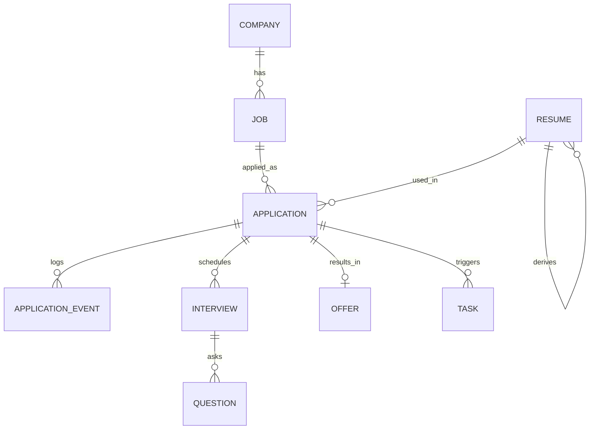

# Land a Job — 产品需求文档（PRD）

[English](./PRD.md) · **简体中文**

| 项 | 内容 |
| --- | --- |
| 产品名 | Land a Job（拿到 offer） |
| 版本 | v1.0 |
| 状态 | 待评审 |
| 更新日期 | 2026-11-04 |
| 关联文档 | [ARCHITECTURE.zh-CN.md](./ARCHITECTURE.zh-CN.md) · [IMPLEMENTATION.zh-CN.md](./IMPLEMENTATION.zh-CN.md) |

---

## 1. 背景与问题

找工作是一段**高不确定、高重复劳动、低反馈**的过程。求职者真正卡住的不是「不会写简历」，而是四件事：

1. **找不全**：目标公司散落在招聘网站、公司官网、内推群、朋友圈，没有一份统一的「目标清单」。
2. **投不动**：每家公司官网一套表单，重复填姓名/学校/工作经历/上传简历，一份投递 10–20 分钟，一天投不了几家。
3. **记不住**：投了 40 家之后，谁面到几面、谁该催、谁给了口头 offer，全靠微信收藏和记忆，**跟进断线直接损失机会**。
4. **比不清、谈不好**：多个 offer 的总包、期权、公积金、加班强度混在一起，靠感觉决策；谈薪时不知道自己的锚点在哪。

现有工具各自只解决一环：简历工具不管投递，招聘平台不管你的目标公司，表格要自己维护，ChatGPT 每次都要重新交代上下文。

**本产品要做的**：一个本地优先、Agent 原生的求职作战台 —— 把「目标清单 → 简历定制 → 投递 → 跟进 → 面试 → offer 谈判」串成一条有状态、可度量、可自动化的流水线。

---

## 2. 第一性原理与北极星指标

### 2.1 从「投得多」修正为「转化率链」

原始想法是「投递尽可能多的公司」。这句话是**手段**，不是**目标**，而且直接执行会反噬：海投带来简历不匹配、被招聘系统降权、精力被低质量机会吃掉。

把结果拆到不可再分：

```
拿到 offer 数 = 投递量 × 简历命中率 × 面试通过率 × offer 接受率
约束：每周可投入时间 ≈ 10 小时（有上限，不可突破）
```

四个乘数对应四类可被产品干预的动作：

| 乘数 | 现状瓶颈 | 产品干预 | 对应功能 |
| --- | --- | --- | --- |
| 投递量 | 官网表单重复填，单份 10–20 min | 半自动填表 + 批量目标管理，单份降到 3–5 min | FR-3 |
| 简历命中率 | 一份简历投所有岗位 | JD 关键词 × 简历证据的缺口分析 + 一键定制变体 | FR-2 |
| 面试通过率 | 无准备、无复盘 | 基于 JD×简历生成必考题/风险追问 + 模拟面试评分 | FR-6 |
| offer 接受率 | 凭感觉比，谈薪无锚点 | 可比总包模型 + 谈判区间与话术 | FR-5 |

**推论：** 产品的核心不是「自动化点击」，而是**把时间从低价值环节（找、填、记）转移到高价值环节（匹配、准备、谈判）**。因此自动化必须「可审计 + 人确认」，否则省下的时间会被错误投递的成本抵消。

### 2.2 北极星指标

| 层级 | 指标 | 定义 | 目标（v1 使用 8 周后） |
| --- | --- | --- | --- |
| 北极星 | 周有效投递数 | 简历已针对 JD 定制且 fit ≥ 60 的投递数 | ≥ 15 / 周 |
| 一级 | 简历→面试转化率 | 进入 interview 及以上的 application / 已投递 | ≥ 15% |
| 一级 | 面试→offer 转化率 | offer 数 / 进入面试数 | ≥ 20% |
| 二级 | 单份投递耗时 | 从打开表单到确认提交的中位时长 | ≤ 5 min |
| 二级 | 跟进遗漏数 | 超过跟进阈值仍无动作的 application | 0 |
| 二级 | 数据完整率 | 有 JD 原文 + 简历版本的 application 占比 | ≥ 90% |

---

## 3. 目标用户

### 3.1 主用户（v1 唯一用户）

**画像**：3–8 年经验的互联网技术/产品从业者，正在主动求职，目标公司 30–100 家，同时推进 10–30 个流程。

- 会用 Claude Code / Codex / WorkBuddy 等 Agent 工具，愿意用命令行/自然语言驱动
- 有自己的判断，**拒绝黑盒海投**，需要看到每次投递投了什么、投给谁
- 数据敏感：简历含手机号、身份信息，不接受上传到不明第三方

### 3.2 使用场景（Jobs to be Done）

| 场景 | 触发 | 期望结果 |
| --- | --- | --- |
| 周日晚上做计划 | 新的一周开始 | 20 分钟内产出本周 15 家目标公司清单，按 fit 排序 |
| 工作日午休投 3 家 | 有 30 分钟碎片时间 | 3 份定制简历 + 3 次官网投递，全程留痕 |
| 收到面试邀约 | HR 微信/邮件 | 一键建面试、自动生成该公司必考题与我的项目讲述稿 |
| 周三例行跟进 | 日历提醒 | 看到「5 家已投 7 天无回音」，一键生成催进度话术 |
| 两个 offer 撞期 | 谈判窗口 3 天 | 看清 4 年总包差异，拿到目标薪资的谈判区间与话术 |

### 3.3 非目标用户

应届生海投（需求是量而非质）、非知识型岗位（官网表单占比低）、猎头（需要多候选人管理）。

---

## 4. 产品形态与定位

### 4.1 双入口，一套数据，AI 只在 Agent 侧

```
        ┌──────────────────────────────────────────┐
        │        本地服务（唯一数据源 SQLite）        │
        │  规则能力：状态机 / fit / 总包 / 统计       │
        └───────┬──────────────────────────┬───────┘
                │                          │
          MCP (stdio)                 HTTP + WS
                │                          │
      ┌─────────┴─────────┐               │
      │  任意 Agent        │            Web 看板
      │  + 安装的 Skill    │     (Dashboard / 看板 / 简历编辑
      │  ← AI 能力的唯一处 │      / 日历 / 对比 / 题库)
      └───────────────────┘
```

**AI 的归属（已定）**：产品**不内置模型、不持有 API Key、不代理模型调用**。所有"生成、改写、评判、检索"类能力，都由用户在 Agent 中安装的 **Skill** 承载——Skill 描述"这件事怎么做、调哪些 MCP 工具、产出什么格式"，Agent 用用户自己的模型执行，结果通过 MCP 落回应用。

| 入口 | 能做 | 不能做 |
| --- | --- | --- |
| **Agent + Skill** | 全流程驱动：出题、改写简历、生成字段映射、谈薪话术、周报 | 不持有数据所有权（数据在本地库） |
| **Web** | 查看、编辑、拖拽、录入、导出、对比计算 | 不发起任何模型调用；生成类动作以「在 Agent 中执行」交接 |

- **Agent 入口**：说人话驱动（"帮我把这周的 15 家投了"、"明天面字节，帮我准备"）。换 Claude Code / Codex / WorkBuddy / Cursor 均可用，只要装了同一个 Skill 包；豆包工作这类不读 skill 目录的客户端，把对应 `SKILL.md` 正文交给它即可。
- **Web 入口**：看得见的状态。漏斗、看板、日历、对比表、简历编辑器。**不依赖 Agent 常驻**，关掉终端也能用。
- 两者改的是同一份数据，改动实时互相同步（WebSocket 推送）；AI 产出与人工编辑用 `provenance` 字段区分来源。
- **交接机制**：Web 上每个需要 AI 的按钮不是"直接生成"，而是复制一段已注入上下文的指令（模板随 Skill 版本走）或提示在 Agent 中执行，避免出现"点了没反应"的死路。

### 4.2 差异化

| 对比对象 | 它做什么 | 我们不同在哪 |
| --- | --- | --- |
| 招聘平台（BOSS/拉勾） | 平台内投递 | 我们管**平台外**的官网投递与全流程状态，不绑定单一渠道 |
| 简历工具（木及/WPS） | 排版与导出 | 简历是流水线的一环，与 JD、投递记录、面试题共用同一份数据 |
| 表格（Notion/Excel） | 自由记录 | 有状态机、有提醒、有指标、能被 Agent 直接读写 |
| ChatGPT 对话 | 单次生成 | 有持久上下文（你的简历库 + 投递历史），不用每次重新交代 |

---

## 5. 功能需求

优先级：**P0** = v1 必须；**P1** = v1 尽量；**P2** = 后续版本。

### FR-1 简历工坊（P0）

复用 `resume-generator-2` 的编辑器内核（React 19 + Zustand + 三套模板 + PDF 导出 + MCP 工具层）。

| 编号 | 需求 | 验收标准 |
| --- | --- | --- |
| FR-1.1 | 多简历管理 | 支持多份简历，可命名、复制、删除、设为默认；素材库简历（master）与投递变体（variant）区分 |
| FR-1.2 | 可视化编辑 | 保留原项目的实时预览、条目增删改排序、模板切换、头像裁剪 |
| FR-1.3 | PDF 导出 | 文件名 `姓名_岗位_公司_yyyymmddHHMM.pdf`；正文链接可点击；页面未打开时降级无头 Chrome 渲染 |
| FR-1.4 | 导入导出 | 支持 JSON 备份/恢复；兼容 `resume-generator-2` 的 `ResumeData` JSON（可直接迁移旧数据） |
| FR-1.5 | 版本血缘 | 每个 variant 记录 `base_resume_id` 与 `job_id`，可追溯「这份简历是为哪家公司改的」 |

### FR-2 JD 匹配与简历定制（P0）

| 编号 | 需求 | 验收标准 |
| --- | --- | --- |
| FR-2.1 | JD 采集 | 输入 URL 按来源分层采集（官方 ATS 公开接口 → Readability 通用提取 + 本地快照）；失败时由 `jd-collect` Skill 引导 Agent 用自带浏览器读回原文，或人工粘贴；两条降级入口与自动抓取等价，采集方式落库且 Web 可见；手工补录公司/岗位/薪资 |
| FR-2.2 | 关键词抽取 | 从 JD 抽出硬性要求（年限/学历/城市）、技术栈、职责关键词，落库可检索 |
| FR-2.3 | 匹配度打分 | 输出 0–100 分 + **可解释因子**（技能重合 / 年限 / 行业 / 地点 / 薪资区间）；打分逻辑确定性可复现，Agent 可覆写并留痕 |
| FR-2.4 | 缺口分析 | 列出「JD 要求但简历无证据」的项，按致命/可补/加分分级 |
| FR-2.5 | 一键定制 | 基于 master 简历 + 该 JD 生成 variant：调整摘要、重排项目与技能、对齐 JD 用词；**生成前后 diff 可看、可回滚** |
| FR-2.6 | 禁止编造 | 定制只做重组、重述、突出，不得新增不存在的经历；生成结果标注「来自哪条原始经历」 |

### FR-3 投递流水线（P0）

| 编号 | 需求 | 验收标准 |
| --- | --- | --- |
| FR-3.1 | 目标公司库 | 公司实体：名称、官网、行业、规模、地点、投递入口、备注、优先级 |
| FR-3.2 | 岗位管理 | 岗位挂在公司下：标题、JD、链接、薪资范围、城市、渠道（官网/内推/平台）、优先级 |
| FR-3.3 | 状态机 | `lead → queued → applied → screening → assessment → interview → offer → accepted`，旁支 `rejected / ghosted / withdrawn`；非法跃迁被拒绝并提示 |
| FR-3.4 | 手动投递登记 | 3 次点击内完成「投了什么岗、用了哪版简历、什么渠道、什么时候」；自动生成时间线事件 |
| FR-3.5 | 投递助手（半自动） | 浏览器自动化打开官网表单 → 输出字段映射计划 → 预填 → **人工确认后提交** → 截图存证；默认 dry-run |
| FR-3.6 | 批量投递队列 | 一次排队多个岗位，逐个进入确认；不做无人值守批量提交 |
| FR-3.7 | 重复投递拦截 | 同公司同岗位已存在 active application 时告警，不静默创建 |

### FR-4 进度监控与跟进（P0）

| 编号 | 需求 | 验收标准 |
| --- | --- | --- |
| FR-4.1 | 看板视图 | 按状态分列，卡片含公司/岗位/fit/最后更新时间/停留天数；拖拽改状态（写时间线） |
| FR-4.2 | 时间线 | 每个 application 有完整事件流（创建、改状态、备注、面试、offer、提醒），只追加不覆盖 |
| FR-4.3 | 跟进规则 | 已投 7 天无更新 → 待跟进；面试后 3 天 → 建议感谢信；offer deadline 前 2 天 → 强提醒 |
| FR-4.4 | 今日待办 | 聚合当日面试、待跟进、待确认提交、截止倒计时；Agent 可通过工具读取 |
| FR-4.5 | 漏斗看板 | 各阶段数量、转化率、渠道对比、简历版本胜率（只算已投，哪版简历带来最多面试）、响应时长中位数 |
| FR-4.6 | 静默流失识别 | 超阈值未更新自动标记 `ghosted` 候选，需用户确认后才变更状态 |

### FR-5 Offer 对比与谈薪（P0）

| 编号 | 需求 | 验收标准 |
| --- | --- | --- |
| FR-5.1 | Offer 录入 | base×月数、绩效系数、签字费、期权（股数/行权价/估值/vesting）、公积金比例、补贴、城市、职级、deadline |
| FR-5.2 | 总包模型 | 输出首年现金、4 年总包、年化现金、期权风险调整后价值；口径与假设在页面显式展示 |
| FR-5.3 | 多维对比 | 至少 2 个 offer 并排对比，支持维度加权（钱/成长/稳定/WLB），权重可调并即时重算 |
| FR-5.4 | 谈薪准备 | 输出：市场区间锚点、我的可让步区间、三档报价话术（先手/还价/收尾）、对方常见反驳的应对 |
| FR-5.5 | 情景模拟 | 输入对方报价，计算接受后的税后月现金流与 4 年差额 |
| FR-5.6 | 决策留痕 | 最终选择、放弃理由、关键假设存档，便于事后复盘 |

### FR-6 模拟面试（P1）

| 编号 | 需求 | 验收标准 |
| --- | --- | --- |
| FR-6.1 | 题库生成 | 基于 JD 要求 × 简历证据生成三类题：必考技术题、简历风险追问、行为面（STAR）；每题标注考察点与对应简历条目 |
| FR-6.2 | 逐题作答 | Agent 或 Web 逐题提问，记录回答文本（v1 不做语音） |
| FR-6.3 | 评分与追问 | 按结构完整性/证据密度/表达清晰度三维评分，给出改进版参考答案与追问链 |
| FR-6.4 | 缺口闭环 | 「答不上来」的题自动关联 FR-2.4 的简历缺口，形成补强清单 |
| FR-6.5 | 面后复盘 | 真实面试结束后录入问题与自评，沉淀进个人题库，按公司/轮次可查 |

### FR-7 MCP + Skill：AI 能力的唯一载体（P0）

产品的 AI 能力 = 用户装的 Skill × 用户的 Agent × 本地应用的 MCP。因此 Skill 不是"使用说明"，而是**产品交付物本身**，必须写清每个 AI 功能的输入、步骤、产出格式与落库方式。

| 编号 | 需求 | 验收标准 |
| --- | --- | --- |
| FR-7.1 | MCP 服务 | stdio MCP，覆盖 FR-1~FR-6 的全部读写能力；工具返回结构化 JSON，错误可读且可自我纠正 |
| FR-7.2 | MCP 资源 | `land://today`、`land://pipeline`、`land://job/{id}`、`land://resume/{id}`、`land://offer/compare` 供 Agent 直接读上下文，避免多轮取数 |
| FR-7.3 | Skill 包 | 5 个可安装工作流：`jd-collect`（JD 采集与浏览器兜底）、`job-hunt`（日计划/入库/投递）、`resume-tailor`（JD 定制）、`job-prep`（面试准备与模拟）、`offer-decide`（对比与谈薪）；每个 Skill 用统一结构描述：触发场景 → 前置取数 → 步骤 → 产出格式 → 落库工具 → 禁止事项 |
| FR-7.4 | AI 功能映射完整 | 第 5.9 节表中每个"需要 AI"的能力，都能在某个 Skill 中找到对应步骤；反之 Skill 不含未落库的无效产出 |
| FR-7.5 | 跨 Agent 兼容 | Claude Code / Codex / WorkBuddy / Cursor 均可安装同一 Skill 包并跑通；豆包工作这类不读本地 skill 目录的客户端，以 `SKILL.md` 正文为任务说明，浏览器动作可做、落库走 MCP 客户端或 Web 粘贴；不依赖任何 Agent 专有工具（如某家的 todo、文件树约定） |
| FR-7.6 | 安装即用 | 提供一行安装命令与手动复制两种方式；README 给出 Claude Code（`~/.claude/skills/`）、Codex（`~/.codex/skills/`）与 WorkBuddy（`~/.workbuddy/skills/`）的具体路径 |
| FR-7.7 | 产出留痕 | 所有 AI 生成的简历改写、面试题、评分、谈判材料，落库时带 `provenance`（skill 名 + 版本 + 模型 + 时间），Web 可筛选"只看 AI 生成" |
| FR-7.8 | 幂等与安全 | 写操作带幂等键；删除、提交投递等破坏性操作需显式确认参数；Skill 内明确"先确认再提交" |
| FR-7.9 | 降级可用 | Agent 不在时，Web 仍可完成录入、编辑、状态推进、统计、导出；Skill 缺失时不报错阻塞 |

### FR-8 Web 可视化（P0，移动端 P2）

| 编号 | 需求 | 验收标准 |
| --- | --- | --- |
| FR-8.1 | Dashboard | 北极星指标（周目标可在页面上直接改，默认 8）+ 漏斗 + 本周趋势 + 今日待办，首屏可读 |
| FR-8.2 | 页面矩阵 | 简历编辑、目标公司库、投递看板、面试日历、Offer 对比、题库 |
| FR-8.3 | 实时同步 | Agent 侧改动 1s 内反映到页面（WS 推送），无需刷新 |
| FR-8.4 | 单地址 | 固定 `http://127.0.0.1:4399`，避免多 origin 数据分裂 |
| FR-8.5 | 移动端可用（P2） | 看板与今日待办在手机浏览器可读（响应式，不追求编辑体验） |
| FR-8.6 | AI 交接 | 生成类按钮**不调用模型**：展示已注入上下文的指令供一键复制，或提示"在 Agent 中执行"；Skill 未安装时给出安装引导，不出现死按钮 |
| FR-8.7 | 来源标记 | AI 生成内容带角标（skill 名 + 时间），可与人工编辑区分，并支持"以人工版本覆盖" |

### 5.9 AI 能力清单与承载映射

**判定原则**：规则能做的不用 AI（可复现、离线、零成本、可解释）；AI 只负责"语言组织"与"需要判断的权衡"，且结果必须落库留痕。这条原则决定了哪些能力在服务端、哪些在 Skill。

| 能力 | 是否需 AI | 执行方 | 承载 Skill | 落库方式 |
| --- | --- | --- | --- | --- |
| JD 关键词抽取 | 否（规则+词表） | server | — | `job.keywords_json`，Agent 可覆写 |
| fit 打分 | 否（确定性加权） | server | — | `job.fit_score` / `fit_reasons_json`，覆写记 `fit_source=agent` |
| 简历摘要与项目重述 | **是** | Agent | `resume-tailor` | PATCH `/resumes/:id`，写 `provenance` |
| 简历缺口分级（致命/可补/加分） | 半（规则给候选，AI 判轻重） | server + Agent | `resume-tailor` | 落 `job` 详情的 gap 字段，AI 判定部分带 provenance |
| 官网字段映射计划 | **是** | Agent | `job-hunt` | `plan_form_fill` → 执行器校验后填充 |
| 投递后跟进话术 | **是** | Agent | `job-hunt` | `add_application_note`，标注 draft |
| 面试题生成（必考/风险/行为） | **是** | Agent | `job-prep` | `save_question`，`origin=generated` |
| 回答评分与改进稿 | **是** | Agent | `job-prep` | `score_answer`，写三维分与改进文本 |
| 市场薪资锚点检索 | **是**（联网） | Agent | `offer-decide` | `offer.assumptions_json`（含来源链接与日期） |
| 谈判区间与话术 | **是** | Agent | `offer-decide` | `offer.decision_note`（三档报价留档） |
| 周报/复盘总结 | **是** | Agent | `job-hunt` | 可选写 `task` 或事件备注，不新增表 |
| 漏斗/转化/版本胜率 | 否（SQL 聚合） | server | — | `/stats/*` 实时计算 |

**Skill 与功能需求的对应关系**（每个 Skill 必须能回答"我支撑了 PRD 的哪几条"）：

| Skill | 覆盖需求 | 典型触发话术 |
| --- | --- | --- |
| `job-hunt` | FR-3、FR-4、FR-7.2 | "今天该做什么"、"把这几家投了"、"这周进展怎么样" |
| `resume-tailor` | FR-2、FR-1.5 | "按这个 JD 改一版简历"、"我差在哪" |
| `job-prep` | FR-6 | "明天面 XX，帮我准备"、"模拟一轮技术面" |
| `offer-decide` | FR-5 | "这两个 offer 怎么选"、"帮我准备谈薪" |

**Web 端的"AI 交接"落地**：以"定制这份简历"为例，按钮不触发生成，而是弹出：① 一段可直接粘贴给 Agent 的指令（内含 jobId、简历 id、缺口清单）；② 「打开 Agent」提示；③ 「我已手动改好」入口。这样即使 Skill 没装、Agent 没开，流程也不会断在按钮上。

---

## 6. 非功能需求

| 类别 | 要求 |
| --- | --- |
| 数据主权 | 全部数据存本地 SQLite；**应用自身不向任何模型服务发请求**；AI 环节的数据外发范围由用户在其 Agent 客户端掌控；支持一键导出全库 JSON |
| 性能 | 首屏 < 1.5s；1 万条 application 下看板滚动 60fps；MCP 单工具响应 p95 < 300ms（不含网络抓取/浏览器操作） |
| 可靠性 | 写操作事务化；数据文件损坏自动备份并降级启动；进程崩溃不丢已确认投递 |
| 可恢复 | 每日自动快照，保留 7 天；`land restore <snapshot>` 可回滚 |
| 可观测 | 结构化日志（文件 + stderr）；每次 Agent 写操作记录 actor + 来源（mcp/web/cli） |
| 隐私 | 手机号/邮箱在列表页脱敏；截图证据仅存本地；导出文件默认脱敏 |
| 兼容 | macOS / Linux 优先；Node ≥ 22；浏览器 Chrome/Edge/Safari 最近两个大版本 |
| 合规 | 遵守目标站点 ToS 与 robots；不绕过验证码；自动提交必须人工确认 |

---

## 7. 数据模型概要

核心实体与关系（字段级定义见 [ARCHITECTURE.zh-CN.md](./ARCHITECTURE.zh-CN.md#6-数据模型)）：



| 实体 | 说明 | 关键点 |
| --- | --- | --- |
| `company` | 目标公司 | 官网、行业、规模、地点、优先级 |
| `job` | 岗位 | JD 原文 + 快照、抽取的关键词、fit 分与因子、渠道 |
| `resume` | 简历 | `data_json` 兼容旧格式；`kind` = master / variant；血缘字段 |
| `application` | 一次投递 | 状态 + 状态时间 + 使用的简历 + 渠道 + 证据 |
| `application_event` | 时间线 | 只追加；记录 actor 与 source |
| `interview` | 面试轮次 | 时间、形式、面试官、反馈、结果 |
| `question` | 题库 | 来源（生成/真实）、考察点、我的回答、评分 |
| `offer` | Offer | 结构化薪酬组件 + deadline |
| `task` | 提醒 | 类型、到期时间、关联 application |

---

## 8. 范围边界

### 8.1 v1 明确不做

- **Web 端内置 AI / 服务端调用模型**：不接 LLM SDK、不存 API Key、不做模型路由。AI 只在用户 Agent 侧发生（见 4.1、5.9）。
- **多用户 / SaaS / 账号体系 / 云端同步**：单用户、单机、本地库；跨设备靠导出 JSON 或拷贝 `data/`。
- **第三方招聘平台的自动海投**（BOSS/拉勾/猎聘）：违反平台协议、验证码不可绕、账号风险高。平台内投递只做**手动登记**。
- 无人值守批量提交表单：v1 一律人工确认。
- 语音模拟面试、录音转写（P2）。
- 邮件/日历自动解析（P2，先留 `task` 与 `interview` 数据结构）。
- 薪酬数据爬取：市场区间先由用户输入或 Agent 联网检索，不自建数据库。
- 自建 Skill 市场 / 在线安装服务：Skill 以仓库内文件形式分发，安装靠复制或脚本。

### 8.2 与 `resume-generator-2` 的关系

不是 fork 后改，而是**抽包复用**：简历编辑器 UI、`ResumeData` 类型、PDF 导出、MCP 工具层模式、HTTP/WS 桥接与单实例复用机制直接迁移为 `packages/resume-kit`，两项目可各自演进。迁移映射见 IMPLEMENTATION.zh-CN.md 第 2 节。

---

## 9. 风险与对策

| 风险 | 影响 | 对策 |
| --- | --- | --- |
| 自动填表在异构官网失效率高 | 投递助手形同虚设 | 字段映射计划由 Agent 基于 aria snapshot 生成，执行器只做填充；失败可降级为「复制粘贴面板」 |
| 定制简历被判定造假 | 背调/面试翻车 | 硬约束：只重述不新增；生成结果附来源条目；导出前强制人工复核 diff |
| 数据模型过度设计拖慢上线 | 迟迟不能用 | 先落 P0 六张核心表，`question`/`task` 允许 v1.1 补 |
| 用户（自己）三分钟热度不录入 | 数据空洞，指标失真 | 降低录入成本：MCP 一句话登记 + 浏览器快捷录入 + 每日待办推动 |
| 平台封禁/法律风险 | 账号损失 | 不做平台自动投递；仅操作公司官网公开表单；保留 dry-run |
| 总包模型口径错误误导决策 | 选错 offer | 页面显式展示假设与公式；提供手工修正；标注「估算」 |

---

## 10. 里程碑

| 阶段 | 交付 | 出口标准 |
| --- | --- | --- |
| M0 骨架（1 周） | 仓库、SQLite schema、HTTP/WS 服务、Web 空壳、MCP 空壳 | `land dev` 起服务，页面能读到一个 health 状态 |
| M1 流水线（1.5 周） | FR-1/FR-3/FR-4 核心 | 能录入公司→岗位→投递→拖拽改状态，全链路留时间线 |
| M2 定制与投递（1.5 周） | FR-2 + FR-3.5 | 一条 JD 能产出定制 variant 与 diff；投递助手能在一个真实官网预填成功 |
| M3 Agent 化（1.5 周） | FR-7 全量 + 5 个 Skill | 同一个 Skill 包在 Claude Code 与 WorkBuddy 中各自跑通「批量投递」与「面试准备」；AI 产出在 Web 可见且带来源标记 |
| M4 面试与 offer（1.5 周） | FR-5/FR-6 | 两个 offer 能算出 4 年总包并生成谈判话术；一场模拟面试能出评分 |
| M5 打磨（1 周） | FR-8 + 指标 | 漏斗与「版本胜率」数据可信；连续 7 天自用无阻断 |

---

## 11. 验收标准（v1 整体）

1. 从零开始，30 分钟内完成：建 5 家公司 → 10 个岗位 → 3 份定制简历 → 3 次投递登记，无需看文档。
2. 在 Claude Code 与 WorkBuddy 中**安装同一个 Skill 包**后，一句自然语言可完成「查询今日待办并推进状态」，返回结构化结果；换一个 Agent 无需改 Skill。
3. 投递助手在 3 个真实公司官网上完成预填，其中至少 2 个一次成功、1 个可降级手工完成。
4. 任意 application 都能回答：投的哪版简历、什么时候投的、现在第几轮、下一步该做什么。
5. 两个 offer 的 4 年总包计算与手算结果误差 < 1%（不含税后估算）。
6. 关闭所有终端后重启电脑，数据零丢失；Web 与 Agent 读到的数据一致。
7. **应用自身不发生任何模型调用**：断网、未配置任何 API Key 的情况下，Web 的录入/编辑/统计/导出/对比全部可用；需要 AI 的按钮给出明确交接指引而非报错。
8. AI 生成的简历改写与面试题，在 Web 上可识别来源（skill + 时间），并可被人工版本覆盖。

---

## 12. 已定决策与剩余假设

### 12.1 已定决策（不再讨论，改动需重评架构）

| # | 决策 | 对文档的约束 |
| --- | --- | --- |
| **D1** | **只做单用户本地**。无账号、无多租户、无云同步。 | 不加 `user` 表；鉴权只做本机 token；server 只绑 `127.0.0.1`；「上云」不进入任何里程碑 |
| **D2** | **AI 能力全部经由「用户安装的 Skill + 其 Agent」实现**。Skill 描述需要 AI 的功能，Agent 用用户自己的模型执行，结果通过 MCP 落库。应用自身**零模型调用、零 API Key**。 | FR-7 把 Skill 当交付物；5.9 建立能力映射；Web 端所有生成动作改为「交接」；数据库增加 `provenance` 以区分 AI/人工产出；服务端依赖列表禁止出现任何 LLM SDK |
| **D3** | **复用 `resume-generator-2` 的简历编辑器**（抽成 `packages/resume-kit`），不改 `ResumeData` 字段。 | FR-1 不再评估自研；P2 阶段只做「去 store 化 + 抽包」，不做 UI 重设计；旧 JSON 必须可直接迁移 |

**D2 的推论（容易做错的点）**：

1. Skill 里不能写"调用某模型"或"用某家的工具"，只能写"取数 → 处理 → 落库"的步骤，模型由 Agent 决定。
2. 任何"AI 生成"的结果都必须经过 MCP 写入才有意义——Skill 不允许只在对话里输出而不落库（否则 Web 看不到，等于没做）。
3. 需要 AI 的验收标准必须可在**任意一个** Agent 中复现，不能依赖某家的独有能力。
4. Web 端不得出现"点击生成"的假按钮；要么交接，要么明确标注"需在 Agent 中完成"。

### 12.2 剩余假设（v1 按此执行，若变化需局部调整）

| # | 假设 | 影响面 | 若否 |
| --- | --- | --- | --- |
| A1 | 主要投递渠道是**公司官网**，第三方平台仅登记 | 投递助手设计 | 若要平台自动化，需重估合规与稳定性 |
| A2 | 目标岗位为知识型（技术/产品），官网表单字段以文本/文件上传为主 | 字段映射策略 | 蓝领/服务业需另一套投递路径 |
| A3 | 市场薪资区间由 Agent 联网检索或用户输入，不自建库 | FR-5.4 | 需接入薪酬数据源 |

---

## 附录 A：功能与原始诉求对照

| 原始诉求 | 落点 | 增强点 |
| --- | --- | --- |
| 1. 写简历（复用 resume-generator-2） | FR-1 | 加多版本与血缘 |
| 2. 投递简历（官网自动 + 手动添加） | FR-3 | 半自动 + 人工确认 + 证据链 |
| 3. 监控投递和面试进度 | FR-4 | 状态机 + 跟进规则 + 漏斗指标 |
| 4. offer 对比、谈薪 | FR-5 | 4 年总包模型 + 情景模拟 |
| 5. 模拟面试 | FR-6 | 由 JD×简历生成，闭环到简历缺口 |
| 6. 配套 skill 和 mcp，任意 agent 可用 | FR-7 + 5.9 | Skill 承载**全部** AI 能力，产出经 MCP 落库；同一 Skill 包跨 Agent 可复用 |
| 7. 可视化 web 端 | FR-8 | 实时同步 + 指标看板 + AI 交接（Web 不内置模型） |
| （隐含）快速找到工作 | 第 2 节北极星 | 从「投得多」修正为「转化率链」 |
