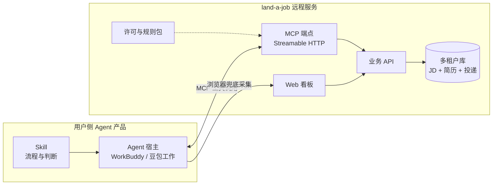

# land-a-job 远程服务模式商业报告

| 项目 | 内容 |
| --- | --- |
| 版本 | v1.0 |
| 日期 | 2026-11-06 |
| 状态 | 提案，待讨论 |
| 讨论对象 | 从「单用户本地工具」转为「远程服务 + Agent 客户端」的合规可行性与财务模型 |
| 数据来源 | 公开财报与定价页、政府采购公告、竞品仓库 README、法规原文 |
| 免责 | 本文的合规定性为工程视角分析，不构成法律意见；财务测算为基于公开参数的估算模型，非承诺 |

---

## 0. 摘要

本报告评估一种新的交付形态：用户在 WorkBuddy、豆包工作等 Agent 产品中安装 land-a-job 的 Skill 与 MCP，业务逻辑运行在 land-a-job 的远程服务上，服务端存储用户通过 MCP 上传的 JD 数据与用户简历。前期面向个人求职者，后期扩展到培训机构与高校就业中心。

**三点结论。**

第一，合规成本是这门生意里最便宜的部分。一次性投入 6–12 万元、年度维护 3–8 万元即可覆盖全部强制义务，真正需要制度设计（而非花钱）的只有一条：岗位库必须永久按用户隔离，不得出现跨用户的公共岗位池。

第二，毛利率结构优于几乎所有同类产品。应用零 LLM 这一既有约束，在 SaaS 化之后从架构洁癖变成了商业护城河——C 端毛利率可以做到 92%，而任何自建模型做简历改写的竞品被 token 成本压在 60–70%。

第三，真正的风险不在合规，在两个不可控项：Agent 平台的渠道政策（抽成、下架、平台自建），以及产品在功能演进中滑向「网络招聘服务」的定性。

财务上，第 3 年营收约 470 万元、净利约 207 万元（净利率 44%），但 C 端贡献 57% 的营收、仅贡献 13% 的利润，B 端贡献 43% 营收、87% 利润。C 端的真实价值不是收入，而是脱敏漏斗数据构成的 B 端议价筹码。

---

## 1. 产品形态定义

### 1.1 组件划分

### 1.2 职责边界

| 层 | 承担什么 | 不承担什么 |
| --- | --- | --- |
| Skill（用户侧） | 流程编排、判断、文案、调用 MCP 落库 | 不直接读写数据库、不调用任何模型 API |
| Agent 宿主 | 模型推理、浏览器自动化、用户交互 | 不持久化业务数据 |
| 远程服务 | 数据持久化、鉴权、许可校验、看板渲染、规则包下发 | **不调用模型**、不启动浏览器、不实施抓取 |
| 浏览器 | 由 Agent 侧驱动，抓取与填表都在用户本地 | 服务端不参与 |

### 1.3 与既有实现的关系

沿用当前 `apps/server` + `apps/mcp` + `apps/web` + `packages/core` 的四段结构，改动集中在三处：

1. **数据库从单机 SQLite 改为多租户**。所有表增加 `user_id`，查询层强制注入，不允许省略。
2. **MCP 传输从 stdio 改为 Streamable HTTP**，同时保留 stdio 供本地直连。
3. **新增鉴权与许可**。MCP 令牌一人一密、可吊销、全量审计。

**不改变的部分**：应用零 LLM、写入必须带 `provenance.skill`、状态机只走 `POST /applications/:id/status`、`ResumePages` 统一分页、五家 ATS 适配器与通用抓取的既有分层。

---

## 2. 市场与竞争

### 2.1 竞争格局总览

赛道在 2026 年上半年完成了一次形态收敛：所有严肃项目都独立收敛到了同一组原则——本地优先、不替用户点提交、AI 在 Agent 侧、自带看板。这组原则与本项目既有决策（D1/D2）一致，属于方向验证而非巧合。

### 2.2 开源阵营

| 项目 | 规模 | 形态 | 岗位来源 | 投递 | 可视化 | LLM 位置 |
| --- | --- | --- | --- | --- | --- | --- |
| career-ops | 约 80k star，MIT | Skill + plugin，跨 8 种 CLI | 55+ provider，欧美 ATS | 填表 | Go TUI + Web(alpha) | 宿主 CLI，另有自带 API 的 eval 旁路 |
| ai-job-search | 约 70k star，MIT | Claude Code skill + 15 个斜杠命令 | 丹麦 4 站 + LinkedIn guest | 材料 | 单文件离线 HTML | 全在宿主 |
| job-search | 小，未标许可 | MCP server（8 工具）+ 本地看板 + Electron 托盘 | 波兰站 + 6 家 ATS + JobSpy | 填表（默认 dry-run） | 本地 Web 看板 | headless `claude -p` |
| job-agent-skills | 小，npm | 10 Skills + jobs-mcp + Next.js kanban | Greenhouse/Lever/Ashby 公开端点 | 填表 | Next.js kanban | 宿主 Agent |
| FreeApply | 小，MIT | 本地 stdio MCP + 签名工作流 | 按配置 | **提交** | 本地 dashboard | 宿主订阅 |
| AIHawk | 约 29k star，MIT | Python CLI | LinkedIn Easy Apply | **提交** | 无 | 自带 API key |
| get_jobs | 约 9k star，PolyForm 非商业 | Java 21 + ChromeDriver + Web | BOSS/猎聘/51job/智联 | **提交** | Web 管理界面 | 自带 OpenAI 兼容 |
| **land-a-job** | — | 9 Skills + MCP（40+ 工具）+ React Web | 5 家 ATS（含飞书、北森）+ 通用抓取 + Agent 浏览器兜底 | 填表 | React Web 看板 | **应用零 LLM + 落库溯源** |

值得注意的是 get_jobs 选择 PolyForm Noncommercial：源码公开但禁止商用。国内这个赛道连最强的自动化实现都主动锁死了商业化路径，说明从业者对法务边界的判断相当保守。

### 2.3 海外闭源

| 产品 | 定价 | 投递深度 | 关键事实 |
| --- | --- | --- | --- |
| Simplify | 免费 + Simplify+ | 填表 | 100 万+ 用户、累计投递 2 亿次，把填表打到零价 |
| Teal | $13/7 天、$29/30 天、$79/90 天 | 材料 | 65 万+ 用户，品类最老 |
| Huntr | 免费(100 岗) + $40/月 | 填表 | kanban UX 最强，2014 年至今 |
| Jobright | 免费 + Turbo 约 $30–40/月 | 填表 | 定价页不公开 |
| Jobaholic | $29 / $59 / $99 每月 | **提交** | 每岗 AI 求职信 + outreach |
| FastApply | $14/月 200 份、$29/月 500 份 | 填表 + **提交** | 32 个板块，公开谈封号风险 |
| JobsAICopilot | $14.54/周起 | **提交** | Review Mode，限量 20/50 份 |
| LazyApply | $99 / $149 / $999 每年 | **提交** | 2026 多篇评测明确不推荐 |
| Loopcv | $13–89.99/月，买断 $39 | **提交** | A/B 简历测试 |
| Jobr | $19.99/周、$44/月、$97/季 | **提交** | 人工复核，50/120 份额度 |
| RemoteHunt | $29 一次性 90 天 | 材料 | 唯一不订阅 |
| Career Hound | $7/周、$20/月、$50/年 | 材料 | 公开数据：779 订户、$12k MRR、LTV $50、流失 31% |

**结构判断**：海外 C 端被两端夹住。一端是 Simplify 这类全免费 autofill，把填表商品化到零价；另一端是 $20–40/月的全自动提交。中间"填表不提交 + 看板"这一格竞争最激烈、盈利最难——Teal 做到 65 万用户仍要靠 $13/周生存，Career Hound 的公开数据（779 订户、流失 31%、LTV $50）是这一格的真实水位。

### 2.4 国内闭源

| 产品 | 定价 | 投递深度 | 备注 |
| --- | --- | --- | --- |
| AI 工作快搜 | 免费 30 额度；¥2.99/70 岗、¥7.99/200、¥19.99/600 | **提交** | 按职位数计价，价格锚点极低 |
| bosshelper | 基础免费 + 高级付费 | 预览后发送 | 可配置间隔规避风控 |
| 速申 | 基础免费 + 批量付费 | 填表 | 形态最接近：离线插件 + 网页看板 + CSV 导出 |
| 求职方舟AI | 岗位汇总免费、AI 改写收费 | 填表 | 靠岗位资讯做流量 |
| 职决 | 按积分 | 确认后提交 | 匹配 + 改写 + 薪资行情 |
| 百分投简历 | 基础免费 + 分析付费 | 材料 | 只打分不发送 |
| 牛客网申助手 | 完全免费 | 填表 | 把校招填表打穿 |
| 猎聘简历大师 | 深度报告 ¥99/次 | 材料 | 唯一卖到高价的 C 端形态：真人顾问复核 |
| BOSS / 猎聘 AI 简历助手 | 免费 / 会员约 ¥40/月 | 材料 | 平台自有，边际成本为零 |

**价格锚点**：国内 C 端付费意愿的心理价位在"一杯奶茶"量级（¥2.99–19.99 拿几十到几百个岗位），而唯一突破千元以下的成功案例是真人服务（¥99/次的顾问复核）。纯软件在这个市场的定价权很薄，这一事实直接决定了第 4 节的定价设计。

### 2.5 定位结论

四个条件同时满足的产品，在公开可检索范围内尚未出现第二个：

1. 国内 ATS 结构化适配（飞书招聘、北森 iTalent + Wecruit 两套端点）
2. 应用零 LLM 作为硬约束，而非权宜之计
3. 写入强制携带 `provenance.skill` 并可追溯
4. Web 看板可作日常主界面

career-ops 的中文推广文案声称内置阿里、腾讯、美团、飞书、Moka，但实际 `providers/` 目录只有欧美 ATS feed，**没有任何中国平台适配器**。这是本项目最稀缺的资产，也是最容易被高估的部分——它的价值在 B 端与数据服务，不在 C 端订阅。

---

## 3. 合规分析

### 3.1 义务分层

合规风险分布极不均匀。真正会推翻商业模式只有一项（3.4 定性问题），其余是花钱能闭环的工程问题。

| 事项 | 依据 | 判断 | 成本 |
| --- | --- | --- | --- |
| ICP 备案 | 《互联网信息服务管理办法》 | 必办。域名与境内服务器前置 | 免费，约 20 天 |
| ICP 经营许可证 | 《电信条例》 | 向用户收费即属经营性；各地通管局明示「招聘类平台」须办 | 代办 1.5–2.5 万；需注册资本 100 万（认缴）、3 人社保、等保二级 |
| 等保二级 | 《网络安全法》第 21 条 | 存个人信息且收费，基本必做 | 测评 0.5–1 万，含整改 2–6 万 |
| 公安联网备案 | 《计算机信息系统安全保护条例》 | 上线 30 日内 | 免费 |
| 日志留存 ≥6 个月 | 《网络安全法》第 21 条 | 最易遗漏。MCP 写库须记录操作者、时间、变更内容 | 存储成本 |
| PIA 影响评估 | PIPL 第 55、56 条 | 处理敏感个人信息必做，报告留存 3 年 | 自做 + 律师审 1–2 万 |
| 敏感信息单独同意 | PIPL 第 28、29 条 | 简历含照片、身份证号、住址、政治面貌、婚育状况 | 产品改造 |
| 自动化决策说明与拒绝权 | PIPL 第 24 条 | fit 打分影响排序即属自动化决策 | 见 3.3 |
| 生成式 AI 服务备案 | 《生成式人工智能服务管理暂行办法》 | **不适用**：应用零 LLM，不向公众提供生成服务 | 0 |
| 算法备案 | 《互联网信息服务算法推荐管理规定》 | **不适用**：岗位排序不具舆论属性或社会动员能力 | 0 |
| 数据出境安全评估 | PIPL 第 38、39 条 | 见 3.5 | 0 |

一次性投入 6–12 万元，年度维护 3–8 万元。其中零 LLM 带来的合规红利值得单独强调：省掉生成式 AI 备案意味着省下 3–6 个月上线周期和数十万元合规支出。**D2 这条决策在 SaaS 形态下的商业价值，第一次真正兑现。**

### 3.2 一条不可让步的红线

2026 年 1 月，人社部、中央网信办、工信部、公安部、金融监管总局联合印发《关于规范网络平台招聘类信息发布的通知》（人社厅发〔2025〕60 号），明确两类主体须持人力资源服务许可证：

1. 经营性人力资源服务机构通过互联网站、应用程序等**发布招聘信息**；
2. 网络平台**为用人单位提供招聘信息发布**等网络招聘服务。

本产品的形态不属于任何一类：不发布自有招聘信息，不为用人单位发布信息，只替求职者整理其自行采集的公开信息。定性上是干净的。

**但地方执法实践存在类推适用。** 某地 2026 年专项行动方案中的表述是：「以人力资源测评、就业指导咨询、**发布人力资源供求信息**等为名，**常态化**发布招聘信息的，视为实际从事职业中介活动。」三个关键词——常态化、发布、供求信息——构成了本产品的架构约束。

由此得出唯一的架构红线：

> **岗位库必须永久按用户隔离，不得出现跨用户的公共岗位池，不得提供公开可检索页。**

一旦用户 A 采集的岗位可被用户 B 看到，产品就从"工具"变成"平台"，直接落入许可范围。这条约束落到代码上是：所有业务表强制 `user_id`，查询层不允许省略该条件，跨用户聚合仅允许在脱敏且分组 ≥50 人的前提下用于统计。

这条设计选择同时决定了产品能力边界——**永远不做"岗位广场"**。功能诱惑越大的地方，法务风险越高。

### 3.3 自动化决策与拒绝权

fit 打分决定岗位排序与推荐，落入 PIPL 第 24 条的自动化决策范畴，义务是：透明、公平、提供说明、允许用户拒绝仅由自动化决策作出的决定。

既有的 `override_fit` 工具正好实现"拒绝权"——用户可手动覆盖评分并给出理由。这一点应写进产品说明与隐私政策，是实打实的合规加分项，成本为零。

对应的表述纪律：对外不称"录用概率""匹配度"，称为"规则匹配度"这一技术指标。

### 3.4 定性风险与连带影响

若被认定为职业中介或网络招聘服务，除许可证本身，还有一条隐蔽的连带风险：地方公告明确将"向求职者收取报名费、中介费、培训费"列为违规收费。**C 端订阅费可能因此被质疑。**

这并不意味着不能向 C 端收费，而是要求产品话术与合同性质严格锚定在"软件服务"而非"求职服务"：

| 避免 | 采用 |
| --- | --- |
| 为你推荐雇主 / 匹配岗位 | 整理你采集的岗位信息 |
| 提高录用率 / 上岸率 | 规则匹配度（技术指标） |
| 求职服务费 | 软件服务费 |
| 职业指导 / 就业咨询 | 简历排版工具 / 流程管理工具 |

发票类目、用户协议措辞、落地页文案三者必须一致。定性证据是产品自己写的字。

### 3.5 数据出境：只能承诺一半

用户表述为"数据不会出境"。这个说法需要精确化，因为其中一半不在地控制范围内。

| 环节 | 是否出境 | 谁控制 |
| --- | --- | --- |
| 用户 → 远程服务（境内机房） | 否 | 本项目可控 |
| 远程服务内部存储与计算 | 否 | 本项目可控 |
| 服务 → MCP → Agent 宿主 | 否 | 传输层 |
| Agent 宿主 → 模型服务 | **取决于模型地域** | **不由本项目控制** |

简历经 MCP 返回 Agent 后，Agent 会将其送入模型。豆包走火山引擎（境内），不构成出境；若用户装的是 Claude Code、Cursor、Codex，则简历进入境外模型。

因此对外表述只能是：

> 「land-a-job 服务端数据存储于中国境内，不主动向境外传输。」

**不能写「数据不出境」。** 一句话的差别，责任主体差一个量级。

配套动作：Skill 显式提示"本流程会将简历内容送入宿主 Agent 的模型，请确认所用模型服务位于境内"，把选择权明确交给用户。

### 3.6 数据最小化与存储

简历是个人信息的高密度集合，其中多项落入 PIPL 第 28 条的敏感个人信息。建议默认不收集：

- 身份证号（投递时由用户当场填写，服务端不落库）
- 照片（仅存引用，不存副本）
- 政治面貌、婚育状况、健康状况

JD 侧，著作权风险弱于反不正当竞争风险。建议只持久化结构化字段（title / company / city / salary / url / fit / 时间戳），正文设 30–90 天 TTL 或按需重取。这同时降低了存储成本与侵权面。

---

## 4. 商业模式

### 4.1 定价设计

**C 端：周期包优先，不做纯月订阅。**

| 档位 | 价格 | 内容 |
| --- | --- | --- |
| Free | 0 | 1 份简历、50 岗/月、本地看板 |
| Pro（求职季包） | ¥99 / 90 天 | 不限岗、多版本简历、fit 覆盖、导出 |
| Pro（年包） | ¥199 / 年 | 同上 + 面试与 offer 模块 |

理由有三：

1. **规避留存悖论**。求职是有限周期行为，成功者立刻离开、失败者放弃，公开的 22–31% 流失率是品类属性而非产品缺陷。周期包把"离开"设计进产品，不与之对抗。
2. **价格可解释**。¥99/90 天约 ¥1.1/天，比"一杯奶茶"贵但可归因（整个求职季），且远高于 ¥2.99/70 岗这类纯投递工具——因为卖的不是投递量。
3. **合规友好**。周期包在合同性质上更接近"软件使用许可"，弱于"持续服务"。

**B 端：三条产品线。**

| 客户 | 形态 | 定价 | 依据 |
| --- | --- | --- | --- |
| 培训机构 | 按人头 + 年框 | ¥99–199/学员/期；年框 ¥2–5 万 | 机构客单 7000–30000，抽 1–3% 无痛感 |
| 高校就业中心 | 项目制 | 15–30 万/校（纯软件） | 政采公开数据：广东财贸职院 27 万、黑龙江工业学院软件 5.9 万、河南职院 67.5 万、安顺学院 61 万（含硬件） |
| 教练 / 猎头 | 席位 | ¥199–499/席位/月 | 一人服务数十候选人，正对应多候选人视图 |

高校市场有两个必须提前计入的硬门槛：

- 政府采购要求**近三年审计报告、连续社保、无重大违法记录**。个人与一年内新设公司无法投标。
- 部分项目要求「**10 年免费运维**并提供免费功能升级、安全补丁、版本迭代」（河南职院案例）。签约等于终身成本，报价必须折现计入。

### 4.2 收入结构判断

C 端与 B 端在财务上的角色完全不同：

- **C 端是数据资产，不是利润来源**。15000 个用户的脱敏投递漏斗（平均投递份数、面试转化率、简历命中率、卡点分布）是 B 端唯一愿意为 20 万而非 2 万付费的理由。学校买的不是软件，是"我们学生平均投 34 份拿 1 个面试、卡在简历命中率 8%"这句话。
- **B 端是利润来源**。单合同额高、无留存悖论（机构不会因一个学生就业就退订）、可年框续约。

C→B 的桥梁是脱敏统计，合规上需额外一步：注册时提供**独立的「脱敏聚合统计授权」**（不得混入主协议），且聚合门槛设为每组 ≥50 人，防止反推个体。完成后，PIPL 第 73 条的匿名化成立，数据不再是个人信息，可用于行业报告与 B 端演示。**这是把合规成本转成商业资产的关键动作，应尽早落地。**

---

## 5. 财务模型

### 5.1 关键假设

| 参数 | 第 1 年 | 第 2 年 | 第 3 年 | 依据 |
| --- | --- | --- | --- | --- |
| C 端付费用户 | 800 | 5,000 | 15,000 | 平台自然流量 + 内容获客 |
| C 端 ARPU | ¥150 | ¥170 | ¥180 | 周期包与年包混合 |
| B 端客户数 | 2 | 8 | 30 | 培训机构先行，高校滞后 |
| B 端平均合同额 | 3 万 | 4 万 | 6.7 万 | 机构 2–5 万，高校 15–30 万 |
| 获客成本（C 端） | ¥62 | ¥50 | ¥53 | 平台分发为主，未计大规模投放 |

### 5.2 三年损益

| 项目（万元） | 第 1 年 | 第 2 年 | 第 3 年 |
| --- | ---: | ---: | ---: |
| C 端收入 | 12 | 85 | 270 |
| B 端收入 | 6 | 32 | 200 |
| **营收合计** | **18** | **117** | **470** |
| 人力 | 40 | 60 | 110 |
| 获客 | 5 | 25 | 80 |
| 云与存储 | 2 | 6 | 15 |
| 合规 | 10 | 5 | 8 |
| 交付与售后 | 0 | 5 | 30 |
| 其他 | 0 | 3 | 20 |
| **成本合计** | **57** | **104** | **263** |
| **净利** | **−39** | **13** | **207** |
| 净利率 | — | 11% | 44% |

### 5.3 毛利结构

| 分部 | 毛利率 | 说明 |
| --- | ---: | --- |
| C 端 | 92% | 无 LLM 成本；JD 采集在用户侧；服务端仅存结构化字段。1.5 万用户的云成本约 15 万/年 |
| B 端 | 70% | 实施、培训、售后、定制吃掉 22 个点；政采回款周期 6–18 个月，现金流弱于利润表 |
| 综合（第 3 年） | 82.6% | — |

对标：任何自建模型做简历改写的竞品，token 成本把毛利压在 60–70%。**这 20 多个百分点的差距，来源是 D2 那条「依赖里不许出现模型 SDK」的红线。**

### 5.4 敏感性

| 变量 | 变化 | 第 3 年影响 |
| --- | --- | --- |
| 获客成本 | ¥30 → ¥100 | 多支出约 105 万，净利降至约 102 万 |
| 平台分成 | 抽成 15–30% | C 端 270 万打折，净利减少 40–80 万 |
| 高校运维条款 | 接受「10 年免费运维」 | 单项目终身成本增加 15–25 万，5 个项目即吞掉半数净利 |
| 付费转化率 | 减半 | 第 3 年营收降至约 335 万，净利约 90 万 |

**获客成本是唯一的生死线。** 其余变量都能通过合同条款或产品设计规避，CAC 不能——它由渠道决定，不由产品决定。

---

## 6. 风险

### 6.1 渠道寄生（高）

入口位于 WorkBuddy、豆包工作等第三方 Agent 产品的插件或连接器市场。三件事任一发生即归零：平台抽成、平台下架、平台自建同类能力。字节推出"豆包找工作"类能力的概率不低。

**对策**：三条通道并行——MCP 直连配置、官网自助注册、桌面启动器（本地程序承担配置器角色，自动写入 `mcp.json`、申请令牌、填充 Header）。任何时点单一平台流量占比不超过 60%。

### 6.2 定性漂移（高）

产品每向"招聘平台"靠近一步，就离许可范围近一步。公开岗位搜索、企业主页、投递排行榜、按公司聚合的岗位池——任何一个功能都会完成这次越界。

**对策**：把「只展示当前用户自己的数据」写入 PRD 作为不可协商项，与「依赖里不许出现模型 SDK」并列。评审时逐条对照。

### 6.3 B 端销售能力（中）

政府采购不是产品问题，是资质、关系与垫资问题。缺乏这些能力时，通过集成商或代理商进入，让出 40–50% 利润，仍快于自建销售团队两年。

### 6.4 平台数据权（中）

JD 数据来自第三方招聘站点。抓取行为发生在用户侧，风险较低；但本项目作为存储者与展示者，反不正当竞争风险从抓取环节转移到存储与再分发环节。跨用户共享是唯一的引爆点。

**对策**：严格用户隔离（3.2）、不对外提供岗位 API、不做公开搜索页、正文设 TTL。

### 6.5 简历泄露（低概率 / 高影响）

令牌泄露即等于用户全部求职数据泄露。

**对策**：一人一密、可吊销、最小权限（只读规则包与自身数据）、全量操作审计、注销即物理删除（含备份与 MCP 写入历史）。

---

## 7. 执行路线

原设想为"前期个人、后期 B 端"，但政府采购从接触到回款需 6–18 个月，按此顺序第 2 年会出现 B 端收入断档。建议改为并行启动。

| 阶段 | 时间 | 目标 | 关键交付 |
| --- | --- | --- | --- |
| P0 主体与资质 | 第 0–2 月 | 具备投标与收费资格 | 公司注册（注册资本 100 万认缴）、ICP 备案与许可申请、等保二级启动 |
| P1 C 端验证 | 第 1–6 月 | 1,000 付费，验证 PMF | 多租户改造、MCP 流式 HTTP、鉴权与许可、隐私政策与单独同意 |
| P2 B 端弹药 | 第 4–6 月 | 可演示的脱敏漏斗 | 匿名化统计管线、行业报告模板、脱敏 demo |
| P3 机构切入 | 第 6–12 月 | 3 个培训机构案例 | 按人头计费、机构侧多候选人视图 |
| P4 高校切入 | 第 12–24 月 | 5 所高校 | 案例背书、审计报告、政采资质、集成商合作 |

**P0 必须最早启动**，因为它不依赖产品完成度，只依赖时间——三年审计报告是从公司成立日开始累积的。

---

## 8. 结论

这个方案的合规定性是税务与资质问题，不是生死问题。6–12 万元可以买干净，前提是守住"岗位库永久按用户隔离"这一条。

真正需要警惕的是两件不由产品决定的事：渠道在别人的应用商店里，定性在监管的解释空间里。前者靠三通道并行对冲，后者靠产品功能自律与文案纪律防守。

财务上这是一个毛利结构优秀、规模天花板明确的生意：第 3 年 470 万营收、207 万净利，C 端负责验证与产数据，B 端负责赚钱。它不会成为一家大公司，但在 2–3 人规模下是一门健康的生意。

最不该做的，是把它做成"又一个 C 端 AI 投递网站"——那里有 8 万星的免费开源项目在替用户跑，它们没有服务器成本，价格上无法竞争。

---

## 附录 A：竞品全表（按投递深度分档）

投递深度三档：**材料** = 只生成简历与求职信；**填表** = 填完停在 Submit 前；**提交** = 全自动提交。

| 项目 | 星标 / 许可 | 形态 | 岗位来源 | 投递 | 可视化 | LLM 位置 |
| --- | --- | --- | --- | --- | --- | --- |
| career-ops | 约 80k · MIT | Skill + plugin | 55+ provider，欧美 ATS | 填表 | Go TUI + Web(alpha) | 宿主 CLI |
| ai-job-search | 约 70k · MIT | Claude Code skill | 丹麦 4 站 + LinkedIn guest | 材料 | 离线 HTML | 宿主 |
| job-search | 小 · 未标 | MCP + 看板 + 托盘 | 波兰站 + 6 ATS + JobSpy | 填表 | 本地 Web | headless claude |
| job-agent-skills | 小 · npm | 10 Skills + kanban | Greenhouse/Lever/Ashby | 填表 | Next.js | 宿主 |
| FreeApply | 小 · MIT | stdio MCP | 按配置 | 提交 | dashboard | 宿主 |
| AIHawk | 约 29k · MIT | Python CLI | LinkedIn Easy Apply | 提交 | 无 | 自带 key |
| get_jobs | 约 9k · 非商业 | Java + ChromeDriver | BOSS/猎聘/51/智联 | 提交 | Web | 自带 |
| land-a-job | — | 9 Skills + MCP + React | 5 ATS + 通用抓取 | 填表 | React Web | 应用零 LLM |
| Simplify | 免费 | 扩展 | 100+ 板块 | 填表 | 扩展内 | 云端 |
| Teal | $13/7 天起 | Web + 扩展 | 主流板块 | 材料 | Web | 云端 |
| Huntr | $40/月 | Web + 扩展 | 主流板块 | 填表 | kanban | 云端 |
| Jobright | 免费 + 约 $30–40/月 | Web + 扩展 | Workday 等 | 填表 | Web | 云端 |
| Jobaholic | $29/59/99 | Web | 8 大板块 | 提交 | Web | 云端 |
| FastApply | $14/200 份 | Web + 扩展 | 32 板块 | 填表 + 提交 | Web | 云端 |
| JobsAICopilot | $14.54/周起 | Web + 扩展 | 主流 ATS | 提交 | Web | 云端 |
| LazyApply | $99–999/年 | 扩展 | 多板块 | 提交 | 扩展 | 云端 |
| Loopcv | $13–89.99/月 | Web | 侧重欧洲 | 提交 | 看板 | 云端 |
| Jobr | $19.99/周起 | 代投 | 企业官网 | 提交 | Web | 人工 + AI |
| RemoteHunt | $29 / 90 天 | Web | 远程岗 | 材料 | Web | 云端 |
| Career Hound | $7/周起 | Web | 远程岗 | 材料 | Web | 云端 |
| AI 工作快搜 | ¥2.99/70 岗 | 扩展 | BOSS/51/智联/猎聘 | 提交 | 扩展 | 云端 |
| bosshelper | 免费 + 付费 | 扩展 | BOSS | 预览后发送 | 扩展 | 云端 |
| 速申 | 免费 + 付费 | 插件 + 网页 | 国内多数 ATS | 填表 | 分状态看板 | 云端 |
| 求职方舟AI | 岗位免费 | 插件 + 网页 | 大厂校招 | 填表 | 网页 | 云端 |
| 职决 | 按积分 | 网页 Agent | 多平台 | 确认后提交 | 网页 | 云端 |
| 百分投简历 | 免费 + 付费 | 扩展 | BOSS | 材料 | 扩展 | 云端 |
| 牛客网申助手 | 免费 | 扩展 | 校招网申 | 填表 | 扩展 | 云端 |
| 猎聘简历大师 | ¥99/次 | 平台内 | 猎聘 | 材料 | 平台 | 真人 + AI |

## 附录 B：合规动作清单

### 上线前必做

- [ ] 完成 ICP 备案（域名 + 境内服务器）
- [ ] 申请 ICP 经营许可证（注册资本 100 万认缴、3 人社保、等保二级报告）
- [ ] 完成等保二级测评与整改
- [ ] 完成公安联网备案（上线 30 日内）
- [ ] 发布隐私政策、用户协议、敏感个人信息单独同意书
- [ ] 完成 PIA 报告并归档（留存 3 年）
- [ ] 落地日志留存 ≥6 个月（含 MCP 写库审计）
- [ ] 向当地人社局书面咨询人力资源服务许可必要性，留存答复

### 架构约束

- [ ] 所有业务表含 `user_id`，查询层不允许省略
- [ ] 不存在跨用户岗位池；无公开检索页
- [ ] MCP 令牌一人一密、可吊销、最小权限
- [ ] JD 正文设 TTL 或按需重取，仅持久化结构化字段
- [ ] 简历敏感字段默认不收集（身份证号、照片副本、政治面貌、婚育）
- [ ] 注销即物理删除，含备份与 MCP 写入历史

### 文案纪律

- [ ] 落地页、协议、发票类目三者口径一致
- [ ] 不出现「为你推荐雇主」「匹配岗位」「提高录用率」「上岸率」
- [ ] fit 统一表述为「规则匹配度」
- [ ] 对外表述为「服务端数据存储于中国境内，不主动向境外传输」，不写「数据不出境」
- [ ] Skill 内提示模型地域，把选择权交给用户

### 商业化前置

- [ ] 注册时提供独立的「脱敏聚合统计授权」
- [ ] 聚合门槛 ≥50 人/组，防止反推个体
- [ ] 公司成立满一年并出具审计报告（政采门票）
